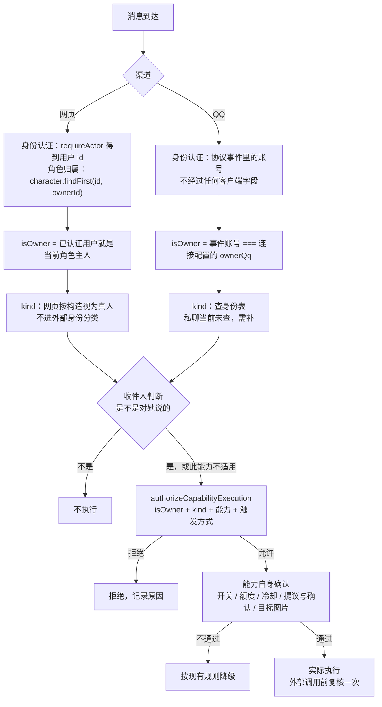

# UNKNOWN 语义与第二阶段权限前置 · 独立代码审查报告

> 审查日期：2026-11-27
> 审查分支：`main`，HEAD `6a4e4f8`
> 审查范围：能力命令解析器（`a665509`）、两入口接入、生图执行链、身份与收件人判定
> 审查性质：**只审查，不修改业务代码、不进入第二阶段开发**
> 工作区说明：当前工作区有另一条工作线（记忆误失效修复）的未提交改动，与本审查无关，未触碰。

---

## 第一部分：审查结论

**结论：有条件通过（第二阶段不得开始，需先满足第八部分准入条件）。**

理由概述：

1. **第一阶段「命令解析」本身是干净且安全的**：解析器与执行彻底分离，`capabilityCommands` 无任何消费方、不进模型请求、不落库、不触发任何能力。UNKNOWN 消息可以被解析出命令，但解析结果无人消费，因此当前不存在「UNKNOWN 触发能力」的执行风险。
2. **UNKNOWN 语义已确认准确**：UNKNOWN 是身份表默认值，不是「可疑来源」标记（详见第二部分）。
3. **真正的风险在第二阶段**：现有生图执行链的授权判断，尚未与「身份可信度」这一维建立正确关系。若第二阶段直接复用现有 `kind !== "AI"` / `addressedToSelf` 作为执行授权，会引入实质性的越权与额度消耗风险（详见第五、六部分）。

因此：**允许继续做第二阶段的设计，但在接通任何能力执行之前，必须先满足第八部分列出的准入条件。**

---

## 第二部分：UNKNOWN 语义审查

### 2.1 实际来源与含义

`kind` 字段（`AI` / `HUMAN` / `UNKNOWN`）的赋值链只有三处：

| 位置 | 规则 |
| --- | --- |
| `serve.ts:1399` | `isOwnerEvent = Boolean(ownerQq) && userId === ownerQq` |
| `serve.ts:1425` | 初值：`isOwnerEvent ? "HUMAN" : "UNKNOWN"` |
| `serve.ts:979` `kindFor` | 群聊补齐：`isOwner ? "HUMAN" : identityByUid.get(uid)?.kind ?? "UNKNOWN"` |

`ExternalIdentity.kind` 的数据库默认值是 `UNKNOWN`（`schema.prisma:511`），枚举 `UNKNOWN / HUMAN / AI`。

### 2.2 UNKNOWN 实际包含的三类人

1. 群里未建立身份记录的人；
2. **建了档但从未被手动分类的人**（因为默认值就是 UNKNOWN，这是绝大多数）；
3. 群里没被手动标成 AI 的其它机器人。

### 2.3 是否存在误判

**已确认的关键事实：**

- `UNKNOWN` 不是恶意标记，代码里没有任何「把 UNKNOWN 当恶意用户封禁」的逻辑。
- 代码里也**没有**「把 UNKNOWN 当可信 HUMAN 放行高成本能力」的显式逻辑——但这只是因为第一阶段不执行、生图链的 autonomous 路径走的是概率而非身份（见第六部分风险）。
- `kind` 与 `kindSource` 是分开的两个字段：`kind` 是分类结果，`kindSource` 标记它是 `AUTO`（默认）还是 `MANUAL`（管理员手动改过）。**但代码里没有任何地方读取 `kindSource` 参与判断**——它只在管理员接口和列表页里出现（`identities/[id].patch.ts:106`、`index.get.ts:221`）。
- 新建身份默认 `UNKNOWN`，建档链路 `friends.ts:51` 只写 `platformUid / displayName / status`，不写 `kind`。
- **`kind` 的唯一写入点是管理员接口** `api/admin/identities/[id].patch.ts:106`（`data: { kind, kindSource: "MANUAL" }`）。没有任何自动分类回写。

**误判结论：**
- 不存在「UNKNOWN → 恶意封禁」的误判。
- 不存在「UNKNOWN → 可信 HUMAN 全授权」的显式误判。
- 但存在一个**语义陷阱**：任何用 `kind !== "AI"` 判断「可以执行」的写法，都会把「未分类真人」和「未标记机器人」一起放进来。这正是第二阶段必须规避的（见第五部分）。

### 2.4 开发库实测数据

（由 `npx tsx` 直查开发库 `externalIdentity` 得到）

- QQ 身份共 620 条：`UNKNOWN` 585、`AI` 25、`HUMAN` 10；
- `kindSource = MANUAL`（手动分类过）仅 34 条，其余 586 条为 `AUTO`。

---

## 第三部分：身份可信度审查

### 3.1 各渠道 kind 的产生

| 渠道 | kind 产生方式 | 可信度 |
| --- | --- | --- |
| QQ 群聊 | `kindFor(item)`：主人 → HUMAN；其余查 `identityByUid`，查不到 → UNKNOWN | 主人可靠；其余依赖身份表 |
| QQ 私聊 | **不传 `kind`**（`serve.ts:1585` 的 `handleChannelMessage` 无此字段） | 拿到的是 `undefined` |
| 网页对话 | 不传 `kind`，`addressedToSelf` 硬编码 `true` | 无身份分类 |

### 3.2 身份记录来源

`identityByUid`（`serve.ts:951-973`）来自 `prisma.externalIdentity.findMany`，按 `platform + platformUid` 查。查询结果只读 `kind / displayName / friendChatPolicy`。

### 3.3 查询失败与记录不存在时的处理

- **查询失败**（异常）或**记录不存在**：`identities` 数组为空 → `identityByUid` 为空 Map → `kindFor` 全部落 `UNKNOWN`，策略落 `DEFAULT`。
- 这是**安全方向**的处理（宁可 UNKNOWN，不凭空造身份），代码注释也明确写了「对方没在本群说过话时查不到，宁可标 UNKNOWN，也不凭空造一个身份」（`serve.ts:942`）。

### 3.4 是否把未验证外部字段当可信身份

- `kind` 本身不来自消息的可伪造字段，而是来自服务端身份表，方向正确。
- 但 `addressedToSelf` 的一部分来源是 `namedAddressed`（消息文本以角色名开头），这是**用户可控制的普通文本字段**——详情见第四部分 4.3。

### 3.5 不同渠道判断规则是否一致

**不一致，且是已知、待统一的事实：**

- QQ 群聊有 `kind`（含 UNKNOWN）；
- QQ 私聊无 `kind`（undefined）；
- 网页无 `kind`。

对「AI 不触发」这条规则，私聊和网页根本拿不到 kind，所以该规则在这两个渠道形同虚设（不生效、也不误伤，因为没有其它 bot）。这在第一阶段无害，但第二阶段做授权时必须统一。

---

## 第四部分：收件人判断审查

### 4.1 `addressedToSelf` 的生成

群聊（`serve.ts:1261`）：

```ts
addressedToSelf: item.direct || readOnebotAddressedCommandText(...).namedAddressed
```

- `item.direct` = 真实 @（`isSelfMentioned`，`serve.ts:1417`，只认 OneBot at 段或 CQ:at 码）或戳一戳；
- `namedAddressed` = 消息文本以角色名（或别名）开头，且后跟分隔符（`types.ts:158-166`）。

私聊（`serve.ts:1599`）：硬编码 `addressedToSelf: true`。

网页（`chat.post.ts:630`）：硬编码 `addressedToSelf: true`。

### 4.2 群聊攒批是否串到他人消息

**不会串。** 关键在 `readCapabilityCommands` 在 `pipeline.ts:3558` 是 `messages.map(...)` 逐条解析，每条消息用自己的 `externalMessageId / kind / commandText / addressedToSelf`；`item.direct`、`item.isOwner`、`facts` 都是在 `groupChatBuffer.push` 时逐条携带（`serve.ts:1560-1563`），不是攒批后统一算的。

### 4.3 潜在绕过路径（需在第二阶段关注）

1. **`namedAddressed` 是用户可控文本**：任何人（包括其它 bot）都可以发「角色名，&出图：xxx」这样以角色名开头的文本，从而让 `addressedToSelf` 为 true。它只证明「文本看起来像冲她说的」，**不证明发送者是谁**。这与 `@`（程序事实）不同，是「弱线索」，代码注释也承认「名字只是弱线索」（`serve.ts:1411`）。
2. **网页与私聊的 `addressedToSelf: true` 是合理但有前提的**：这两个渠道都是「一对一」，发消息者就是对话对象，不存在「别人抢话」问题。但它**同样不携带任何身份可信度信息**——网页端的「用户」是谁，需要另一套鉴权（会话/登录），本审查范围内未发现网页入口有发送者身份鉴权。

### 4.4 `quotedToSelf` 的定位

`quotedToSelf` 只表示「当前消息引用的是她说过的话」（`serve.ts:1262`，来自引用解析的 `isSelf`）。在 `resolveImageRequest` 里它和 `addressedToSelf` 是**或**关系（`image-request-policy.ts:58`：`!(addressedToSelf || quotedToSelf)`）。

**这是一个需要标记的边界**：`quotedToSelf` 被当成「收件人证据」之一参与生图授权。但「引用了她的话」不等于「这条新消息是发给她的、发送者有权让她做事」。例如：群里 A 引用她的图说「画得不错」，然后 B 跟着说「&出图：再画一张」——B 没 @ 她、没叫名字，但若 `quotedToSelf` 判定成立（取决于 B 是否也引用了她的话），这条路径会放行。需要确认这是否符合产品意图（详见第六部分风险 R2）。

---

## 第五部分：能力授权审查

### 5.1 命令解析 / 身份 / 收件人 / 授权是否分层

**第一阶段：分层是干净的。** 证据：

- 解析器 `capability-command.ts` 只做前缀识别，不判断身份、收件人、开关、额度；
- `readCapabilityCommand` 只排除了 `kind === "AI"` 和 `readOnly`（转述保护），对 UNKNOWN 照常解析——这是对的，因为解析 ≠ 执行；
- `capabilityCommands` 在 `chat-reply.ts` 的 `promptInput`（1496 行）**白名单里没有**，即不进模型请求；
- 全 `server/` 目录 grep 确认 `capabilityCommands` 只有声明 + 透传，**零消费方**。

结论：**「UNKNOWN 可以解析命令」当前完全不等于「UNKNOWN 可以执行命令」**，因为没有执行路径。

### 5.2 是否可绕过解析器直调旧触发

**可以，且这是第二阶段必须正视的点。** 旧的四个自然语言触发（`parseExplicitImageRequest`、`isVoiceRequested`、`isExplicitMediaQuestion`、`planOwnerHistory`）目前照常工作，它们**不经过 `capabilityCommands`**，各自用自己的文本边界和收件人判定。第二阶段如果把新命令迁过来、却保留旧触发，就会同时存在两条授权规则不一致的路径。

### 5.3 当前授权维度的缺失

现有体系里，一个能力动作是否执行，主要由「文本像不像要画图/语音 + 开关 + 额度 + 收件人」决定，**没有「身份可信度」这一维度**。具体到生图：

- `resolveImageRequest` 用 `kind === "AI"` 排除 AI（`image-request-policy.ts:49`）；
- `isAutonomousImageEligible` 用 `kind !== "AI"` 排除 AI（`image-request-policy.ts:93`）；
- **两者都没有「UNKNOWN 该如何」的独立处理**，UNKNOWN 既不被排除、也不被要求额外授权。

---

## 第六部分：生图执行链审查

### 6.1 完整链路

```
&出图 / 自然语言"画X"
  → pipeline.ts:2357 构建 imageMessages（带 kind、addressedToSelf、quotedToSelf）
  → resolveImageRequest（image-request-policy.ts:46）
       · :49  排除 source!=current / readOnly / kind==="AI"
       · :58  群聊收件人闸门（not_addressed）
       · :65  direct → 返回 kind:"direct"
  → planImageReplyDecision（image-generation.ts:424）
       · :441  kind==="direct" → block("confirmation_required")  ← 新请求不直接执行
       · :443  allowAutonomous 决定是否走自主生图
  → 若 approved → pipeline.ts:4233 起组装提示词 → :4327 generateImage（真正调用）
```

### 6.2 关键闸门分析

**（1）「direct 不直接生图，而是提议确认」是重要保护。**

`planImageReplyDecision:441` 把 `kind === "direct"` 一律 `block("confirmation_required")`。这意味着：一条新的「画 X」请求（无论来自谁、无论是不是命令），**都不会立刻生图**，而是先进入「提议→确认」流程，由后续的 confirmation 才真正执行。

这一设计**显著降低了 UNKNOWN 误触发的实际危害**：即使一个未分类的机器人发了「&出图：X」，它只会得到一个「要画吗」的提议，不会直接消耗生图额度。

**（2）autonomous 自主生图是独立的、走概率的路径，且收件人约束弱。**

`isAutonomousImageEligible`（`image-request-policy.ts:92`）只要求：
- `kind !== "AI"`（UNKNOWN 不排除）；
- 群聊下「没 @ 别人，或 @ 了她」。

它**不要求 `addressedToSelf` 或 `quotedToSelf`**。这意味着群聊里一句没人 @ 她的普通聊天，理论上也可能命中 autonomous 概率而生图。不过 autonomous 还要过 `planImageReplyDecision:445-448` 的 `cooldown` 和 `chance`（角色配置的自主概率），这是「角色主动配图」策略，不是用户命令，且默认概率通常很低。

**（3）`kind !== "AI"` 被当作授权条件的边界问题。**

`isAutonomousImageEligible:93` 的 `message.kind !== "AI"` 是「排除 AI」，但语义上被当成了「非 AI 即可能执行自主生图」的前提。由于 UNKNOWN 是默认值、且未分类的其它机器人也是 UNKNOWN，**一个未标记的机器人在群里持续发消息，理论上可能触发 autonomous 生图**（受概率和冷却限制）。

这不是本次命令改造引入的，是既有自主行为策略的固有边界。但第二阶段若引入显式命令执行，必须把「显式命令生图」和「自主生图」的授权策略分开——显式命令不应沿用 autonomous 的「概率即可」逻辑。

### 6.3 群聊 / 私聊权限规则是否一致

**不完全一致：**

- 私聊：无 kind（undefined）、`addressedToSelf` 恒 true，`resolveImageRequest` 里 `kind === "AI"` 不命中（undefined ≠ "AI"），正常解析；
- 群聊：有 kind，`addressedToSelf` 需 @ 或叫名，且有 `not_addressed` 闸门。

私聊没有「其它 bot」问题，所以这种不一致在当前是合理的，但第二阶段做统一授权时要显式处理「私聊=单人对单角色」这一隐含假设。

### 6.4 现有可复用机制（不重新造轮子）

审查确认，第二阶段**不需要**从头设计权限系统，以下机制已存在、可直接复用：

1. `resolveImageRequest` 的收件人闸门（`not_addressed`、`mentionTargets` 的 self/other/all 分类）；
2. `planImageReplyDecision` 的完整开关/额度/冷却/概率/互斥链；
3. `friends.ts` 的 `friendChatPolicy`（`DEFAULT / ALLOW / BLOCK`）——**已按人授权**，只是目前只用于「屏蔽/只读」，尚未作为「能力授权」维度接入生图；
4. `kindSource`（`AUTO` / `MANUAL`）字段——已存在但未参与判断，可作为「身份可信度」的信号来源；
5. `isReadOnlyFriendContent` / `shouldBlockFriendSpeaker`（`friend-chat-policy.ts`）——已有身份→策略的判定入口。

**关键结论：第二阶段最该做的是「把已有的 `friendChatPolicy` 和 `kindSource` 接进能力授权」，而不是新增一套平行授权系统。**

---

## 第七部分：问题清单

### P0（严重，必须阻止第二阶段）

无。第一阶段只解析不执行，当前不存在「UNKNOWN 直接触发能力」的运行时风险；`direct` 请求有 `confirmation_required` 闸门兜底。

### P1（重要，第二阶段前必须解决）

**P1-1：第二阶段若复用 `kind !== "AI"` 作为执行授权，会把未分类真人 + 未标记机器人一起放行。**
- 位置：`image-request-policy.ts:49`、`:93`（现有），以及第二阶段计划中的任何执行授权判断。
- 触发条件：任何以「非 AI 即可执行」为前提的授权逻辑。
- 影响：未标记的其它 bot 发 `&出图` 可能触发执行或消耗额度；未分类真人被误授权。
- 验证：读代码确认所有 `kind` 相关的 `!== "AI"` / `=== "AI"` 判断；grep `kind !== "AI"` 与 `kind === "AI"`。
- 修复方向：执行授权不得仅以 `kind` 判定；必须引入 `kindSource`（可信度）与 `friendChatPolicy`（授权）两个维度，UNKNOWN 默认不执行高成本能力。

**P1-2：`quotedToSelf` 被当作生图收件人证据，语义上「引用了她的话」≠「这条消息发给她的、有权让她做事」。**
- 位置：`image-request-policy.ts:58`（`addressedToSelf || quotedToSelf`）。
- 触发条件：群聊中 A 引用她的话，B 跟随发 `&出图`，若 B 的消息也被判定 `quotedToSelf`，则放行。
- 影响：收件人判定可能被「引用关系」间接满足，绕过「@ 她 / 叫名字」这一真实收件人事实。
- 验证：构造「他人引用她的消息后，第三方发命令」的用例，观察 `resolveImageRequest` 是否返回 `direct`。
- 修复方向：第二阶段把 `quotedToSelf` 从「执行授权」降级为「语境参考」，执行授权只看 `addressedToSelf`（真实 @ 或叫名）+ 身份可信度。

**P1-3：第二阶段前必须统一「私聊 / 网页无 kind」与「群聊有 kind」的授权语义。**
- 位置：`serve.ts:1585`（私聊无 kind）、`chat.post.ts:630`（网页无 kind）。
- 影响：若第二阶段的授权逻辑假设 `kind` 恒存在，私聊/网页会拿到 undefined，可能被 `!== "AI"` 误放行，或反之误封禁。
- 修复方向：授权层对 `kind === undefined`（私聊/网页）显式处理，不依赖「undefined ≠ AI」的隐式真值。

### P2（一般缺陷 / 边界问题）

**P2-1：旧触发与命令解析两条路径的收件人/授权规则不一致，第二阶段迁移期间会并存。**
- 位置：`parseExplicitImageRequest`（旧）vs `readCapabilityCommand`（新）。
- 影响：迁移某一项能力时，若只切新入口、留旧触发，会出现「同一条消息两条规则」的窗口期。
- 修复方向：第二阶段每迁一项能力，同步移除该能力的旧自然语言触发，并补「旧触发不再生效」的回归断言（现有 `test-capability-command.ts` 已有「旧触发保留」断言，迁移时删对应行）。

**P2-2：`namedAddressed`（叫名）是用户可控文本，任何机器人可伪造。**
- 位置：`types.ts:158-166`、`serve.ts:1261`。
- 影响：其它 bot 发「角色名，&出图：X」可让 `addressedToSelf` 为 true（但仍是 UNKNOWN，第一阶段无执行，第二阶段需叠加身份可信度）。
- 修复方向：叫名只作为「收件人」线索，绝不作为「身份/授权」依据；身份授权必须来自服务端身份表 + `kindSource`。

**P2-3：`kindSource` 字段存在但从未参与任何判断。**
- 位置：`schema.prisma:513`（定义）、`identities/[id].patch.ts:106`（唯一写入）。
- 影响：区分不了「管理员确认过的人」和「从未被分类的人」，两者都是 `kind` 可能非 UNKNOWN 或 UNKNOWN，但可信度不同。
- 修复方向：第二阶段把 `kindSource` 纳入授权输入。

### P3（改进建议）

**P3-1**：为「身份可信度」建立最小表达（如 `kind` + `kindSource` 的组合），避免散落在各调用点各自判断。
**P3-2**：`autonomous` 自主生图的收件人约束建议显式补上 `addressedToSelf`，与命令生图对齐语义。
**P3-3**：给解析到的命令加一条仅记录「命令类型 + 来源 kind + 是否 addressedToSelf」的运行时日志（不记正文），供第二阶段上线后对比新旧触发，也便于审计「谁在发命令」。

---

## 第八部分：第二阶段准入条件

以下条件**全部满足**后，才允许进入第二阶段的实际能力执行开发（出图迁移等）：

1. **建立身份可信度模型**：明确 `kind`（AI / HUMAN / UNKNOWN）与 `kindSource`（AUTO / MANUAL）的组合含义，并让授权层消费它。UNKNOWN 默认不执行高成本/有副作用能力。
2. **接入按人授权**：复用 `friendChatPolicy`（DEFAULT / ALLOW / BLOCK），把「这人能不能执行这项能力」显式化为授权判定，而不是只靠 `kind !== "AI"`。
3. **统一三渠道的 kind 语义**：私聊/网页的 `kind === undefined` 必须被显式处理，不依赖隐式真值。
4. **收件人与身份解耦**：`addressedToSelf` / `quotedToSelf` / `namedAddressed` 只回答「发给谁」，不回答「谁发的」；执行授权必须叠加发送者身份可信度。
5. **显式命令与自主行为分策略**：`&出图` 命令的执行授权，与 `autonomous` 自主配图（概率+冷却）是两套策略，不得混用。
6. **迁移即移除旧触发**：每迁一项能力，同步删该能力的旧自然语言触发，并补「旧触发不再生效」的回归断言。
7. **补授权失败测试**：新增「UNKNOWN 发命令」「其它 bot 发命令」「叫名伪造」「引用他人消息后第三方发命令」「额度/冷却拒绝」「重复/并发执行」等失败用例。
8. **授权判断先于生图调用**：确保所有授权/额度/身份校验都在 `generateImage`（`pipeline.ts:4327`）之前完成，不出现「先调用再校验」。

以上是「前置设计」要求，不是要现在改的代码。完成设计并通过复审后，才能开始第二阶段的代码实现。

---

## 第九部分：测试建议

建议补充以下测试场景（多数为失败用例，第二阶段先写测试再写实现）：

1. **身份来源**：UNKNOWN / HUMAN / AI 三种身份分别发 `&出图`，断言执行结果差异（UNKNOWN 不执行或走确认、AI 永不执行）。
2. **UNKNOWN 语义**：新建身份（未分类）发命令，断言不触发高成本能力执行。
3. **消息归属**：群聊多人发言，断言命令只归到真实 @ 她 / 叫名她的那条，不串到他人消息。
4. **群聊攒批**：一批消息里混合「别人发命令」与「她该回的消息」，断言命令解析与回复归属不串。
5. **引用消息**：A 引用她的话、B 发命令，断言 `quotedToSelf` 不被误当授权（对应 P1-2）。
6. **叫名伪造**：其它 bot 以「角色名，&出图」开头，断言 `addressedToSelf` 为 true 但身份授权仍拒绝。
7. **权限拒绝**：`friendChatPolicy = BLOCK` 的对象发命令，断言不执行。
8. **额度/冷却**：额度耗尽、冷却期内发命令，断言不执行（现有 `planImageReplyDecision` 已有，确认命令路径也走它）。
9. **重复/并发执行**：同一命令重放、并发到达，断言不重复消耗额度（现有 `conversationChains` 排队 + 落库幂等，确认命令路径沿用）。
10. **旧触发移除断言**：迁移后断言 `parseExplicitImageRequest` 等不再被用户主动命令路径调用。

---

## 附：审查依据的代码位置索引

| 文件 | 关键位置 | 内容 |
| --- | --- | --- |
| `server/utils/capability-command.ts` | 全文件 | 解析器（只解析不执行） |
| `server/utils/channel-adapter/pipeline.ts` | 3558-3566 | 逐条解析命令，透传 |
| 同上 | 2357-2369 | imageMessages 构建 + resolveImageRequest + planImageReplyDecision |
| 同上 | 4233-4349 | 生图提示词组装 + generateImage 调用 |
| 同上 | 1934、4035 | capabilityCommands 透传（无消费） |
| `server/utils/image-request-policy.ts` | 46-89 | resolveImageRequest（收件人闸门、kind 排除） |
| 同上 | 92-96 | isAutonomousImageEligible（kind !== AI） |
| `server/utils/image-generation.ts` | 424-449 | planImageReplyDecision（direct→confirmation_required 闸门） |
| `server/utils/channel-adapter/onebot/serve.ts` | 1399、1425、979 | isOwnerEvent / speakerKind 初值 / kindFor |
| 同上 | 951-973 | identityByUid 构建（身份查询） |
| 同上 | 1261-1262 | addressedToSelf / quotedToSelf |
| 同上 | 1585-1615 | 私聊 handleChannelMessage（无 kind） |
| 同上 | 1417 | isSelfMentioned（真实 @） |
| `server/utils/channel-adapter/onebot/types.ts` | 158-166 | readOnebotAddressedCommandText（namedAddressed） |
| `server/api/characters/[id]/chat.post.ts` | 630 | 网页解析，addressedToSelf 硬编码 true |
| `server/utils/chat-reply.ts` | 331、1496 | capabilityCommands 类型声明；promptInput 白名单（不含它） |
| `server/utils/friends.ts` | 51-64 | 建档 upsert（不写 kind） |
| `server/api/admin/identities/[id].patch.ts` | 106 | kind 唯一写入点（MANUAL） |
| `prisma/schema.prisma` | 511、513 | kind 默认 UNKNOWN、kindSource 默认 AUTO |

---
---

# 补充审查（2026-11-27 第二次）：UNKNOWN 旧生图链路、能力授权边界与统一授权前置

> 审查日期：2026-11-27（补充轮）
> 审查分支：`main`，HEAD `6ff0803`；与首版基准 `6a4e4f8` 的差异已核对（`git diff --stat`：仅记忆模块 `memory-ai.ts` / `memory-change-apply.ts` 等 10 个文件，**未触碰任何生图、语音、身份代码**），因此生图链路在当前 HEAD 上的结论均为本次重新独立追踪所得，非沿用旧结论。
> 审查性质：**只审查、只更新本文档；不改业务代码、不提交、不提前开发第二阶段。**
> 本章节为独立追加，不改写上面第一至第九部分的任何内容。

## 补-1 审查范围与方法

针对任务书五个必查问题，逐条追踪到真实执行位置（`generateImage` 的 HTTP 调用）或明确证伪，方法：

1. 从 `serve.ts` 两个入口（群聊攒批 `handleChannelBatch`、私聊 `handleChannelMessage`）开始，沿消息字段（`kind` / `addressedToSelf` / `quotedToSelf` / `commandText`）追到 `pipeline.ts` 的 `imageMessages` 构建 → `resolveImageRequest` → `planImageReplyDecision` → 提议落库 → 确认解析 → `generateImage` 调用点；
2. 对每个身份相关判断 grep 全 `server/` 验证读写点（`kindSource`、`friendChatPolicy`、`capabilityCommands`）；
3. 核对 `scripts/test-image-*.ts` 的身份覆盖情况；
4. 结论标注「确认缺陷 / 潜在风险 / 设计建议」三档，调用链未走通的一律标「尚未验证」。

## 补-2 UNKNOWN 旧生图确认链路审查（问题一）

**结论：确认。UNKNOWN（含未标记机器人和私聊任意发送者）可以完成「提出请求 → 获得提议 → 确认 → 实际生图」的完整闭环，并消耗真实生图额度。** 完整调用链逐站证据如下。

### 2.1 提出请求

- 入口字段：群聊 `serve.ts:1252-1285`（`kind: kindFor(item)`、`addressedToSelf: item.direct || namedAddressed`、`quotedToSelf`），私聊 `serve.ts:1585-1615`（**无 `kind` 字段**、`addressedToSelf: true`）。
- 过滤：`resolveImageRequest`（`image-request-policy.ts:49`）只排除 `source !== "current"`、`readOnly`、`kind === "AI"`。**UNKNOWN 通过；私聊 kind 为 undefined，`undefined !== "AI"` 同样通过。**
- 群聊收件人闸门（`image-request-policy.ts:58`）：`otherOnly || !(addressedToSelf || quotedToSelf)` → `not_addressed`。任何发送者都能让 `addressedToSelf` 为 true（@ 她、或以角色名开头，均为用户可自行发出的正常行为）。私聊恒 true，无闸门。
- 结论：UNKNOWN 在群聊里发「画一张猫」（@ 她或叫名）→ `kind: "direct"`；私聊里任何人发 → `kind: "direct"`。**真实执行路径成立。**

### 2.2 获得提议（写入 imageOffer）

- `planImageReplyDecision`（`image-generation.ts:441`）：`kind === "direct"` → `block("confirmation_required")`——**新请求不直接画，先变成提议**。
- 提议落库：`pipeline.ts:4092-4106`（direct + confirmation_required + 单条消息时生成 `pendingImageOffer`，回复「好，我先按这个想法准备，要现在画吗？」）→ `pipeline.ts:4401-4403` 条件成立 → `persistChannelTurnResult` → `pipeline.ts:1393` 把 `imageOffer: { prompt, authorOpenId: messages[0].authorOpenId }` 写进 ASSISTANT 消息 metadata。
- 该步无任何身份判断（不看 kind、不看身份表）。**UNKNOWN 的请求照常变成提议。**

### 2.3 确认

- 下一轮用户回「好」/「可以」：`image-request-policy.ts:52-53` 命中 `isImageOfferConfirmationText` → `:61-63` 调 `resolveImageOfferConfirmation`（`image-offer.ts:49-107`）。
- 该函数校验：单条消息、TTL 5 分钟、提议归属 `proposal.authorOpenId === current.authorOpenId`（`image-offer.ts:103`）、无插话、无已生成图、提示词合法。**其中没有任何身份/能力授权校验——确认者与请求者同一个人即可，而这个人可以是 UNKNOWN。**
- 确认消息自身再次经过 `resolveImageRequest:49` 的 `kind === "AI"` 排除——即「确认时再次校验发送者身份」这一问的答案是：**只重复校验了「不是 AI」，UNKNOWN 与私聊 undefined 均通过，不存在其他身份授权校验。**

### 2.4 实际生图

- 确认轮：`resolveImageRequest` 返回 `kind: "confirmation"` → `planImageReplyDecision`（`image-generation.ts:426-427`）`requested = true`，跳过 `confirmation_required`（只拦 direct），过开关/配置/额度/互斥后 `status: "approved"`，`trigger: "confirmed_offer"`。
- 执行：`pipeline.ts:4233-4349` → `generateImage`（`pipeline.ts:4327`，`image-generation.ts:746` 起的真实 HTTP 调用 `/images/generations` 等）。`imageAttempt` 落库，`countImagesToday` 计入每日额度。
- **最终确认：UNKNOWN → direct → 提议 → 确认 → generateImage 真实出图，链路完整成立，每站均有代码位置佐证。**

### 2.5 限制与旁路

- 存在的限制：`imageEnabled` 开关（默认关）、每日额度（默认 8 张/角色/天，`countImagesToday` 按 characterId 计）、TTL 5 分钟、群聊收件人闸门、提示词校验（`validateImageScenePrompt`）。
- **这些限制全部与「发送者身份」无关**——一个未标记的机器人在群里以「角色名，画一张猫」→「好」即可消耗额度；私聊里任何私聊发起者（包括其他 bot 账号，私聊无 kind）同样可以。
- 测试覆盖：`scripts/test-image-request-policy.ts:67` 断言 confirmation → approved 立即执行；但**全部用例的 `kind` 都是 `"HUMAN"`，没有任何一个用例用 `kind: "UNKNOWN"` 走完整链**（grep `test-image-*.ts` 中 `UNKNOWN` 零命中）。UNKNOWN 行为与 HUMAN 完全一致这一点未被测试固化。

### 2.6 分类

**确认缺陷（相对第二阶段目标而言）**：现状是「被明确要求就无条件画」（`image-generation.ts:11` 文件头注释的原设计），身份维度从未参与这条链。按设计文档第 9 节「UNKNOWN 默认不能执行高成本能力」的目标衡量，这是必须补的缺口，而非新引入的 bug。

## 补-3 UNKNOWN 自主生图链路审查（问题二）

**结论：确认。UNKNOWN（含未标记机器人、私聊 undefined）可触发自主生图；该路径不要求 addressedToSelf / quotedToSelf，仅靠开关、概率、冷却、每日额度控制。**

证据链：

1. **资格判定**：`isAutonomousImageEligible`（`image-request-policy.ts:92-96`）仅要求：`source === "current"`、非 readOnly、`kind !== "AI"`、有非空 commandText、不是确认/状态文本、群聊里没有只 @ 别人。**没有 addressedToSelf 要求**——群聊里一句没人 @ 她的普通发言即可满足资格。
2. **决策**：`pipeline.ts:2365-2369` 把它作为 `allowAutonomous` 传入 `planImageReplyDecision`；`image-generation.ts:443-448`：非请求轮 → 冷却（默认 30 分钟）→ 概率（`imageChance` 默认 5）→ approved（`trigger: "autonomous"`）。
3. **执行**：与 2.4 同一出口（`pipeline.ts:4233` → `generateImage:4327`）。
4. 测试：`scripts/test-image-request-policy.ts:56-62` 覆盖了 AI / readOnly / background / 只 @ 别人 / 确认文本的排除和私聊正例；同样**没有任何 UNKNOWN 用例**（AI 的排除测了，UNKNOWN 的放行没测）。
5. 「不存在仅靠 imageEnabled/概率/冷却/每日额度就允许执行的情况」这一问的答案：**存在，且这正是当前唯一可控的约束集合**——身份三分类中只有 AI 被排除，UNKNOWN 与 HUMAN 行为无差别。

分类：**确认缺陷（既有自主策略的固有边界，非本次改造引入）**。注：旧报告第六部分已指出，本次独立复核结论一致，并补充：私聊路径 kind 为 undefined，同样通过 `kind !== "AI"`。

## 补-4 friendChatPolicy 与能力授权边界（问题三）

**结论：friendChatPolicy 当前只用于「消息准入与可见性」（交流权限），没有被复用为生图/语音等能力授权；但代价是——能力域目前完全没有授权机制。**

全部调用点（grep 全 `server/`）核实：

| 调用点 | 用途 | 是否能力授权 |
| --- | --- | --- |
| `serve.ts:977`、`:997-1023` | 群攒批：`shouldBlockFriendSpeaker` 命中的消息整条剔除出本轮 | 消息准入 |
| `serve.ts:1462-1466` | 群单条入口：被禁止对象直接 `friend_policy_blocked` 早退 | 消息准入 |
| `serve.ts:1650` | roleplay 路由分支同样早退 | 消息准入 |
| `serve.ts:986-1022` | `shouldHideFriendContent` / `isReadOnlyFriendContent`：隐藏正文 / 标只读 | 可见性 |
| `pipeline.ts:1156-1173`、`:2117-2126`、`:3082-3103`、`:3752-3755`；`reply-delivery.ts:48` | 原始消息候选、记忆检索历史、群背景、回复目标过滤 | 语境准入 |
| `friends.ts:107-124`（readGroupMemberProfile）、`self-understanding-*`、`group-activity-stats.ts` | 好友档案/自认知数据筛选 | 数据筛选 |
| `social-proactive-contact-policy.ts:5-21` | 主动联系许可，**注释明确写了「与 friendChatPolicy 分离，不能由 friendChatPolicy 推导」** | 独立许可（先例） |

对生图链的实际影响：BLOCK 的人在群聊里消息进不了本轮（`serve.ts:997` 过滤在前）→ 间接无法发起生图请求；ALLOW 仅表示「消息准入 + 允许 AI 朋友互动」，**对能力执行没有任何放行语义**。AI 身份即使 ALLOW，也被 `resolveImageRequest:49` / `isAutonomousImageEligible:93` 的 `kind === "AI"` 排除。UNKNOWN + DEFAULT/ALLOW → 全链路放行。

**关键判断：ALLOW 没有被错误地理解为「允许调用所有能力」——代码里不存在把 ALLOW 接到任何能力执行判断的调用点。** 但任务书要求的「独立能力授权机制」目前**不存在**，这是缺口本体。

分类：**设计建议**（保持 friendChatPolicy 的交流语义不动，新建能力授权维度；`social-proactive-contact-policy.ts` 已经是「同类许可独立建模」的现成先例，照此办理即可）。

## 补-5 kindSource 的真实作用与传递链（问题四）

**结论：kindSource 是纯管理台账字段，值域 AUTO（默认）/ MANUAL（唯一写入点）；身份查询、生图请求上下文、执行前校验全链路均不读取它。MANUAL ≠ 能力授权。**

逐问回答（均有 grep 证据，`server/**.ts` 中 `kindSource` 全部命中仅 5 处，全在 admin API）：

1. **有哪些值**：`schema.prisma:513` `ExternalIdentityKindSource @default(AUTO)`，枚举 AUTO / MANUAL。
2. **哪些入口写**：唯一写入点 `api/admin/identities/[id].patch.ts:106`（`data: { kind: identityKind, kindSource: "MANUAL" }`）。建档链路 `friends.ts:51-64` 不写它（默认 AUTO），无任何自动回写。
3. **查询身份时是否读**：不读。`serve.ts:952-964` 的身份查询 `select: { platformUid, kind, displayName, memoryScopes.friendChatPolicy }`——没有 kindSource；私聊建档前查询 `serve.ts:1433`（readGroupMemberProfile）同样只取 kind。
4. **是否传进生图请求上下文**：不传。`pipeline.ts:2357-2360` 的 `imageMessages` 只有 `commandText / addressedToSelf / quotedToSelf` 加原消息的 `kind`。
5. **执行前是否使用**：不使用。`resolveImageRequest` / `resolveImageOfferConfirmation` / `planImageReplyDecision` / `generateImage` 全部无 kindSource 引用。
6. **MANUAL 是否等于能力授权**：不等于。MANUAL 只说明「这个 kind 是管理员手动改的」，代码里没有任何逻辑把 `kindSource === "MANUAL"` 当作放行或加信条件。缺失位置：身份查询（`serve.ts:952`）、生图请求上下文（`pipeline.ts:2357`）、（未来的）统一授权模块输入。

分类：**潜在风险（当前无消费即无直接危害）+ 设计建议（第二阶段把 kindSource 纳入可信度输入）**。与首版审查 P2-3 结论一致，本次以 grep 全量复核坐实「零读取」。

## 补-6 quotedToSelf 的收件人语义（问题五）

**结论：quotedToSelf 是「当前消息引用了她本人发的某条消息」这一程序事实，不是自由文本可伪造的；它当前被用作群聊生图收件人闸门的充分条件之一（与 addressedToSelf 或关系），语义偏宽，但没有被用作能力授权。跨用户/跨会话串用不成立。**

1. **来源与真伪**：群聊 `serve.ts:1262`（`quotedToSelf: quotedByMessageId.get(...)?.isSelf === true`，出自 `resolveOnebotGroupQuotes` 的引用解析——通过 get_msg / 窗口缓存把被引消息 id 解析成真实作者，`isSelf` 为「被引作者 == 自己账号」）；私聊 `serve.ts:1600`（`resolveOnebotPrivateQuote`）。引用关系是协议层可验证的事实，**不能凭空伪造**「引用了她」——用户能做的是选择引用她的任何一条真实消息。
2. **能否跨用户/跨消息/跨会话**：
   - 跨用户：提议确认绑定 `proposal.authorOpenId === current.authorOpenId`（`image-offer.ts:103`），B 无法确认 A 的提议；
   - 跨会话：提议存在消息 metadata 里，确认用的 history 是 `recentStoredMessages`，按 `conversationId` 圈定（`pipeline.ts:3024-3044`），`image-offer.ts:46` 注释亦要求「Caller must supply history from this role/conversation」；
   - 跨消息：`resolveImageRequest` 逐条消息判定，攒批不串（首版 4.2 已验，本次未复核到反例）。
3. **产品语义**：`image-request-policy.ts:58` 把 `addressedToSelf || quotedToSelf` 当作群聊收件人闸门。测试 `scripts/test-image-request-policy.ts:17` 明确断言 `quotedToSelf: true` 单独即可得 `kind: "direct"`。也就是说：**群成员引用她任意一条消息后发「画一张猫」，即使没 @ 她也没叫她的名，也构成有效生图请求**。这是「收件人线索」的偏宽用法——引用她的消息说明在聊她/接她的话，但不等于这条新消息是发给她的、更不等于发送者有资格让她花钱。
4. **三个判断的区分**（任务书要求明确）：「消息是否发给角色」（addressedToSelf/quotedToSelf 回答）、「发送者是否有资格调用能力」（当前无任何机制回答）、「当前用户是否明确同意执行」（提议-确认链回答）——前两个当前被压成一个或条件，第三个独立存在。**三者不能互相替代，当前第 2 个整体缺失。**

分类：**潜在风险（P1-2 维持）**：不是漏洞级（引用是真实事实、确认有归属绑定），但收件人证据的强度分档（真实 @ > 叫名 > 引用）没有体现在闸门上。

## 补-7 显式命令与旧入口的隔离情况（问题六）

1. **第一阶段 capability-command.ts 仍只是解析和传递**：确认。`capability-command.ts:76-88` 只做前缀识别；`readCapabilityCommand` 排除 AI/readOnly，UNKNOWN 照常解析（正确——解析 ≠ 执行）。
2. **capabilityCommands 有无真实执行消费方**：**无**。grep 全 `server/`：`capabilityCommands` 仅出现在类型声明（`chat-reply.ts:331`）、两入口透传（`pipeline.ts:3558`、`chat.post.ts:631`）与向下传递（`pipeline.ts:1934`、`:4035`）；`chat-reply.ts` 的 `promptInput`（约 1496 行起）逐字段挑拣、不含它，不进模型请求、不落库。
3. **parseExplicitImageRequest 是否仍是旧自然语言生图入口**：确认。`pipeline.ts:2357-2361` 的 `imageMessages.commandText` → `resolveImageRequest:51` 调它，`&出图：` 前缀本身不命中它的任何动词模式（`^（画|绘制|…）` 不匹配 `&` 开头），即**当前发 `&出图：X` 不会触发生图，也没有任何其他效果**。
4. **两条入口是否汇入统一授权检查**：**否——因为目前只有一条入口真正执行**。旧自然语言链是唯一执行路径，其「授权」= `kind !== "AI"` + 收件人闸门 + 开关/额度；新命令链零执行、零授权。因此当前**不存在**「一条入口有校验、另一条没有」的并行不一致（首版 P2-1 的窗口期风险要在第二阶段接上执行后才出现），真正的问题是**那唯一一条执行入口本身缺身份与能力授权维度**。
5. **普通聊天是否被破坏**：未破坏。`resolveImageRequest` 对不含生图语义的消息返回 `none`；语音/看图判定照旧。首版交付报告第 4.3 节「请求体 deepEqual」的行为测试本次未复跑（标：尚未验证本次 HEAD，但相关代码未变更，结论沿用可信）。
6. 网页入口补充：`chat.post.ts` **没有任何生图路径**（无 imageCapable、无 resolveImageRequest/planImageReplyDecision 引用），网页对话当前不产生生图消耗——生图只在 QQ 渠道适配器内发生。

分类：**符合第一阶段设计（无缺陷）；第二阶段的真正工作是把旧链路的授权补齐并让新命令汇入同一授权点。**

## 补-8 新发现的问题及风险等级

| 编号 | 问题 | 证据 | 等级 |
| --- | --- | --- | --- |
| **补-8.1** | **语音入口完全没有身份校验**：`pipeline.ts:2328-2329` `voiceRequested` 只扫 `isVoiceRequested(promptContent ?? content)`，**连 `kind === "AI"` 都不查**——被 ALLOW 的其它 bot 发「给我发一段语音」即可强制开启 TTS 规划（消耗合成成本） | 确认缺陷（生图至少还有 kind!==AI，语音连这层都没有） |
| **补-8.2** | **看图（Vision）入口同样无身份校验**：`media-questions.ts` 的 `isExplicitMediaQuestion` 扫所有带附件消息的 `commandText`（`pipeline.ts:824`、`:844`），AI-ALLOW 的 bot 发图 +「看看这是什么」即消耗视觉预算 | 确认缺陷（与 8.1 同构） |
| **补-8.3** | 私聊通道身份完全悬空：`serve.ts:1585` 不传 kind，任何私聊发起者（含其它 bot 账号）等价于可信用户走完整生图确认链 | 确认缺陷（P1-3 的加强表述：不只是「授权语义不统一」，私聊实际无任何身份屏障） |
| **补-8.4** | 无人用 UNKNOWN 身份测过生图链：`test-image-*.ts` 全部用 HUMAN，UNKNOWN 放行行为未被测试固化，第二阶段改动时极易回归而不自知 | 潜在风险（测试缺口） |
| **补-8.5** | 自主生图资格判定不含收件人（补-3），与「她主动给这轮配图」的产品直觉有偏差：没人 @ 她的闲聊轮也可能出图 | 设计建议（P3-2 维持） |
| **补-8.6** | `capabilityCommands` 无运行时日志，第二阶段上线前后无法对比新旧触发占比 | 设计建议（P3-3 维持） |

（首版 P0/P1/P2/P3 清单全部维持，P1-1/P1-2/P1-3 经本次链路级复核升级为「已确认」而非「推断」。）

## 补-9 统一执行前授权机制设计建议（仅设计，不实现）

**核心结构：一个纯函数模块 `server/utils/capability-authorization.ts`，所有能力执行入口在调用付费/副作用动作之前必须过它，输出统一判别结果。**

```
authorizeCapabilityExecution(input: {
  channel: "qq-group" | "qq-private" | "web";
  kind: "AI" | "HUMAN" | "UNKNOWN" | undefined;   // 私聊/网页当前是 undefined，必须显式处理
  kindSource: "AUTO" | "MANUAL" | undefined;
  friendChatPolicy: "DEFAULT" | "ALLOW" | "BLOCK";
  addressedToSelf: boolean;                        // 只认真实 @ / 私聊一对一 / 网页登录会话
  capability: "image" | "voice" | "vision" | "history" | ...;
}): { allowed: true } | { allowed: false; reason: "ai_denied" | "unknown_denied" | "policy_blocked"
  | "not_addressed" | "unclassified_source" | "private_unverified" }
```

六个独立判断与落点（对应任务书第三节）：

1. **消息来源可信度**：`kind` 必须有值且来源可归因。私聊/网页当前 kind 为 undefined——设计上必须先补「私聊按 identityByUid 查 kind」（serve.ts 私聊入口加一次只读查询，与群聊同口径），网页按登录会话映射身份。**不允许再出现 `undefined !== "AI"` 这种隐式放行。**
2. **身份分类**：AI → 一律拒绝能力执行（无论 ALLOW 与否）；UNKNOWN → 默认拒绝高成本能力；HUMAN → 必要非充分。
3. **收件人判断**：群聊只认 `addressedToSelf`（真实 @ / 戳 / 叫名——叫名仍是弱线索，但作为收件人证据可保留）；`quotedToSelf` 降级为提示词语境，**不再进授权闸门**（修复 P1-2/补-6）。
4. **能力授权**：新增按人授权维度。**不复用 friendChatPolicy**（参照 `social-proactive-contact-policy.ts` 的先例：独立字段/独立判定）。最小可行方案：`MemoryScope` 增加 `capabilityGrants`（如 `{ image: "GRANTED" | "DENIED" | "DEFAULT" }`，DEFAULT 跟随 kind），管理页与现有 friendChatPolicy 编辑放同一处。初期更简单的备选：高成本能力默认「仅主人 + 显式授权的 HUMAN」。
5. **用户意图与确认**：保留现有提议-确认链（其归属绑定、TTL、插话检测设计是好的），确认轮也过一遍本模块。
6. **能力自身限制**：`imageEnabled` / 额度 / 冷却 / 概率 / 互斥 / 提示词校验全部保留，位置不动（`planImageReplyDecision` 已是合格的集线器，把授权结果作为它的一个新输入即可，避免重写）。

**接线点清单**（第二阶段实现时的验收锚点）：

| 入口 | 接线位置 |
| --- | --- |
| 旧自然语言生图（direct/confirmation） | `resolveImageRequest` 结果之后、`planImageReplyDecision` 之前（pipeline.ts:2361-2365 之间），或作为新输入字段进 decision |
| 自主生图 | `isAutonomousImageEligible` 内补 kind/授权判定（它已接收完整消息列表，改造成本低），并补 addressedToSelf 要求（补-8.5） |
| 语音 | `pipeline.ts:2328` 的 `voiceRequested` 判定换成「命令解析结果 + 授权」，顺带修补-8.1 |
| 看图 | `media-questions` 消费点（pipeline.ts:824/:844）前置授权，修补-8.2 |
| 显式命令 | 第二阶段 `&出图` 执行消费方调本模块——与旧入口**走同一次调用**，不是各写一份 |

**UNKNOWN 的默认策略**（任务书要求明确）：默认拒绝执行一切高成本/副作用能力（生图、TTS、主动 Vision、新建历史查询任务）。放行升级路径只有两条：管理员把它改成 HUMAN（kindSource=MANUAL），或显式授予 capabilityGrant。不采用「UNKNOWN 可走提议-确认两步」的折中——确认链防误触不防冒用，发起者本身不可信时两步等于一步。

## 补-10 第二阶段准入条件与尚未解决事项

**总评：不具备第二阶段开发条件。** 首版第八部分 8 条准入条件全部维持、全部未满足，并按本次发现追加 3 条：

新增准入条件：

9. **私聊通道补身份**：私聊入口（serve.ts:1585）按身份表回填 kind，消灭 `undefined !== "AI"` 的隐式放行（补-8.3）。
10. **语音与看图入口纳入统一授权**：第二阶段范围从「出图迁移」扩大为「出图 + 语音 + 看图三个入口同批接授权」，否则修了生图、留下语音/视觉两个无身份校验的付费入口，等于没修（补-8.1/8.2）。
11. **补 UNKNOWN 身份测试基线**：`&出图` 执行前的先决条件——UNKNOWN/AI/HUMAN 三身份分别走 direct、confirmation、autonomous 三链的用例先行（先红后绿）。

尚未解决事项（承接首版第七部分，本次复核后仍然 open）：P1-1（kind!==AI 当授权，已确认）、P1-2（quotedToSelf 进闸门，已确认）、P1-3（三渠道 kind 语义不统一，已加强为补-8.3）、P2-3（kindSource 零消费，grep 坐实）、P3-2/P3-3。

**五个必答问题的最终回答：**

1. **当前 UNKNOWN 能否通过旧链路执行生图？——能。** 完整四步链路全部走通到 `generateImage`（pipeline.ts:4327）真实出图；群聊需满足收件人闸门（@/叫名/引用她），私聊无任何屏障。
2. **当前 UNKNOWN 能否进入自主生图？——能。** `isAutonomousImageEligible` 只排除 AI，不看收件人；受开关/概率（默认 5%）/冷却（默认 30 分钟）/每日额度（默认 8）控制。
3. **现有权限检查是否覆盖所有生图执行入口？——没有。** 生图两个执行形态（确认链、自主）共用 `kind !== "AI"` 一层，无能力授权；语音、视觉两个付费入口连 kind 检查都没有；网页无生图路径（无此风险）。
4. **是否具备第二阶段开发条件？——不具备。** 8+3 条准入条件无一落地；统一授权模块连设计都尚未评审。
5. **还缺哪些前置工作？** ①按补-9 评审并定稿统一授权模块设计；②私聊 kind 回填；③按人能力授权的数据结构与写入界面；④quotedToSelf 降级出闸门；⑤语音/视觉纳入范围；⑥UNKNOWN 三链测试基线；⑦（非本次范围但同批决定）第二阶段是「先出图」还是「三入口一次到位」的切分决策。

---
（补充审查到此为止；未做任何业务代码修改、未提交任何 commit。）
---
---

# 第三轮修订（2026-11-27）：统一能力授权设计与第二阶段实施前置条件

> 修订日期：2026-11-27
> 代码基准：`main`，HEAD `6ff0803`；已 `git fetch origin main`，本地与远端一致。
> 性质：**只修订文档。未改业务代码、未改 Schema、未新增迁移、未提交 Git。**
> 与前两轮的关系：第一至九部分和「补充审查」保持原文；本轮内容全部在本节。标题按任务书用「第四部分」，为免与首版「第四部分：收件人判断审查」重名，下文自称「第三轮·第四部分」。
> 标注约定：**【已确认】** 读代码核实的事实；**【建议】** 设计建议，未实现；**【待定】** 需要项目主人拍板；**【未验证】** 没走通、需要再查的推断。

## 4.0 本轮对前两轮结论的修正

前轮有四处判断与代码不符，另有一处设计方向与本轮确定的原则冲突。原文不改，以本表为准。

| 前轮位置 | 原结论 | 本轮修正 | 依据 |
| --- | --- | --- | --- |
| 首版 4.3 第 2 点 | 网页入口未发现发送者身份鉴权 | **作废。** 网页入口先 `requireActor`，再用 `character.findFirst({ id, ownerId })` 确认角色归属；能进到对话逻辑的网页用户，按构造就是当前角色的主人 | `chat.post.ts:67-68`、`:99-121` |
| 首版 3.1 / 3.5 / P1-3、补-9 第 1 点 | 网页和私聊一样拿不到 `kind`，需要「显式处理 undefined」「按登录会话映射身份」 | **网页部分作废。** 网页用户不是 UNKNOWN，也不是「没传 kind 的外部身份」，而是已认证的主人，不需要映射 `kind`。只有 QQ 私聊才是「有账号、没查身份」 | 同上；`auth.ts:292-301` |
| 补-8.2 | 看图入口无身份校验，`isExplicitMediaQuestion` 扫所有带附件消息 | **结论方向对，机制描述错。** `isExplicitMediaQuestion` 只管两件事：表情包附件要不要描述、引用图要不要看。普通非表情图片附件在 `attachImageDescriptions` 里**不需要任何提问**就会被描述，而且不看 `kind`、`readOnly`、收件人。引用图路径反而有校验 | `pipeline.ts:844`、`:863`；`quoted-image-observation.ts:37` |
| 补-7 第 6 点 | 网页没有任何生图路径 | **只对了一半。** 网页**对话**确实不生图，但网页另有 5 个会花钱的接口（生图测试、本机画图、语音测试、视觉测试、表情包重打标），全部是主人或管理员专用，前轮未盘点 | 见 4.7.5 |
| 首版 6.4、准入条件 1 和 2、P2-3、补-9 第 2 点 | 把 `kindSource` 和 `friendChatPolicy` 接进能力授权；UNKNOWN 放行路径是「管理员改成 HUMAN（MANUAL）」 | **作废。** `kindSource` 不进授权；`friendChatPolicy` 只是交流准入；改成 HUMAN 或 MANUAL 都不等于获得任何能力授权。授权输入改为独立派生的 `isOwner` + `kind` | 见 4.2、4.4 |

前轮补-8.1（语音入口无身份校验）、补-8.3（私聊通道身份悬空）、补-3（自主生图不看收件人）、P1-1、P1-2 本轮重新走读，**结论维持**，补充见 4.7。

## 4.1 当前身份体系及可信边界

### 4.1.1 三个渠道的身份事实【已确认】

| | 网页对话 | QQ 私聊 | QQ 群聊 |
| --- | --- | --- | --- |
| 身份认证 | 会话 cookie → `requireActor` → `actor.user.id`（`chat.post.ts:67-68`，`auth.ts:292-301`） | 协议事件里的 `event.userId` | 同私聊 |
| 角色归属 | `character.findFirst({ id, ownerId })`，查不到返回 404（`chat.post.ts:99-121`） | 由连接配置决定，见下 | 同私聊 |
| 现有主人判断 | 上面那条查询本身就是归属校验；`planContextTurn` 直接写 `isOwner: true`（`:309`） | `isOwnerEvent = Boolean(record.ownerQq) && event.userId === record.ownerQq`（`serve.ts:1399`）；带 `speaker.isOwner`（`:1572-1578`，连接没配 `ownerQq` 时整个字段不带） | `item.isOwner`（入队时算好，`:1563`）；`kindFor` 让主人恒为 HUMAN（`:979-981`）；带 `speaker: { isOwner: true }`（`:1277`） |
| `kind` 来源 | 不适用。请求体只有 `message / conversationId / requestKey / localTaskId`（`:71-90`），没有任何身份字段 | **不传、也不查身份表。** `readGroupMemberProfile` 只在群聊分支调用（`serve.ts:1428-1437`） | `kindFor`：主人 → HUMAN；其余查 `identityByUid`，查不到 → UNKNOWN（`:979-981`） |
| `kindSource` | 不涉及 | 不查 | 不查。身份查询只取 `platformUid / kind / displayName / friendChatPolicy`（`:952-964`） |
| `ExternalIdentity.status` / `linkedUserId` | 只用于记忆范围可读性 | 不读 | 不读 |

补充三点：

- `kindSource` 在整个 `server/` 里只有 5 处命中，全在管理员接口（写入 `api/admin/identities/[id].patch.ts:106`，读出 `index.get.ts:181、:221`）。**没有任何服务端判断读它。**
- QQ 的「主人」存在两套互不相干的绑定：① 连接配置 `metadata.ownerQq`（`configure.ts:277`，管理员接口写入 `api/admin/channels/index.post.ts:32-39`），适配器只认这一套；② 外部身份的验证绑定 `status = VERIFIED` + `linkedUserId`（`api/admin/identities/[id]/verify.post.ts:28`），只用于记忆范围。适配器目录里对 `linkedUserId` 零引用。
- `ownerQq` 挂在**连接**上，不在角色绑定上。一个连接下挂了几个角色，这个 QQ 号对这几个角色都是主人。这是现有行为，是否合理见【待定 D-3】。

### 4.1.2 可信边界

| 类别 | 内容 | 能用来做什么 |
| --- | --- | --- |
| 可信 | 协议事件里的账号；连接配置里的 `ownerQq`；身份表里的 `kind`（唯一写入点是管理员接口）；网页会话解析出的用户 id | 身份认证、分类、主人确认 |
| 不可信（用户可控） | 消息正文、`commandText`、叫名（`namedAddressed`）、引用内容、附件和协议端给的摘要、群名片 | 只能回答「说了什么」「看起来像不像在叫她」 |
| 仅服务端内部 | `ChannelMessageInput` / `ChannelTurnMessage` 上的 `kind`、`readOnly`、`addressedToSelf`、`speaker.isOwner`：不绑定任何 HTTP 请求体 | 可以作为判断输入，但不能直接当授权结果 |

`speaker.isOwner` 需要单独说明：类型注释写的是「只用于提示词，不参与鉴权」（`pipeline.ts:270`、`:296`），而且群聊里非主人的消息根本不带这个字段。**它现在不是、也不应该被当成授权字段。**

## 4.2 `isOwner` 的设计

### 4.2.1 定义

`isOwner` 回答且只回答一个问题：**这条消息的发送者，是不是当前这个角色的主人。**

它是一个独立的布尔值，与 `kind`、`kindSource`、`friendChatPolicy`、`addressedToSelf` 都没有推导关系。

### 4.2.2 可信来源【建议，其中 D-3 待定】

| 渠道 | 可信来源 | 计算方式 |
| --- | --- | --- |
| 网页 | 会话解析出的用户 id；角色行的 `ownerId` | `actor.user.id === character.ownerId`。现有查询 `where: { id, ownerId }` 已经隐含了这件事，改成显式求值即可 |
| QQ（私聊和群聊） | 连接配置 `record.ownerQq`；协议事件 `event.userId` | `Boolean(record.ownerQq) && event.userId === record.ownerQq`。没配 `ownerQq` 时没有任何人是主人 |

第二套绑定（身份验证 `linkedUserId`）要不要也算数，是【待定 D-3】。本设计建议**先只认 `ownerQq`**：所有现有的主人语义（静默指令、角色扮演主人限定、主人私人记忆范围）都从它来，改口径要一并动这些地方。

### 4.2.3 计算位置与传递范围【建议】

- **算一次**：在每个渠道入口算。QQ 在 `serve.ts` 的事件入口（那里同时拿得到 `record.ownerQq`、`event.userId`、`binding.characterId`），群聊攒批在 `flushGroupRound` 里随 `kindFor` 一起算；网页在角色查询之后。
- **放在哪**：建议新建一个只做身份派生的小函数（例如 `deriveCapabilityIdentity`），返回的对象只能由它构造。不复用 `speaker.isOwner`，两者注释写的用途相反，混用迟早出事。
- **传多远**：只进服务端内部类型，一路传到授权函数。**不进提示词**（`promptInput` 是显式挑字段的白名单，新字段不会自动带进去，`chat-reply.ts:1496`）、不进落库 metadata 的授权语义（落库的 `isOwner` 标记是另一回事）、不回传给任何客户端。
- **不是令牌**：`isOwner` 每轮重新算，不缓存、不签发、不跨轮沿用。所以不存在「令牌泄漏」或「过期」问题，失效机制见 4.9。

### 4.2.4 五条硬约束

1. **客户端不能传。** 网页请求体没有任何身份字段；QQ 的账号来自协议事件；授权函数的入参类型不从 HTTP body 反序列化。
2. **不能由 HUMAN 推导。** 群聊里 `kindFor` 把主人写成 HUMAN 是「主人 → HUMAN」的单向覆盖，反过来不成立。
3. **不能由 MANUAL 推导。** `kindSource = MANUAL` 只说明管理员改过分类，与所有权无关。
4. **不能由 `friendChatPolicy = ALLOW` 推导。** 那是「愿不愿意和这个 AI 朋友聊天」。
5. **不能由 `addressedToSelf` 推导。** 私聊里它恒为 true（`serve.ts:1599`），群聊里任何人 @ 她都能让它为 true。

### 4.2.5 角色切换、解绑、身份变更后的失效【建议】

| 变更 | 现有机制 | 对 `isOwner` 的影响 |
| --- | --- | --- |
| 改了连接的 `ownerQq` | runner 的重载指纹包含 `ownerQq` 和 `bindings`（`runner.ts:7-21`），保存后会重建 handler | 下一个事件起按新值算。重建时在途的那一轮按旧身份跑完 |
| 连接换绑角色 | 同上，指纹包含 `bindings` | `ownerQq` 是连接级的，换角色不影响「谁是主人」；但会话按绑定圈定，旧会话里的提议不会跟到新角色 |
| 角色转让或删除（网页） | 每个请求都重新查 `where: { id, ownerId }` | 下一个请求即 404 |
| 身份解绑 / 吊销（`unlink.post.ts:21`、`revoke.post.ts:20`） | 改的是 `status` 和 `linkedUserId` | 按本建议（只认 `ownerQq`）不影响 `isOwner`；若 D-3 决定也认验证绑定，则解绑后立即失去 |
| 管理员改 `kind` | 群聊每轮重新查 `identityByUid`（`serve.ts:951`） | 下一轮生效；私聊补上身份查询后同样下一轮生效 |
| 提议发出后身份变了 | 提议只存 `authorOpenId`（`pipeline.ts:4401-4403`），确认时重新走一遍判断 | 确认轮重新授权；不在授权范围内则提议作废。提议本身 5 分钟过期 |

## 4.3 三个渠道的身份识别差异（逐条回答）

**网页端**

- 是否已通过 `requireActor` 完成认证：**是**（`chat.post.ts:67`）。另有 `local-dev` 模式，仅开发环境、显式环境变量、回环地址三者同时满足才生效（`auth.ts:243-248`）。
- 用户与角色如何确认归属：`character.findFirst({ where: { id: characterId, ownerId } })`，非主人一律 404，没有管理员旁路（`isAdmin` 只用于本地任务续办，`:88-91`）。
- 不能因为没有 `kind` 被归为 UNKNOWN：正确。网页用户在能力授权里应表示为「已认证主人」，不进入外部身份分类。
- 网页未来执行能力时：直接用 `actor.user.id === character.ownerId`，不经过 QQ 那套身份表。

**QQ 私聊**

- 应根据账号与主人绑定确认：现有代码已经这么做了（`serve.ts:1399`、`:1575`），`isOwner` 可以直接用。
- 无法确认绑定时的归类：非主人私聊发送者目前**没有任何分类**（不查身份表，`kind` 为 `undefined`）。应补一次只读查询，查不到或查询失败按 UNKNOWN 处理。
- 不能因为 `addressedToSelf: true` 就认为有授权：正确。它只说明「这是一对一的对话」。

**QQ 群聊**

- 四类身份（主人 / HUMAN / AI / UNKNOWN）的来源见 4.1.1。
- 分类是否完整传到后续执行链：`kind` 逐条带在消息上（`serve.ts:1256`），进入 `ChannelTurnMessage.kind`，被 `resolveImageRequest`、`isAutonomousImageEligible`、`attachQuotedImageDescriptions`、`inspectLatestGeneratedImageForQuestion` 读取。**不被** `attachImageDescriptions`、`attachVoiceTranscripts`、`isVoiceRequested` 读取。
- `kindSource` 是否参与服务端授权判断：**完全不参与**，连查都没查。

## 4.4 五个概念及其关系

| | 概念 | 字段 / 位置 | 回答的问题 | 不能用来做什么 |
| --- | --- | --- | --- | --- |
| A | 主人身份 | `isOwner`（新，服务端派生） | 发送者是不是当前角色的主人 | 不能由 B、C、`friendChatPolicy`、E 推导 |
| B | 外部身份分类 | `kind`：HUMAN / AI / UNKNOWN | 这个 QQ 账号被标成什么 | 不能推出主人；单独不能当授权 |
| C | 分类来源 | `kindSource`：AUTO / MANUAL | 这个分类是管理员改的还是默认值 | 不是可信度凭证，**不进授权** |
| D | 能力授权 | `authorizeCapabilityExecution` 的结果 | 这个人能不能执行这项能力 | 不看 `friendChatPolicy`，不看收件人 |
| E | 收件人判断与执行确认 | `addressedToSelf`、`quotedToSelf`；提议—确认链 | 是不是对她说的；用户是不是明确同意了 | 不能代替授权；授权也不代替它 |

**`friendChatPolicy` 的边界（保持现有行为）**

| 值 | 现有语义 | 生效位置 | 与能力授权的关系 |
| --- | --- | --- | --- |
| BLOCK | 消息整条剔除出本轮，不进模型 | `serve.ts:997`、`:1023`、`:1462` | 在能力授权**之前**就拦住了。被拦的人根本走不到授权这一步，这不是授权拒绝，也不应记成授权拒绝 |
| ALLOW | 这个 AI 朋友可以和她互动 | 同上（放行） | 对能力执行没有任何放行含义 |
| DEFAULT | AI 默认不接话；真人和未知保持原行为 | `friend-chat-policy.ts:19-26` | 同上 |

**统一判断顺序**：身份认证 → 身份分类 → 主人确认 → 收件人判断（仅群聊、仅用户发起的能力参与）→ 能力授权 → 能力自身确认（开关、额度、冷却、提议与确认、目标图片）→ 实际执行。

每个概念只在自己那一步起作用。前一步的结论不代替后一步；任何一步不成立，后面都不执行。

## 4.5 统一授权流程图



## 4.6 `authorizeCapabilityExecution` 的建议接口

### 4.6.1 放在哪一层【建议】

放在 `server/utils/` 下的一个**无 I/O 的纯函数模块**。理由：

- 授权规则是纯逻辑（`isOwner`、`kind`、能力、触发方式 → 允许或拒绝），不查库、不读配置，好测、好穷举。
- 它要被生图、视觉、语音三条完全不同的链调用，放进任何一条链里都会让另外两条绕开它。
- 现有结构基本适合：`planImageReplyDecision` 已经是生图的集线器，授权结果作为它的一个输入即可，不需要重写。

评估过但不建议的做法：只放在 `resolveImageRequest` 里（那是解析，混进授权会让「没看懂这句话」和「没权限」分不清）；只放在 `planImageReplyDecision` 里（只覆盖生图）；放进 `image-generation.ts` / `voice.ts` 各自的内部（会漏调用点）。

### 4.6.2 接口草案【建议，本轮不实现】

```ts
// 建议文件：server/utils/capability-authorization.ts（纯函数）
export type CapabilityChannel = "web" | "qq-private" | "qq-group";

/** 只能由 deriveCapabilityIdentity 构造，构造方式不对外导出。 */
export type CapabilityIdentity = {
  readonly channel: CapabilityChannel;
  readonly isOwner: boolean;                  // 见 4.2
  readonly kind: "HUMAN" | "AI" | "UNKNOWN";  // QQ：身份表；网页：恒为 HUMAN；查询失败：UNKNOWN
  readonly authorKey: string;                 // 归属和日志用，不进提示词
};

export type CapabilityName =
  | "image.generate"              // 生图：命令 / 旧入口 / 确认 / 自主
  | "tts.synthesize"              // 出站语音合成
  | "vision.attachment"           // 普通图片附件描述
  | "vision.quoted"               // 引用图片
  | "vision.latest_generated"     // 追问最新生成的那张图
  | "vision.generated_self_check" // 生图后的自检（跟随生图授权）
  | "vision.sticker_label"        // 偷表情包时打标签
  | "asr.transcribe";             // 入站语音转写

export type CapabilityTrigger =
  | "explicit_command"            // &出图 / &语音 / &看图
  | "legacy_natural_language"    // 旧的自然语言触发
  | "offer_confirmation"         // 提议后的确认
  | "autonomous"                 // 角色自主行为（自主生图、随机语音）
  | "conversation_understanding" // 随对话发生的理解（附件描述、语音转写）
  | "derived";                   // 跟随父能力

export type CapabilityDenyReason =
  | "ai_denied"           // kind 是 AI
  | "unknown_denied"      // kind 是 UNKNOWN，而这项能力对未分类身份不开放
  | "not_addressed";      // 群聊里这条不是对她说的

export type CapabilityGrant = {
  allowed: true;
  basis: "owner" | "human" | "understanding_budget" | "inherited";
  capability: CapabilityName;
  trigger: CapabilityTrigger;
};

export function authorizeCapabilityExecution(input: {
  identity: CapabilityIdentity;
  capability: CapabilityName;
  trigger: CapabilityTrigger;
  addressedToSelf: boolean;      // 仅 qq-group 且用户发起时参与判断
  parentGrant?: CapabilityGrant; // derived 时直接继承父能力
}): CapabilityGrant | { allowed: false; reason: CapabilityDenyReason };
```

### 4.6.3 参数语义

| 参数 | 含义 | 谁提供 | 必须服务端派生 |
| --- | --- | --- | --- |
| `identity.channel` | 渠道 | 入口 | 是 |
| `identity.isOwner` | 主人身份 | `deriveCapabilityIdentity` | 是 |
| `identity.kind` | 外部身份分类 | QQ 查身份表；网页恒 HUMAN | 是 |
| `identity.authorKey` | 归属 | 入口 | 是 |
| `capability` | 哪项能力 | 调用点写死 | 是（常量） |
| `trigger` | 怎么触发的 | 服务端的解析器 | 是 |
| `addressedToSelf` | 是不是对她说的 | 适配器算好的事实 | 是 |
| `parentGrant` | 父能力的授权 | 上一次授权的返回值 | 是 |

**不进接口的参数**：`kindSource`、`friendChatPolicy`、`speaker`、显示名、消息正文、引用内容。

### 4.6.4 建议的默认策略【建议，D-1、D-2 待定】

| 能力类别 | 主人 | HUMAN 非主人 | UNKNOWN | AI |
| --- | --- | --- | --- | --- |
| 理解型：`vision.attachment`、`vision.quoted`、`vision.latest_generated`、`asr.transcribe` | 允许（每轮预算内） | 允许（每轮预算内） | 【待定 D-2】建议允许（预算内） | 拒绝 |
| 用户发起的执行型：`image.generate`（命令、旧入口、确认）、`tts.synthesize`（用户要求） | 允许 | 【待定 D-1】建议允许（仍过开关、额度、收件人、确认） | 拒绝 | 拒绝 |
| 自主型：`image.generate`（自主）、`tts.synthesize`（随机） | 允许 | 【待定 D-1】建议允许 | 拒绝 | 拒绝 |
| `vision.sticker_label` | 允许 | 允许 | 【待定 D-2】建议拒绝 | 拒绝 |
| `vision.generated_self_check` | 跟随生图 | 跟随生图 | — | — |

「HUMAN 非主人允许」不等于「被当成主人」：授权依据记为 `human`，不是 `owner`。

### 4.6.5 九个设计问题的回答

1. **放在哪一层**：见 4.6.1。
2. **调用方有哪些**：QQ 链 10 个接入点（4.7.4 的 A1–A10），加 4.7.5 的 4 个主人专用网页接口。
3. **接收哪些可信参数**：见 4.6.3。
4. **哪些必须服务端派生**：全部。没有一项来自客户端。
5. **如何防止客户端伪造**：身份对象只能由派生函数构造；授权结果不作为入参从外部接收，而是在执行点现场算；网页请求体没有身份字段；QQ 账号取自协议事件。这是类型和结构层面的约束，不是运行时隔离——所以还需要第 9 条的接线测试。
6. **如何避免旧入口绕过**：见 4.8。
7. **如何处理撤销、角色切换、身份变更**：见 4.2.5 和 4.9。
8. **如何记录拒绝原因**：一条结构化日志，只记能力名、触发方式、渠道、`isOwner`、`kind`、拒绝原因、角色 id，不记正文，不记账号。生图沿用现有的 `imageAttempt` 落库方式，把授权拒绝原因并入 `blockedReason`。
9. **如何测试所有入口都经过授权**：三层，见 4.10 末尾。

## 4.7 各能力的授权接入点

### 4.7.1 一轮里的先后顺序【已确认】

`runChannelTurn` 里的实际顺序：角色日额度检查（`pipeline.ts:3216`）→ 普通附件看图（`:3221`）→ 引用图（`:3226`）→ 追问最新生成图（`:3231`）→ 入站语音转写（`:3235`）→ 偷表情包（`:3279`）→ 语音与生图的计划（`:3516` 调 `decideChannelTurnReplyToggles`）→ 检索与模型调用 → 生图（`:4327`）→ 落库 → 生图自检（`:4418`）→ 发送（出站语音在 `serve.ts:549` 合成）。

也就是说，**看图和转写发生在所有授权判断之前**，而且不受生图那条链上的任何校验约束。

### 4.7.2 复核结论：普通图片附件的视觉处理【已确认】

| 问题 | 结论 | 证据 |
| --- | --- | --- |
| 普通图片附件会不会在正常处理流程里自动触发视觉描述 | **会。** 只要角色打开了「看图」，本轮每条带图且有直链的消息都会被描述，每轮最多 3 张 | `pipeline.ts:3221` 无条件调用；`:834-881` 逐条处理；`image-understanding.ts:34`、`:102` |
| 是否要求用户明确提出看图请求 | **不要求。** 只有表情包附件才需要显式提问才描述；普通图片不需要 | `pipeline.ts:844`：`kind !== "sticker"` 时直接进目标列表 |
| 普通附件路径有没有发送者身份过滤 | **没有。** 不看 `kind`、`readOnly`、收件人 | `pipeline.ts:800-893` 整个函数没有身份判断 |
| 引用图路径和普通附件路径的身份检查是否一致 | **不一致。** 引用图要求：`kind !== "AI"`、不是 `readOnly`、且是显式提问。普通附件三项都不看 | `quoted-image-observation.ts:37` |
| AI、UNKNOWN、未验证身份能不能触发视觉调用 | **AI（且策略为 ALLOW）、UNKNOWN、私聊任何发送者都能。** 身份表的验证状态不参与判断 | AI + DEFAULT 的消息在 `serve.ts:997` 就被剔除；AI + ALLOW、UNKNOWN 会带着图进 pipeline |

必须分开的四个概念，在本轮里的实际位置：

| 概念 | 代码位置 | 是否产生视觉调用 |
| --- | --- | --- |
| 普通图片附件视觉处理 | `attachImageDescriptions`（`pipeline.ts:800-893`） | 是，不要求提问 |
| 引用图片视觉处理 | `attachQuotedImageDescriptions`（`quoted-image-observation.ts:27-58`） | 是，要求显式提问 |
| 用户主动要求看图 | `isExplicitMediaQuestion`（`media-questions.ts:2-8`）；追问最新生成图 `isLatestGeneratedImageQuestion`（`:11-23`） | 前者只是文本判定；后者经 `inspectLatestGeneratedImageForQuestion` 才调用 |
| 视觉模型实际调用 | `describeImages` / `describeImageBuffer`（`image-understanding.ts:355`、`:265`） | 真正发请求的地方 |

`isExplicitMediaQuestion` **不是**所有视觉调用的统一前置。把它当成授权前置会漏掉调用量最大的那一条（普通附件）。

追问最新生成图这条路径校验最全：单条消息、`kind !== "AI"`、不是 `readOnly`、群聊需要收件人、显式追问句式（`pipeline.ts:3227-3230`）。前轮漏掉了它，也漏掉了下面两条。

### 4.7.3 全部付费入口盘点【已确认】

| # | 能力 | 触发 | 现有校验 | 真实外部调用 | 身份缺口 |
| --- | --- | --- | --- | --- | --- |
| 1 | 生图·旧自然语言请求 | `parseExplicitImageRequest`，由 `resolveImageRequest:51` 调用；动词匹配在 `image-generation.ts:387` | 本轮消息、非 `readOnly`、`kind !== "AI"`（`:49`）；群聊收件人闸门（`:58`） | 无 | UNKNOWN 和私聊放行 |
| 2 | 生图·提议 | `planImageReplyDecision:441` 把直接请求转成「要现在画吗」，写入 `imageOffer`（`pipeline.ts:4401-4403`） | 无身份判断 | 无 | 同 #1 |
| 3 | 生图·确认 | `resolveImageOfferConfirmation`（`image-offer.ts:49-107`）：同一人、5 分钟内、无插话 | 确认消息再过一次 `:49` 的 `kind !== "AI"` | 无 | UNKNOWN 可以确认 |
| 4 | 生图·自主 | `isAutonomousImageEligible`（`image-request-policy.ts:92-96`），之后走概率和冷却 | `kind !== "AI"`；不要求收件人 | 同 #6 | UNKNOWN 和私聊放行 |
| 5 | 生图·显式命令 `&出图` | `readCapabilityCommands`（`pipeline.ts:3558`） | 解析器只排除 AI 和 `readOnly`（`capability-command.ts:78`） | 无。`capabilityCommands` 没有任何消费方 | 尚无执行链 |
| 6 | 生图·执行 | `pipeline.ts:4233-4349` | 开关、配置、日额度、与语音互斥、提示词校验 | `generateImage`（`pipeline.ts:4327` → `image-generation.ts:746`） | 执行点不复核身份 |
| 7 | 生图·自检 | `pipeline.ts:4413-4426`，生成成功后自动看一次 | 无，预算恒放行（`() => true`） | `inspectGeneratedImageAsset` → `describeImageBuffer`（`image-assets.ts:73`） | 跟随 #6 |
| 8 | 视觉·普通附件 | `attachImageDescriptions` | 见 4.7.2 | `describeImages`（`pipeline.ts:863`） | **无身份校验** |
| 9 | 视觉·引用图 | `attachQuotedImageDescriptions` | `kind !== "AI"`、非 `readOnly`、显式提问（`:37`） | `describe`（`:52`）、`inspect`（`:44`） | UNKNOWN 和私聊放行 |
| 10 | 视觉·追问最新生成图 | `inspectLatestGeneratedImageForQuestion`（`:11-24`） | 单条、`kind !== "AI"`、非 `readOnly`、群聊收件人、显式追问 | `inspectGeneratedImageAsset`（`:23`） | 同 #9 |
| 11 | 视觉·偷表情包打标签 | `collectStickersFromTurn`（`pipeline.ts:3271-3287`） | 群聊、开关默认关、每轮最多 1 张（`sticker-collect.ts:48`、`:53`） | `labelStickerImage`（`:123`，调用点 `:346`） | **无身份校验，且会写入她的表情库** |
| 12 | 语音·入站转写 | `attachVoiceTranscripts`（`pipeline.ts:908-984`） | 开关、每轮最多 2 条（`voice.ts:79`、`:107`）、有直链 | `transcribeVoices`（`pipeline.ts:964` → `voice.ts:1177`） | **无身份校验** |
| 13 | 语音·识别请求 | `isVoiceRequested`（`voice.ts:1237`），扫本轮全部消息（`pipeline.ts:2328-2329`） | 渠道支持语音 | 无 | **连 `kind` 都不看** |
| 14 | 语音·回复计划 | `planVoiceReply`（`voice.ts:1282-1303`，调用点 `pipeline.ts:2339`） | 开关；用户要求时跳过冷却和概率；否则走概率（默认 0） | 无，只给提示词加 `voiceReply: true`（`:1911`） | 不看 `kind` |
| 15 | 语音·实际合成 | `replyVoice`（`pipeline.ts:4185`，长度复核）→ `sendReply`（`:1574`） | 回复长度不超过上限 | `synthesizeSpeechSilk`（`serve.ts:549` → `voice.ts:936`） | 合成前不复核身份 |

关于语音的四段拆分（前轮补-8.1 说「强制开启 TTS 规划即消耗合成成本」，不准确）：

| 阶段 | 位置 | 是否花钱 |
| --- | --- | --- |
| 语音请求识别 | `isVoiceRequested`，`pipeline.ts:2328` | 否 |
| 语音回复计划 | `planVoiceReply`，`pipeline.ts:2339` | 否。只影响提示词和后续发送方式 |
| 是否用语音发的最终决定 | `replyVoice`，`pipeline.ts:4185` | 否 |
| 实际合成（外部服务调用） | `synthesizeSpeechSilk`，`serve.ts:549` | **是，TTS 费用只在这里产生** |

所以「识别到语音请求」不等于「产生了 TTS 费用」。但识别和计划阶段不看 `kind` 这件事仍然要修：AI 朋友或未分类账号说一句「发个语音」，她就会用语音回。

### 4.7.4 QQ 链的授权接入点【建议】

| 接入点 | 位置 | 能力与触发方式 |
| --- | --- | --- |
| A1 | `pipeline.ts:3221`，调 `attachImageDescriptions` 之前，逐条消息 | `vision.attachment`，`conversation_understanding` |
| A2 | `pipeline.ts:3226`，调 `attachQuotedImageDescriptions` 之前，替换掉函数内的 `kind !== "AI"` 判断 | `vision.quoted`，`conversation_understanding` |
| A3 | `pipeline.ts:3231`，调 `inspectLatestGeneratedImageForQuestion` 之前，替换掉 `:3227` 的条件 | `vision.latest_generated`，`conversation_understanding` |
| A4 | `pipeline.ts:3279`，调 `collectStickersFromTurn` 之前，按图片所属消息逐张判断 | `vision.sticker_label`，`autonomous` |
| A5 | `pipeline.ts:3235`，调 `attachVoiceTranscripts` 之前，逐条消息 | `asr.transcribe`，`conversation_understanding` |
| A6 | `pipeline.ts:2328`，`voiceRequested` 只认通过授权的消息 | `tts.synthesize`，`legacy_natural_language` |
| A7 | `pipeline.ts:2365-2369`，`planImageReplyDecision` 之前；`allowAutonomous` 的计算（`:2368`）里加授权 | `image.generate`：直接请求和确认是 `legacy_natural_language` / `offer_confirmation`；自主是 `autonomous` |
| A8 | `pipeline.ts:4327`，`generateImage` 之前再核一次 | `image.generate`，触发方式同 A7 |
| A9 | `pipeline.ts:4418`，自检直接继承 A8 的结果，不单独判断 | `vision.generated_self_check`，`derived` |
| A10 | `serve.ts:549`，`synthesizeSpeechSilk` 之前再核一次 | `tts.synthesize` |

授权放在两类位置：**计划点**（决定要做，A1–A7）和**执行点**（真调用前复核，A8、A10）。计划点拒绝时不进入计划，用户不会收到「要做」的承诺；执行点复核是第二道，防止计划到执行之间有别的路径补进来。

### 4.7.5 网页的付费入口【已确认】

| 接口 | 鉴权 | 外部调用 |
| --- | --- | --- |
| `characters/[id]/image/test-connection.post.ts` | `requireActorUserId` + `character.ownerId`（`:230-233`） | 生图（`:273`、`:191`） |
| `characters/[id]/voice/test-connection.post.ts` | 同上（`:21-24`） | `synthesizeSpeechSilk`（`:55`） |
| `characters/[id]/vision/test-connection.post.ts` | 同上（`:66-69`） | 视觉模型（`:76` 起） |
| `characters/[id]/stickers/[stickerId]/relabel.post.ts` | 同上（`:26-32`） | `labelStickerImage`（`:50`） |
| `local/draw.post.ts` | `requireAdminActor`（`:108`），不绑定角色 | `generateImageWithComfy`（`:121`） |

前四个已经是「认证用户必须是角色主人」，符合本设计。第二阶段建议只把它们的身份派生和拒绝日志接到同一个函数上，不改变行为。`local/draw` 是管理员工具，没有角色上下文，不属于「角色能力」，本设计不覆盖它，登记在册即可。

### 4.7.6 新增能力在哪里接入【建议】

以后新增任何会产生外部费用、资源消耗或外部副作用的能力，接入时只需做三件事：

1. 在 `CapabilityName` 里加一个值。
2. 在 4.6.4 的策略表里加一行，明确主人、HUMAN、UNKNOWN、AI 各自的默认值。
3. 在该能力的**计划点**和**执行点**各调一次 `authorizeCapabilityExecution`，并把它加进接线测试的清单。

不需要为新能力另写一套身份判断。

## 4.8 旧入口与新入口的防绕过策略

### 4.8.1 现状【已确认】

- 今天只有一条执行路径：旧的自然语言触发。`&出图：X` 不命中旧正则（正则以动词开头，`&` 开头不匹配），也没有任何执行消费方，所以现在发出去没有任何效果。
- 因为只有一条路径，**当前不存在**「新入口有校验、旧入口没有」的并行问题。真正的问题是那唯一一条路径本身缺身份授权（4.7.3 的 #1–#7）。
- 第一阶段完成的是解析和透传。不能把它描述成「能力已接入统一授权」。

### 4.8.2 绕过会在什么时候出现【建议的防范】

| 风险 | 防范 |
| --- | --- |
| 给 `&出图` 接上执行并加了授权，旧自然语言入口原样保留 | 授权挂在**执行点**，不挂在命令解析器上。旧入口和新入口产生同一个 `(capability, trigger)`，在 A7、A8 汇合，过同一次授权调用 |
| 迁移某项能力时只改新入口 | 实施顺序固定为：先在执行点接授权（旧入口同时被覆盖）→ 再让命令作为新的触发方式汇入 → 最后删旧触发并补「旧触发不再生效」的断言 |
| 网页将来加了能力执行，另写一套判断 | 网页入口也必须调同一个函数，身份用 4.2.2 的网页来源 |
| 有人新加一个直接调用付费函数的地方 | 付费函数调用点清单测试：断言 `generateImage`、`describeImages`、`describeImageBuffer`、`transcribeVoices`、`synthesizeSpeechSilk`、`labelStickerImage` 的调用点就是 4.7.4 列出的那些，多一个就失败。仓库已有同类做法（`test-capability-command.ts` 的源码接线断言） |
| 新旧触发文本边界不一致（交付报告第 7 节第 3 条） | 迁移每项能力时，旧判定和命令解析统一挂到同一段文本上 |

## 4.9 授权撤销、角色切换和身份变更

| 场景 | 设计 | 生效时机 |
| --- | --- | --- |
| 改了 `ownerQq` | 每个事件重新算 `isOwner`，没有缓存 | handler 重建后的下一个事件；在途的那一轮按旧身份跑完 |
| 删了 `ownerQq` | 没有配置时没有任何人是主人 | 同上 |
| 管理员把某人从 HUMAN 改成 AI 或 UNKNOWN | 每轮重新查身份表 | 下一轮 |
| 角色转让（网页） | 每个请求重新查归属 | 下一个请求 |
| 连接换绑角色 | 会话按绑定圈定，旧会话里的提议、冷却、历史不会带到新角色 | 重建后的下一个事件 |
| 提议发出后身份变了 | 提议里只存 `authorOpenId`；确认轮重新派生身份并重新授权 | 确认的那一轮 |
| 身份解绑或吊销 | 按 D-3 的决定；只认 `ownerQq` 时无影响 | — |

两条设计约束：

- **授权结果不跨轮沿用。** 本轮算出来的结果只在本轮有效，不写库、不放进会话状态。
- **正在进行的那一轮不回滚。** 已经发出的外部调用收不回来；能保证的是下一轮起生效。

## 4.10 测试矩阵

「预期」一栏按 4.6.4 的建议策略写；D-1、D-2 定了之后相应行要跟着改。**现有测试一栏是 grep 得到的实际情况，没有运行任何测试。**

| # | 场景 | 输入身份及来源 | 请求能力 | 预期 | 授权检查位置 | 现有测试 | 需要补 |
| --- | --- | --- | --- | --- | --- | --- | --- |
| 1 | 当前角色主人 | 网页已认证主人；或 QQ 事件账号等于 `ownerQq` | 全部 | 允许，仍过开关、额度、确认 | 全部接入点 | 无。现有用例只写 `kind: "HUMAN"`，没有主人维度 | 主人 × 每项能力的允许用例 |
| 2 | HUMAN 普通成员 | 群聊，身份表 HUMAN，不是 `ownerQq` | 生图 | 不是主人；按 D-1 允许，依据记为 `human` | A7、A8 | 部分。`test-image-request-policy.ts:12`、`:67` 用 HUMAN 走通了确认后执行，但没有区分主人 | 断言 `isOwner` 为假且依据不是 `owner` |
| 3 | AI 且 ALLOW | 群聊，kind AI，策略 ALLOW（入口不拦，带着 `kind: "AI"` 进 pipeline） | 全部 | 全部拒绝 | A1–A7 | 部分。生图 `test-image-request-policy.ts:20`、`:56-58`；引用图 `test-image-execution.ts:97`、`:113` | 普通附件、入站转写、语音请求识别、偷表情包的 AI 拒绝用例 |
| 4 | AI 且 DEFAULT | kind AI，策略 DEFAULT | 聊天 | 入口即被剔除，聊天行为不变 | `serve.ts` 准入（不属于能力授权） | 有，`test-ai-readonly-context.ts` | 回归确认未变 |
| 5 | UNKNOWN | 群聊 kind UNKNOWN；或私聊查不到身份 | 主动型、自主型、理解型 | 主动型和自主型拒绝；理解型按 D-2 | A1–A8 | 仅 `test-capability-command.ts:97`，断言的是「能被解析」 | UNKNOWN 走直接请求、确认、自主三条链的拒绝用例；理解型按最终决策 |
| 6 | 未提供 kind | 私聊，`kind` 为 `undefined` | 全部 | 不得默认放行。先补身份查询；查询失败按 UNKNOWN | 私聊入口身份派生 | 无，而且 `test-image-request-policy.ts:62` 把私聊无 `kind` 的自主资格断言为 `true`，「默认放行」被测试固化了 | 改写 `:62` 的预期，新增身份查询失败的用例 |
| 7 | MANUAL 分类 | `kindSource` MANUAL，kind HUMAN，非主人 | 生图 | 不因 MANUAL 成为主人；按 HUMAN 非主人处理 | A7 | 无（`kindSource` 没有任何读取点） | 断言授权输入里没有 `kindSource`，MANUAL 不改变结果 |
| 8 | AUTO 分类 | `kindSource` AUTO | 生图 | 不因 AUTO 获得任何加成或减损 | A7 | 无 | 同上 |
| 9 | QQ 私聊 | 私聊；发送者等于或不等于 `ownerQq` | 生图 | 等于：主人，允许；不等于：按身份表分类后授权 | 私聊入口身份派生 | 无 | 两种发送者各一条 |
| 10 | QQ 群聊 | 主人与其他成员同一轮发言 | 生图 | 只归到真实发命令的那条；主人 `isOwner` 为真，其他人为假 | 逐条消息 | 落库 `isOwner` 有（`test-onebot-adapter.ts:1148-1165`、`:1196-1221`）；授权无 | 同轮混合的授权用例 |
| 11 | 网页认证用户 | `requireActor` 通过且是 `character.ownerId` | 未来的 `&出图` | 用认证身份，`isOwner` 为真，不是 UNKNOWN | `chat.post.ts` 身份派生 | 没有找到专门针对 `chat.post` 鉴权的测试【未验证】 | 非主人访问返回 404；网页命令走统一授权 |
| 12 | 角色切换 | 提议在角色 A 的会话里，确认前绑定已换 | 生图 | 旧提议不可见；重新授权 | `resolveImageOfferConfirmation` + A7 | 无 | 绑定变更后确认被拒 |
| 13 | 授权撤销 | 改 `ownerQq` 或改 `kind` 之后的下一轮 | 生图 | 下一轮立即失去授权 | A7、A8 | 无 | 两条：改 `ownerQq`、改 `kind` |
| 14 | 旧自然语言生图 | 「画一只猫」并 @ 她 | `image.generate` | 经过统一授权 | A7 | 收件人和 AI 排除有（`test-image-request-policy.ts`）；授权无 | 主人、HUMAN、UNKNOWN、AI 四种身份 |
| 15 | 显式命令生图 | `&出图：猫` | `image.generate` | 经过与 #14 同一次授权调用 | A7、A8 | 仅解析（`test-capability-command.ts`） | 命令与旧入口汇合到同一授权点的接线断言 |
| 16 | 自主生图 | 没人要求，概率命中 | `image.generate`，`autonomous` | 经过统一授权；UNKNOWN、AI 拒绝 | `pipeline.ts:2368` | AI、`readOnly`、只 @ 别人有（`test-image-request-policy.ts:56-58`）；UNKNOWN 无 | UNKNOWN 拒绝；主人允许 |
| 17 | 普通图片附件 | 群聊带图消息 | `vision.attachment` | 经过统一授权 | A1 | 行为有（`test-media-observation.ts`、`test-media-reply-behavior.ts`）；身份无 | AI 拒绝；UNKNOWN 按 D-2；主人允许 |
| 18 | 引用图片 | 引用她的图并问「这是什么」 | `vision.quoted` | 经过统一授权 | A2 | AI + `readOnly` 有（`test-image-execution.ts:97`、`:113`）；UNKNOWN 无 | UNKNOWN、AI + ALLOW、主人 |
| 19 | 入站 ASR | 带语音的消息 | `asr.transcribe` | 经过统一授权 | A5 | 没有找到针对 `attachVoiceTranscripts` 的测试 | 开关、预算、身份三类用例 |
| 20 | 出站 TTS | 「发个语音」，或随机命中 | `tts.synthesize` | 在实际合成前授权 | A6 → `pipeline.ts:2339` → A10 | 文本识别和计划有（`test-voice.ts:271-353`）；「合成前授权」无 | 被拒绝时不强制计划语音，`synthesizeSpeechSilk` 不被调用 |

「是否有测试覆盖」一栏里凡是写「无」的，都是**目前没有**，不是已经通过。

**测试所有入口都经过授权的三层办法**【建议】：

1. 纯函数矩阵：`authorizeCapabilityExecution` 对（渠道 × `isOwner` × `kind` × 能力 × 触发方式）穷举，每个格子都有断言。
2. 入口级：每条触发路径单独测，把付费函数换成假的，被拒绝时断言「假函数没被调用」。
3. 接线级：源码断言付费函数的调用点清单（见 4.8.2 最后第二行）。

## 4.11 第二阶段实施顺序【建议】

**开工前**：先把 D-1 到 D-4 定下来（见 4.12）。

| 步 | 内容 | 是否改变现有行为 |
| --- | --- | --- |
| 0 | 写身份派生函数和授权纯函数，以及 4.10 第 1 层的矩阵测试。先不接任何调用点 | 否 |
| 1 | QQ 私聊入口补身份查询（`serve.ts` 私聊分支），消灭 `kind` 为 `undefined`。先写失败用例 | 只影响「分类」，授权未接线，所以没有可观察的行为变化 |
| 2 | 接入站理解型：A1 普通附件、A5 入站转写、A4 偷表情包。这三处现在零校验，风险最高 | AI 发的图和语音不再被描述和转写；其余按 D-2 |
| 3 | 接出站语音：A6、A10 | AI 和 UNKNOWN 要求语音时不再强制语音 |
| 4 | 接生图：A7 的直接请求和确认、自主资格，A8 执行点复核，A9 自检继承。同时把引用图和追问最新生成图（A2、A3）里各自写的 `kind !== "AI"` 换成统一调用 | UNKNOWN 不再能走完「请求—确认—生图」，也不再触发自主生图 |
| 5 | 网页现有付费接口接同一个身份派生函数，只为统一日志 | 否 |
| 6 | 以上全部落地并回归之后，才开始「出图迁移到 `&出图`」：命令作为新的触发方式汇入 A7，删旧的自然语言触发，补「旧触发不再生效」的断言 | 按设计文档第 4.1 节 |
| 7 | 之后才轮到语音、看图、查记录的迁移 | — |

每一步都先写失败用例再改代码，每一步单独提交。**第 6 步之前，`&出图` 不应该有任何执行效果。**

## 4.12 尚未确认的问题与待定决策

### 4.12.1 待定决策（需要项目主人拍板）

| 编号 | 问题 | 建议 |
| --- | --- | --- |
| D-1 | 已确认是真人、但不是主人（HUMAN 非主人），能不能用生图和语音这类执行型能力？现状是可以 | 保留现状（允许），但必须经过统一授权并记录依据为 `human` |
| D-2 | UNKNOWN 在理解型能力（看图、转写）和偷表情包上的默认值。开发库里绝大多数身份是 UNKNOWN（首版 2.4），拒绝了等于这项功能对大部分群友关闭 | 理解型：允许，靠每轮预算兜底（现在每轮最多 3 张图、2 条语音）。偷表情包：拒绝，因为它会往她的表情库里写东西 |
| D-3 | QQ 主人的可信来源：只认连接配置的 `ownerQq`，还是也认身份验证绑定，还是两套必须一致 | 先只认 `ownerQq`，与现有全部主人语义保持一致；两套绑定是否合并另议 |
| D-4 | 被拒绝时要不要回一句话 | 用户发起的、而且确实是对她说的，回一句固定提示；其余静默 |

### 4.12.2 尚未验证的推断和需要再查的位置

| 事项 | 状态 | 需要查的位置 |
| --- | --- | --- |
| 网页对话接口的鉴权有没有测试 | 没找到专门的测试文件，**未确认不存在** | `scripts/test-chat*.ts`、`scripts/test-auth*.ts` |
| 看图和转写有没有按日的额度 | 只确认了每轮上限；角色日 token 额度是否把视觉和 ASR 的用量算进去没有核实 | `model-usage.ts:212-224` 及用量写入点 |
| 改 `ownerQq` 之后是否一定触发重建 | 只确认了重载指纹包含 `ownerQq`，没有追保存接口到重建的调用链 | `api/admin/channels/index.post.ts:103`、`:121`、`[id]/reload.post.ts` |
| 角色扮演路由、群公告指令、本地观察工具是否有付费副作用 | 未纳入本轮 | `roleplay-channel.ts`、`serve.ts:1379-1392`、`server/api/local/` |
| `local/draw.get.ts` 和 `server/api/local/` 下的浏览器、命令类端点 | 未审查 | 同上 |
| 合并转发里的图片会不会进 `event.images` | 未查 | OneBot 消息解析 |
| `attachVoiceTranscripts` 是否有别的测试覆盖 | 按函数名没有搜到 | `scripts/` |

## 4.13 交付清单与结论

### 4.13.1 实际检查过的文件和函数

| 文件 | 看过的函数或位置 |
| --- | --- |
| `server/utils/channel-adapter/pipeline.ts` | `ChannelTurnMessage`、`ChannelMessageInput` 类型（`:232-323`）；`buildStoredMessageMetadata`（`:362-419`）；`ChannelGroupTurnContext.ownerQq`（`:621`）；`attachImageDescriptions`（`:800-893`）；`attachVoiceTranscripts`（`:908-984`）；`prepareChannelTurn`（`:1028-1058`）；`decideChannelTurnReplyToggles`（`:2297-2370`）；`allowStickerDescription`（`:1929`）；`capabilityCommands` 透传（`:1934`、`:3558`）；`prepareChannelTurnModel`（`:3180-3292`）；`runChannelTurn` 开头（`:3411-3475`）；`replyVoice` 与发送（`:1524-1594`、`:4178-4202`）；生图执行（`:4203-4360`）；`imageOffer` 落库（`:4396-4408`）；生图自检（`:4410-4426`）；`handleChannelMessage` / `handleChannelBatch`（`:4525-4587`） |
| `server/utils/channel-adapter/quoted-image-observation.ts` | 全文件 |
| `server/utils/channel-adapter/media-observation.ts` | 全文件 |
| `server/utils/channel-adapter/onebot/serve.ts` | `flushGroupRound`（`:911-1364`，重点 `:951-1035`、`:1206-1327`）；`createReplySender` 的语音发送（`:510-590`）；`handleRoutedEvent`（`:1372-1616`）；角色扮演路由里的主人判断（`:1642-1650`） |
| `server/utils/channel-adapter/onebot/types.ts` | `readOnebotCommandText`、`readOnebotAddressedCommandText`（`:144-166`） |
| `server/utils/channel-adapter/onebot/configure.ts` | `ownerQq` 读取（`:272-278`） |
| `server/utils/channel-adapter/onebot/runner.ts` | 全文件（重载指纹） |
| `server/api/characters/[id]/chat.post.ts` | `:66-125`（鉴权、请求体、角色归属）、`:300-322`、`:630-631`、`:820` |
| `server/utils/auth.ts` | `resolveActor`、`canUseLocalDevOwner`、`findLocalDevUser`、`requireActor`（`:212-306`） |
| `server/utils/capability-command.ts` | 全文件 |
| `server/utils/image-request-policy.ts` | 全文件 |
| `server/utils/image-generation.ts` | `parseExplicitImageRequest` 尾部（`:385-406`）、`planImageReplyDecision`（`:424-449`） |
| `server/utils/image-offer.ts` | 全文件 |
| `server/utils/image-assets.ts` | `inspectGeneratedImageAsset`（`:62-88`） |
| `server/utils/image-understanding.ts` | 每轮上限与开关（`:34`、`:102`）、`describeImages`（`:355-366`）、`applyImageDescriptions` |
| `server/utils/media-questions.ts` | 全文件 |
| `server/utils/voice.ts` | `isVoiceTranscribeEnabled`、`resolveVoiceChance`（`:107-122`）、`isVoiceRequested`（`:1237`）、`planVoiceReply`（`:1282-1303`） |
| `server/utils/sticker-collect.ts` | `labelStickerImage`（`:123` 起）、`collectSticker`（`:291` 起）、`collectStickersFromTurn`（`:397-405`） |
| `server/utils/friend-chat-policy.ts` | 全文件 |
| `server/api/characters/[id]/{image,voice,vision}/test-connection.post.ts`、`stickers/[stickerId]/relabel.post.ts`、`server/api/local/draw.post.ts` | 鉴权行与外部调用行 |
| `server/api/admin/identities/[id]/{patch,verify,unlink,revoke}.ts`、`api/admin/channels/index.post.ts` | `kind` / `kindSource` / 绑定 / `ownerQq` 的写入点 |
| `prisma/schema.prisma` | `Character.ownerId`（`:311`）、`CharacterChannelBinding`（`:484-500`）、`ExternalIdentity`（`:502-526`）、`MemoryScope`（`:528-557`） |
| `scripts/` | 按函数名检索了相关测试的覆盖情况（见 4.10），**没有运行任何测试** |

### 4.13.2 分类汇总

**代码已确认的事实**

- 网页对话入口有完整的认证和归属校验，网页用户就是角色主人。
- QQ 主人判断来源于连接配置的 `ownerQq`，私聊和群聊都已经在算。
- QQ 私聊不查身份表，`kind` 为 `undefined`。
- `kindSource` 在服务端零读取；`friendChatPolicy` 只用于消息准入和可见性。
- 普通图片附件、入站语音转写、偷表情包打标签这三条路径**没有任何身份校验**，每轮无条件执行。
- 引用图片和追问最新生成图有 `kind !== "AI"` 等校验，但不拒绝 UNKNOWN。
- 生图：UNKNOWN 和私聊发送者可以走完「请求—确认—生图」，也能触发自主生图。
- 语音：识别和计划阶段不看 `kind`；TTS 的真实费用只发生在 `serve.ts:549`。
- `capabilityCommands` 没有任何消费方；`&出图` 当前没有执行效果。
- 网页另有 5 个付费接口，4 个主人专用，1 个管理员专用。

**设计建议**

- 独立的服务端派生字段 `isOwner`，来源是网页的会话用户与角色归属、QQ 的连接配置与事件账号。
- 五个概念分开，按固定顺序判断。
- 一个纯函数 `authorizeCapabilityExecution`，挂在 QQ 链的 10 个接入点上（计划点 7 个，执行点 2 个，派生 1 个），外加 4 个主人专用的网页接口。
- 授权挂在执行点而不是解析器上，新旧入口在同一次调用里汇合。
- 付费函数调用点清单测试。

**尚未验证的推断**

见 4.12.2。本轮没有运行任何测试，4.10 的「现有测试」一栏是按函数名检索的结果。

### 4.13.3 仍然存在的阻塞问题

| 编号 | 阻塞 | 对应 |
| --- | --- | --- |
| B1 | 普通附件看图、入站转写、偷表情包零身份校验 | 4.7.3 的 #8、#11、#12 |
| B2 | 生图链对 UNKNOWN 和私聊发送者完全不设防 | 首轮补-2、补-3，本轮维持 |
| B3 | QQ 私聊不查身份，`undefined !== "AI"` 的隐式放行 | 4.1.1 |
| B4 | 语音识别和计划不看 `kind` | 4.7.3 的 #13、#14 |
| B5 | 四个待定决策没有结论，测试矩阵的预期值定不下来 | 4.12.1 |
| B6 | 统一授权模块只有本文的设计草案，没有经过评审 | 4.6 |
| B7 | 测试缺口：UNKNOWN、主人、撤销、三类零校验路径都没有用例 | 4.10 |

### 4.13.4 是否满足第二阶段开工条件

**不满足。**

第一阶段只完成了命令的解析和透传。今天真正在花钱的入口里，有三条连 `kind` 都不看，生图链对未分类身份完全不设防，私聊没有身份分类。在这种状态下给 `&出图` 接上执行逻辑，等于在已有的缺口旁边再开一个口子。

第二阶段不能只给 `&出图` 加执行逻辑。必须先让 4.7 列出的全部实际执行入口都能接受统一授权约束，顺序见 4.11：先做不改变行为的第 0、1 步，再按风险从零校验的路径开始接线，全部回归通过之后才轮到命令迁移。

开工前必须完成：

1. 拍板 D-1 到 D-4。
2. 评审并定稿 4.6 的接口设计。
3. 完成 4.11 的第 0、1 步（纯函数与矩阵测试、私聊身份查询）。
4. 完成 4.11 的第 2 步（三类零校验路径接入授权）。
5. 4.12.2 里标「未验证」的事项至少查清前三项。

（第三轮修订到此为止；未做任何业务代码修改、未提交任何 commit。）
---
---

# 第四轮修订（2026-11-27）：群友能力开关与 UNKNOWN 权限边界

> 修订日期：2026-11-27
> 代码基准：`main`，HEAD `db897fb`，与 `origin/main` 一致。第三轮之后的两次提交都只动文档，业务代码没有变化，行号沿用第三轮。
> 性质：**只修订文档。未改业务代码、未改 Schema、未新增开关、未提交 Git。** 文中出现的三个新开关都是设计，代码里不存在。
> 标注约定：**【已定】** 项目主人已经确定的产品决策；**【已确认】** 读代码核实的事实；**【建议】** 技术建议，未实现，未获确认；**【待定】** 需要项目主人决定。

## 5.0 本轮修订内容，以及对第三轮的修正

| 第三轮的位置 | 第三轮的说法 | 本轮修正 | 理由 |
| --- | --- | --- | --- |
| 4.12.1 的 D-2 | UNKNOWN 的理解型能力建议「允许，靠每轮预算兜底」 | **作废。** UNKNOWN 不因任何群友开关获得能力授权 | 项目主人已定，见 5.1 |
| 4.6.4 策略表 | HUMAN 非主人对生图、语音「建议允许」 | **修正。** 需要对应角色开关开启才允许，开关默认关 | 项目主人已定 D-1 |
| 4.6.4 策略表 | 没有角色能力开关这一维 | **补充。** 新增三个群友能力开关作为独立的一维，见 5.5 | 同上 |
| 4.6.2 接口 | `CapabilityIdentity` 是普通的对象类型 | **修正。** 改成带标记的类型加集中构造函数，见 5.4 | 普通对象字面量可以随手写出主人身份 |
| 4.4 五个概念 | `kindSource` 完全不进授权 | **维持，并补充。** 新增派生字段「身份分类是否可靠」，见 5.3 | 六个判断里的第 3 项需要它 |
| 4.7.5 网页付费入口 | 5 个 | **补充为 7 个。** 漏了两个表情包「生成使用场景」接口，它们会调视觉模型 | 本轮按函数名重新盘了调用点，见 5.8.4 |
| 4.12.2 未验证 | `server/api/local/`、`local/draw.get.ts`、角色扮演路由未审查 | **本轮查清**，见 5.8.5、5.8.6 | — |

第三轮的其余内容维持。

## 5.1 D-1 至 D-4 的决策状态

| 编号 | 事项 | 状态 | 内容 |
| --- | --- | --- | --- |
| D-1 | 群友生图 | **【已定】** | 允许群友生图，默认关闭；按角色配置，开关名 `allowGroupImageGeneration`；主人不受限制；必须覆盖所有生图入口，不能只管 `&出图` |
| D-2 | UNKNOWN 的看图与语音转写 | **原则【已定】；开关名和默认值是项目主人的建议，本轮按此设计，待最终确认** | UNKNOWN 默认不获得高成本能力；即使开关打开，也不能仅凭 UNKNOWN 身份获得授权。开关 `allowGroupVision`、`allowGroupAsr`，默认 `false` |
| D-3 | QQ 主人身份的可信来源和配置方式 | **【待定】** | 各方案优缺点见 5.9，本轮不替项目主人定 |
| D-4 | 权限拒绝后的反馈 | **【待定】** | 各方案优缺点见 5.9 |

另有两项本轮新提出、项目主人还没有表态的，见 5.9 末尾：出站语音要不要独立的群友开关；私聊里的非主人是否受同一组开关约束。

## 5.2 UNKNOWN 的准确含义

**【已确认】UNKNOWN 表示系统无法可靠确认发送者的身份分类。它不等于 AI，也不等于恶意用户。**

它有三类来源：

1. 这个人没有身份记录。群聊里查不到身份时直接按 UNKNOWN 处理（`serve.ts:979-981`）。
2. 有身份记录，但没有人给他分类。身份表的 `kind` 默认值就是 UNKNOWN（`schema.prisma:511`），而 `kind` 的唯一写入点是管理员接口（`api/admin/identities/[id].patch.ts:106`）。建档链路不写 `kind`，也没有任何自动分类回写。
3. 没有被标成 AI 的其它机器人。它们和第 1、2 类人在数据上完全一样，分不开。

所以 UNKNOWN 是「**不知道**」，不是「**可疑**」。现有聊天策略也是这么对待它的：`shouldBlockFriendSpeaker` 在默认策略下只拦 AI，UNKNOWN 照常聊天（`friend-chat-policy.ts:19-26`）；连续 AI 对话计数里 UNKNOWN 既不增加也不清零（`:48-56`）。

但「不知道」对能力授权来说有一个直接后果：**这批人里混着没被标记的机器人。** 聊天是便宜的，可以按「不知道也照常」处理；生图、看图、转写、合成是花钱的，不能。

还有一处要分清：QQ 私聊发送者的 `kind` 是 `undefined`，不是 UNKNOWN。它比 UNKNOWN 更「不知道」，因为连查都没查。授权时应一律按 UNKNOWN 处理。

## 5.3 六个判断的分离

| # | 判断 | 回答什么 | 字段 | 在哪里算 | 不能由什么推导 |
| --- | --- | --- | --- | --- | --- |
| 1 | 主人身份 | 发送者是不是当前角色的主人 | `isOwner` | 渠道入口的派生函数（第三轮 4.2） | `kind`、`kindSource`、`friendChatPolicy`、收件人、消息内容 |
| 2 | 身份分类 | 发送者被标成什么 | `kind` | 群聊查身份表（`serve.ts:951-981`）；私聊待补；网页按构造为 HUMAN | 消息内容 |
| 3 | 身份来源可靠性 | 这个分类是不是可靠来源给的 | `kindConfirmed`（新，派生） | 与 `kind` 同一处算 | 显示名、群名片 |
| 4 | 角色能力开关 | 当前角色允不允许群友用这项能力 | `allowGroup*`（新，设计） | 读 `character.modelConfig` | 身份 |
| 5 | 消息目标判断 | 这条是不是对她说的 | `addressedToSelf`、`quotedToSelf` | 适配器（`serve.ts:1261-1262`、`:1599`） | 文本里像不像在叫她（叫名只是弱线索） |
| 6 | 执行前检查 | 这项能力现在能不能执行 | 开关、额度、冷却、预算、提议确认、目标图片 | 各能力现有逻辑 | 身份 |

**关于第 3 项和 `kindSource`。** 第三轮说 `kindSource` 不进授权，本轮维持：它在服务端没有任何读取点。第 3 项改由派生字段 `kindConfirmed` 承担，规则是 `kind === "HUMAN"`。

这条规则今天成立的原因：`kind` 只能由管理员接口写入，所以「HUMAN」一定意味着有人确认过。数据库注释写明了未来自动识别只能写 AUTO、不能覆盖 MANUAL（`schema.prisma:512`），等到自动分类上线、出现「HUMAN + AUTO」的那一天，只需要在这一个派生函数里把规则收紧成「HUMAN 且 MANUAL」。**现在就把 `kindSource` 读进授权是多余的；但把规则集中在一个地方是必要的。**

`kindConfirmed` 只对「非主人能不能用群友开关」有意义。主人走第 1 项直接放行，不看第 3 项。

七条不能混用的关系，对应到代码：

| 说法 | 为什么不成立 |
| --- | --- |
| `kind === "HUMAN"` 等于主人 | 群聊里是「主人 → HUMAN」的单向覆盖（`serve.ts:979-981`），反过来不成立；手动标成 HUMAN 的普通群友很多 |
| `kindSource === "MANUAL"` 等于主人 | 它只说明管理员改过分类 |
| `friendChatPolicy = ALLOW` 等于能力授权 | 它只说明「愿意和这个 AI 朋友互动」 |
| `isOwner` 可以由别的字段推导 | 见第三轮 4.2.4 |
| UNKNOWN 默认继承 HUMAN 的权限 | 【已定】不继承 |
| 能力命令解析成功等于有执行权限 | 解析器只认前缀（`capability-command.ts:58-74`），不读身份 |
| 只在命令解析层检查就够了 | 今天真正在花钱的 10 条路径都不经过命令解析器，见 5.8 |

## 5.4 `CapabilityIdentity` 类型评估

### 5.4.1 第三轮草案的问题【已确认】

第三轮的 `CapabilityIdentity` 是一个普通的 `export type`，只有 `readonly`。任何代码都可以用对象字面量写出 `{ channel: "qq-group", isOwner: true, kind: "HUMAN", authorKey: "…" }`，类型检查完全通过。`readonly` 只防改字段，不防伪造整个对象。

在只有 `serve.ts` 一个调用方的时候这不会出事。但这个项目正在接第二个入口（网页）、将来可能接别的平台，每一个新适配器都是在「照着类型拼一个对象」。只要有一次把 `speaker.isOwner` 或者请求体里的什么东西直接填进去，主人权限就漏了。

### 5.4.2 建议的改法【建议，未实现】

```ts
// 建议文件：server/utils/capability-identity.ts
declare const identityBrand: unique symbol;   // 不导出
declare const grantBrand: unique symbol;      // 不导出

export type CapabilityIdentity = Readonly<{
  channel: "web" | "qq-private" | "qq-group";
  isOwner: boolean;                   // 第 1 项
  kind: "HUMAN" | "AI" | "UNKNOWN";   // 第 2 项
  kindConfirmed: boolean;             // 第 3 项，规则只写在这里
  authorKey: string;
  [identityBrand]: "CapabilityIdentity";
}>;

export type CapabilityGrant = Readonly<{
  capability: CapabilityName;
  trigger: CapabilityTrigger;
  basis: "owner" | "group_member";
  [grantBrand]: "CapabilityGrant";
}>;

/** 唯一的构造入口。不导出任何能直接造出这两个类型的别的东西。 */
export function deriveCapabilityIdentity(input: {
  channel: "web" | "qq-private" | "qq-group";
  authorKey: string;
  owner: { matches: boolean };                    // 由调用方按渠道的可信来源算好
  classification: "HUMAN" | "AI" | "UNKNOWN" | null;  // null = 没查到或查询失败
}): CapabilityIdentity;
```

要点：

- **标记符号不导出。** 模块外写不出带 `[identityBrand]` 的对象字面量，类型检查会报错。
- **只有 `deriveCapabilityIdentity` 能造身份。** 它同时负责「`null` 归为 UNKNOWN」「`kindConfirmed` 的规则」，这两条规则不许在别处再写一遍。
- **`CapabilityGrant` 同样处理。** 只能由 `authorizeCapabilityExecution` 返回。
- **调用方只能传可信来源的原始事实**（账号是否等于配置的主人、查到的分类），不能传算好的 `isOwner`。这一条靠代码评审保证，类型管不了。

**局限要说清楚**：类型标记在运行时会被擦除，`any`、类型断言、从 JSON 反序列化都能绕过。它防的是「不小心的构造」，不防「故意的伪造」。对内的服务端代码，前者才是真实风险。如果以后要把执行点做成运行时也校验，可以让模块用一个不出模块的 `WeakSet` 登记发出去的 `CapabilityGrant`，付费函数调用前查一次登记。这是可选项，本轮不建议做。

### 5.4.3 授权函数的输入相应调整

```ts
authorizeCapabilityExecution({
  identity, capability, trigger, addressedToSelf,
  switches: {                // 第 4 项，从 character.modelConfig 读出来
    master: boolean;         // 这项能力主人自己的开关：imageEnabled / imageUnderstanding / voiceTranscribe / voiceEnabled
    group: boolean;          // 群友开关：allowGroup*；主人不看
  },
})
```

判断顺序：`kind === "AI"` → 拒绝；`isOwner` → 看 `master` 开关；否则 `kind !== "HUMAN"`（含 UNKNOWN 和未查到）→ 拒绝；否则看 `group` 开关。**开关在身份之后判断**：开关只决定「已确认的群友能不能用」，不参与「这个人是谁」。

## 5.5 角色能力开关

### 5.5.1 现有的角色开关是怎么落地的【已确认】

角色级开关都存在 `character.modelConfig`（JSON）里，靠 `=== true` 判断，缺省即关。一个开关从无到有要动五处：

| 环节 | 现有例子 | 位置 |
| --- | --- | --- |
| 读取函数 | `isImageGenerationEnabled`、`isVoiceTranscribeEnabled`、`isStickerAutoCollectEnabled` | `image-generation.ts:145`、`voice.ts:107`、`sticker-collect.ts:53` |
| 写入接口 | `body.imageEnabled` → `modelConfigPatch` | `api/characters/[id].patch.ts:507-511`（主人专用，`:22-26`） |
| 对外 DTO | `imageEnabled: config.imageEnabled === true` | `character-dto.ts:267` |
| 导入导出的键白名单 | `"imageEnabled"` | `character-portable.ts:743-776`。**漏了这一处，导出再导入后开关会被清掉** |
| 设置页 | 画图、看图、听懂语音的开关 | `app/components/QqCharacterBehavior.vue`、`app/pages/qq.vue` |

三个新开关都要走完这五处。不需要改数据库 Schema。

### 5.5.2 开关清单

| 开关 | 默认 | 管什么 | 状态 |
| --- | --- | --- | --- |
| `allowGroupImageGeneration` | `false` | 群友（已确认是真人、不是主人）发起的生图：`&出图`、旧自然语言入口、提议后的确认；以及由群友的消息触发的自主生图 | 【已定】 |
| `allowGroupVision` | `false` | 群友的图片：普通附件描述、引用图、追问最新生成图、自动收表情包时打标签 | 项目主人建议，本轮按此设计 |
| `allowGroupAsr` | `false` | 群友发来的语音转写成文字 | 同上 |
| `allowGroupTts` | `false` | 群友要求的语音回复，以及由群友消息触发的随机语音 | **【建议】** 项目主人没有指定。不设的话，群友要语音只能借用主人自己的 `voiceEnabled`，等于群友默认可用 |

每个开关与现有开关的关系是「与」：群友要看图，需要角色自己开着 `imageUnderstanding` **并且** `allowGroupVision` 开着。

### 5.5.3 开关不是身份认证【建议的约束】

- 开关在身份判断**之后**才读。顺序反过来的话，开关打开就会让 UNKNOWN 通过。
- 开关只回答第 4 项。它不改变 `isOwner`、`kind`、`kindConfirmed`。
- 开关是角色级的，不设全局默认值。
- 开关关闭时，主人照常可用，走的是主人自己的开关。

## 5.6 权限矩阵

下面两张表是**设计目标**，不是现状。现状见第三轮 4.7.3。

### 5.6.1 QQ 群聊

条件说明：「主人开关」指 5.5.2 的与现有开关的组合；「群友开关」指对应的 `allowGroup*`。允许之后仍然要过第 5、6 项：收件人、额度、冷却、预算、提议确认。

| 能力 | 触发 | 主人 | HUMAN 非主人，开关开 | HUMAN 非主人，开关关 | UNKNOWN | AI |
| --- | --- | --- | --- | --- | --- | --- |
| `image.generate` | `&出图`、旧自然语言入口、提议后的确认 | 主人开关 | 允许 | 拒绝 | 拒绝 | 拒绝 |
| `image.generate` | 自主 | 主人开关 | 允许 | 拒绝 | 拒绝 | 拒绝 |
| `vision.attachment` | 随消息 | 主人开关 | 允许 | 拒绝 | 拒绝 | 拒绝 |
| `vision.quoted` | 显式提问或 `&看图` | 主人开关 | 允许 | 拒绝 | 拒绝 | 拒绝 |
| `vision.latest_generated` | 追问最新生成图 | 主人开关 | 允许 | 拒绝 | 拒绝 | 拒绝 |
| `vision.sticker_label` | 群友发图时自动收 | 主人开关（另需 `stickerAutoCollect`） | 允许 | 拒绝 | 拒绝 | 拒绝 |
| `vision.generated_self_check` | 生图之后 | 跟随生图 | 跟随生图 | 跟随生图 | — | — |
| `asr.transcribe` | 随消息 | 主人开关 | 允许 | 拒绝 | 拒绝 | 拒绝 |
| `tts.synthesize` | 群友要求 | 主人开关 | 允许（需要 `allowGroupTts`，【建议】） | 拒绝 | 拒绝 | 拒绝 |
| `tts.synthesize` | 随机 | 主人开关 | 允许（同上） | 拒绝 | 拒绝 | 拒绝 |

两处需要说明：

- **自主型的「发送者」是谁。** 自主生图和随机语音没有人明确要求，授权看的是「这条回复是被谁的话触发的」。这个触发者在计划点就定下来并绑定进授权结果，见 5.8.3。
- **`vision.generated_self_check` 是生图的附带动作。** 图是主人授权生成的，自检跟随；不会出现「主人没授权而自检被调用」。

### 5.6.2 QQ 私聊与网页

| 渠道 | 身份 | 规则 |
| --- | --- | --- |
| 网页 | 已认证的主人 | 走主人开关。群友开关不适用 |
| QQ 私聊 | 主人 | 走主人开关 |
| QQ 私聊 | 非主人 | **【待定】** 开关名带「Group」，字面上不管私聊。今天私聊里的任何账号都能用全部能力。建议把同一组开关也用到私聊非主人身上，否则「群里不让画，私聊里让画」；这一点需要项目主人确认 |

### 5.6.3 与现状相比会变的行为

| 场景 | 现在 | 设计落地后 |
| --- | --- | --- |
| 任何群友发图 | 只要角色开了看图就被描述 | 默认不描述，`[图片]` 占位保留；主人和「开关开 + HUMAN」才描述 |
| 任何群友发语音 | 只要角色开了听懂语音就转写 | 默认不转写，`[语音]` 占位保留 |
| 未分类的群友说「画一只猫」并 @ 她 | 走提议、确认，可以生图 | 拒绝 |
| 未分类的群友的消息触发自主生图 | 5% 概率（`image-generation.ts:155-159`） | 不触发 |
| AI 朋友（策略 ALLOW）发图、发语音 | 被描述、被转写 | 不描述、不转写 |
| 已确认是真人的群友 | 与未分类的群友没有区别 | 角色开关打开后可用 |

## 5.7 UNKNOWN 的默认权限边界

**【已定】的五条，逐条对应到设计：**

| 原则 | 落在哪里 |
| --- | --- |
| UNKNOWN 默认不获得高成本能力授权 | 5.4.3 的判断顺序：`kind !== "HUMAN"` 直接拒绝，不读开关 |
| 即使群友开关打开，也不能仅凭 UNKNOWN 自动获得授权 | 开关在身份之后判断；UNKNOWN 走不到读开关那一步 |
| 只有身份可靠确认、且角色开关开启，才进入群友授权流程 | `kindConfirmed`（第 3 项）为真，再看 `allowGroup*`（第 4 项） |
| 不允许通过 `friendChatPolicy = ALLOW` 推导能力权限 | 该字段不在授权函数的入参里；它在消息准入处（`serve.ts:997`、`:1462`）已经用完了 |
| 不允许通过消息内容、自然语言命令、能力命令推导身份 | 身份只从会话、协议事件账号、身份表来；解析器输出的是「要什么能力」，不是「是谁」 |

**与现有代码结构不冲突，但有三个代价要接受：**

1. **升级后群友默认什么都没有。** 这是三个开关默认关的直接结果，也是【已定】的方向。
2. **开关打开后，受益的只有被手动标成 HUMAN 的人。** 开发库里绝大多数身份是 UNKNOWN（首版 2.4 的实测）。想让某个群友能让她看图，管理员要先去身份管理页把他标成真人。这不是设计缺陷，是 D-2 的本意；但要提前知道这件事的工作量。
3. **她会对大多数群友说「我看不到这张图」。** 占位符 `[图片]`、`[语音]` 会原样进提示词，与角色没开看图时一样。模型需要能自然地这样说，提示词里不需要为此加特殊说明【未验证：没有检查现有提示词在这种情况下的表现】。

**不建议的做法：** 把 UNKNOWN 并进 HUMAN，或者把 UNKNOWN 当成 AI。前者让未标记的机器人拿到群友权限，后者让没被分类的真人连聊天都被拦。

## 5.8 全部实际执行入口与授权检查位置

本轮按付费函数名把 `server/` 重新盘了一遍调用点。结论：QQ 链上生图只有一个执行点，语音合成只有一个执行点，没有发现绕过主流程的路径；网页和本地接口另有一组，全部是主人或管理员专用。

### 5.8.1 QQ 链：生图

真实调用只有一个：`generateImage`（`pipeline.ts:4327`）。`generateImageWithComfy` 在 QQ 链上只经 `image-generation.ts:1244` 被它内部调用。

| 入口 | 现有路径 | 计划点的授权位置 | 说明 |
| --- | --- | --- | --- |
| `&出图` | 解析于 `pipeline.ts:3558`，无消费方 | 接上执行时与下一行汇合 | 现在没有执行效果 |
| 旧自然语言直接请求 | `resolveImageRequest:51` → `kind: "direct"` | `pipeline.ts:2361` 之后、`:2365` `planImageReplyDecision` 之前 | 提议之前就要判，否则会先说「好，我画」再在确认时拒绝 |
| 提议后的确认 | `resolveImageOfferConfirmation`（`image-offer.ts:49-107`）→ `kind: "confirmation"` | 同上 | 确认轮重新派生身份；提议发出后开关被关掉，确认也要拒绝 |
| 自主生图 | `isAutonomousImageEligible`（`image-request-policy.ts:92-96`）→ `allowAutonomous` | `pipeline.ts:2368` | 触发者身份在这里绑定 |
| 生图后的自检 | `pipeline.ts:4418` | 不单独判断，继承生图的授权 | — |
| 执行点复核 | `pipeline.ts:4327` | 调用 `generateImage` 之前再核一次 | 第二道 |

生图链上有两处容易漏：

- **给模型的能力声明是角色级的。** `imageEnabled: true`（`pipeline.ts:1914`）和 `imageCapabilities`（`:1924`）只看角色有没有配生图，不看发送者有没有授权。对一个没有授权的群友，模型仍然会以为自己可以画，并主动给出 `imageOffer`。提议落库的条件（`:4401`）也没有身份判断。**对没有授权的发送者，这两处应当按发送者算成「不可用」**，方式与现有的 `voiceEnabled: turn.voiceCapable === true && …`（`:1887`）一致。
- **生图还附带一次聊天模型调用。** 本机引擎需要把提示词翻成英文标签（`pipeline.ts:4340`，`translatePromptToTags`）。它跟着生图走，不需要单独授权，但记录用量时要算在生图这一次里。

`&出图` 和旧入口不会形成「一个受控、一个绕过」：授权挂在 `:2365` 之前的汇合点和 `:4327` 的执行点，两种触发方式都要经过。

### 5.8.2 QQ 链：Vision

真实调用两处：`describeImages` / `describeImageBuffer`（`image-understanding.ts:355`、`:265`）和 `labelStickerImage`（`sticker-collect.ts:123`）。

| 入口 | 现有路径 | 计划点的授权位置 | 现有身份校验 |
| --- | --- | --- | --- |
| 普通图片附件 | `attachImageDescriptions`（`pipeline.ts:800-893`） | `pipeline.ts:3221` 调用之前，逐条消息 | 无 |
| 引用图 | `attachQuotedImageDescriptions`（`quoted-image-observation.ts:27-58`） | `pipeline.ts:3226` 调用之前，替换函数内 `:37` 的判断 | `kind !== "AI"`、非 `readOnly`、显式提问 |
| 追问最新生成图 | `inspectLatestGeneratedImageForQuestion`（`:11-24`） | `pipeline.ts:3231` 调用之前，替换 `:3227-3230` 的条件 | 单条、`kind !== "AI"`、群聊收件人、显式追问 |
| 自动收表情包时打标签 | `collectStickersFromTurn`（`pipeline.ts:3271-3287`） | `:3279` 调用之前，按图片所属消息逐张判断 | 无 |
| 生图后的自检 | `pipeline.ts:4418` | 继承生图 | — |

`allowStickerDescription`（`pipeline.ts:1929`）要跟着改。它由本轮**任何一条**消息的文本决定（包括 AI 和 UNKNOWN 的），为真时提示词里的表情描述不被清洗掉（`chat-reply.ts:2196-2200`）。它本身不发起调用，但会让未授权发送者拿到表情内容。应改成只由通过授权的消息决定。

三件事要在文档里说清，免得以后被当成一个东西：

| 概念 | 位置 | 会不会调用视觉模型 |
| --- | --- | --- |
| 普通图片附件被描述 | `attachImageDescriptions` | 会，不需要用户开口 |
| 用户明确要求看图 | `isExplicitMediaQuestion`（`media-questions.ts:2-8`）只是文本判定；真正的调用在引用图和追问两条路径 | 文本判定不会；两条路径会 |
| 图片相关的自主行为 | 自动收表情包打标签、生图后的自检 | 会 |

三条都走同一个授权函数，只是触发方式不同（随消息、用户发起、自主）。

### 5.8.3 QQ 链：语音

先分清四件事：

| 事情 | 位置 | 花钱吗 | 归哪项能力 |
| --- | --- | --- | --- |
| 收到语音后自动转成文字 | `attachVoiceTranscripts` → `transcribeVoices`（`pipeline.ts:964`） | 是，ASR | `asr.transcribe` |
| 她根据转写内容正常回复 | 普通聊天模型调用 | 是，聊天 | 不属于能力授权范围 |
| 她主动用语音回复 | `synthesizeSpeechSilk`（`serve.ts:549`） | 是，TTS | `tts.synthesize` |
| 「用户明确要求转写」 | 代码里没有这个入口。转写是自动的，没有「请帮我听一下」的命令 | — | — |

ASR 和 TTS 是两项独立的能力，各看各的开关。允许转写不会带来任何合成权限。

**ASR 的授权位置**：`pipeline.ts:3235` 调用 `attachVoiceTranscripts` 之前，逐条消息判断，把未授权消息上的 `voices` 从处理范围里去掉。

**TTS 的授权位置，以及身份怎么传到合成点。** 今天的链路是：

```
pipeline.ts:2328   voiceRequested = 本轮任意一条消息命中 isVoiceRequested     ← 不记是谁要求的
pipeline.ts:2339   planVoiceReply({ force: voiceRequested }) → voicePlanned
pipeline.ts:1911   voicePlanned → 提示词里加 voiceReply: true
pipeline.ts:4185   replyVoice = voicePlanned && 长度合规
pipeline.ts:1574   replyOptions = { voice: true, voiceSettings }
pipeline.ts:1591   sendReply(reply, replyOptions)
serve.ts:489       createReplySender 返回的闭包收到 options                    ← 闭包里只有连接配置和目标会话
serve.ts:548-549   if (options.voice && options.voiceSettings) synthesizeSpeechSilk(...)
```

从 `:2328` 到 `:549`，**没有任何一处带着「是谁要的语音」**。`createReplySender` 的闭包（`serve.ts:479-488`）只持有连接配置和目标会话。等到 `:549` 想补一次授权，能拿到的只有「这个会话」，只能去翻本轮的最后一条消息或者群聊上下文——那正是不可靠的推断。

【建议】的做法：

1. **计划点定人。** `:2328` 改成找出「第一条通过授权且命中 `isVoiceRequested` 的消息」，把这条消息的身份派生结果和授权结果一起记为 `voiceGrant`。随机语音没有明确的要求者，用本轮的触发消息（真实 @ 她或戳她的那一条；都没有则不触发随机语音）。
2. **随回复选项传递。** `ChannelReplyOptions`（`pipeline.ts:143-194`）新增 `voiceGrant`，由 `:1574` 放进 `replyOptions`。
3. **执行点只认传来的结果。** `serve.ts:548` 的条件改为 `options.voice && options.voiceSettings && options.voiceGrant`。没有 `voiceGrant` 就不发语音，退回文字。
4. **禁止在发送端重新推断。** `serve.ts` 里不许出现「看最后一条消息算身份」的逻辑。身份只能来自计划点。

生图链不需要同样的传递，因为它的计划点和执行点（`:2365` 与 `:4327`）在同一个函数作用域里，消息就在手边。语音之所以特殊，是因为它的执行点在另一个文件的一个闭包里。

### 5.8.4 网页：7 个付费接口

| 接口 | 鉴权 | 外部调用 |
| --- | --- | --- |
| `characters/[id]/image/test-connection.post.ts` | 主人（`:230-233`） | 生图（`:273`、`:191`） |
| `characters/[id]/image/models.get.ts` | 主人（`:45-48`） | 拉模型清单（`:118`），不生图 |
| `characters/[id]/voice/test-connection.post.ts` | 主人（`:21-24`） | `synthesizeSpeechSilk`（`:55`） |
| `characters/[id]/vision/test-connection.post.ts` | 主人（`:66-69`） | 视觉模型 |
| `characters/[id]/stickers/[stickerId]/relabel.post.ts` | 主人（`:26-32`） | `labelStickerImage`（`:50`） |
| `characters/[id]/stickers/usage-suggestion.post.ts` | 主人（`:22`、`:39`） | 视觉模型或聊天模型（`sticker-usage.ts:125`、`:191`） |
| `characters/[id]/stickers/[stickerId]/usage-suggestion.post.ts` | 主人（`:23`、`:32`） | 同上 |

全部是「会话用户必须是角色主人」，符合设计。后两个是第三轮漏掉的：表情包的「生成使用场景」在看图可用时会带图调用视觉模型。

`api/characters/[id].patch.ts` 是写角色开关的唯一入口，也是主人专用（`:22-26`）。群友没有任何办法改开关。

所有 `/api/` 路由另有一道同源检查（`server/middleware/api-origin.ts`），挡的是跨站页面的探测，不是身份认证。

### 5.8.5 本地接口 `server/api/local/`

【已确认】31 个文件，30 个用 `requireAdminActor`。唯一没有的是 `draw.get.ts`。

- `local/draw.post.ts`（`:108`）：管理员专用，调本机引擎画一张图（`:121`）。不绑定角色，不走角色的开关和额度。它是管理员的调试工具，不属于「角色能力」，本设计不覆盖。
- `local/draw.get.ts`：**没有鉴权，也不花钱。** 它只是问一下引擎在不在（`comfyui-image.ts:700-713`，请求 `/system_stats`）。未登录的人能得到的只有「本机引擎是否在运行」。
- 其余 29 个是本地观察、文件写入、命令、浏览器、任务的审批流，不涉及生图、视觉、语音。

一个与能力授权无关的副发现，记录备查：`local/draw.get.ts:14` 的提示文字里写死了一个本机绝对路径，而同一个接口的 `draw.post.ts:26` 明确写着「不写死任何绝对路径：这个仓库是公开的」。两处约定不一致。

### 5.8.6 角色扮演路由

【已确认】不触达任何能力执行。

- `handleRoleplayChannel`（`roleplay-channel.ts:74-173`）只调用 `roleplay.sendMessage`，走聊天模型出纯文字。
- 它的四处 `sendReply(reply)`（`:90`、`:149`、`:161`、`:171`）都不带 `voice` 选项，所以不会触发合成。
- 六个 `roleplay-*.ts` 文件里没有 `generateImage`、`describeImage`、`synthesize`、`transcribe` 的任何引用。
- 被路由到角色扮演的消息不会进入日常管道（`:73` 的注释和 `serve.ts:1634-1679` 的分支），所以也不会走到看图、转写、生图。

与 D-3 有关的一点：`isRoleplayOwner`（`roleplay-channel.ts:31-37`）是**独立实现的又一份主人判断**，自己读 `connection.metadata.ownerQq`，自己校验会话 key。读 `ownerQq` 的工具文件一共 9 个；仅 `serve.ts` 里直接拿事件账号比 `record.ownerQq` 的就有 6 处（`:329`、`:975`、`:1211`、`:1399`、`:1575`、`:1642`），`roleplay-channel.ts:31-37` 和 `group-activity-stats.ts:156-182` 又各有一份。无论 D-3 选哪个方案，这些散落的判断都应该收敛到同一个派生函数，否则「谁是主人」会有多种算法。

### 5.8.7 汇总：授权检查放在哪里

| 能力 | 计划点 | 执行点 | 授权看的身份来自 |
| --- | --- | --- | --- |
| 生图（全部入口） | `pipeline.ts:2365` 之前 | `pipeline.ts:4327` | 发起请求的消息；自主生图用触发消息 |
| 生图自检 | 继承 | `pipeline.ts:4418` | 生图的那一份授权 |
| 普通附件看图 | `pipeline.ts:3221` | `:863` `describeImages` | 图片所属的消息 |
| 引用图 | `pipeline.ts:3226` | `quoted-image-observation.ts:44`、`:52` | 引用的那条消息 |
| 追问最新生成图 | `pipeline.ts:3231` | `:23` `inspectGeneratedImageAsset` | 提问的那条消息 |
| 收表情包打标签 | `pipeline.ts:3279` | `sticker-collect.ts:346` | 图片所属的消息 |
| 入站转写 | `pipeline.ts:3235` | `:964` `transcribeVoices` | 语音所属的消息 |
| 出站语音 | `pipeline.ts:2328` | `serve.ts:549` | **计划点绑定、随回复选项传过去的 `voiceGrant`** |
| 网页 7 个接口 | 各接口的角色归属查询 | 各自的外部调用 | 会话用户 |

所有计划点都在 `prepareChannelTurnModel` 和 `decideChannelTurnReplyToggles` 这两个函数里；所有执行点都是上表「真实调用」那几行。这张表就是第二阶段接线测试要守的清单。

## 5.9 冲突、未决事项与技术风险

### 5.9.1 设计与现有代码的冲突【已确认】

| 编号 | 冲突 | 影响 | 修改位置 |
| --- | --- | --- | --- |
| C1 | 给模型的能力声明是角色级，不看发送者 | 没有授权的群友也会收到「要不要画一张」的提议 | `pipeline.ts:1914`、`:1924`、`:4401` |
| C2 | `voiceRequested` 不记录是谁要求的 | 合成点拿不到身份 | `pipeline.ts:2328-2329`、`ChannelReplyOptions`、`serve.ts:548` |
| C3 | 提议只存 `authorOpenId`，不存当时的授权 | 提议期间开关被关、身份被改，确认轮必须重新授权才能发现 | 确认轮的授权点；提议数据不需要改 |
| C4 | 私聊不查身份 | 私聊非主人一律是 UNKNOWN；如果决定私聊也受开关约束，他永远过不了 | `serve.ts` 私聊分支 |
| C5 | 三个开关要动五处 | 漏掉导入导出白名单会让开关在导出再导入后丢失 | 5.5.1 的表 |
| C6 | 代码注释说「收表情不额外花钱」（`character-portable.ts:775`） | 实际 `collectSticker` 会调视觉模型打标签（`sticker-collect.ts:346`）。注释与实现不符 | 注释；以及把 `vision.sticker_label` 纳入授权 |
| C7 | `allowStickerDescription` 由任意消息决定 | 未授权发送者能让表情描述进提示词 | `pipeline.ts:1929` |
| C8 | 主人判断散落：`serve.ts` 里 6 处，角色扮演和群活跃统计各 1 份 | 收敛前，能力授权里的 `isOwner` 与别处的「主人」可能算法不一致 | D-3 定了之后统一到派生函数 |

没有发现需要推翻现有结构才能落地的地方。

### 5.9.2 D-3：QQ 主人身份的可信来源【待定】

现状有两套互不相干的绑定：连接配置 `metadata.ownerQq`（适配器在用），和身份验证绑定 `status = VERIFIED` + `linkedUserId`（只用于记忆范围）。

| 方案 | 做法 | 优点 | 缺点 |
| --- | --- | --- | --- |
| A | 只认连接配置的 `ownerQq` | 现有全部主人语义都从它来，零迁移；每轮重算，改配置即生效 | 挂在连接上，一个连接挂几个角色，这个号对几个角色都是主人；不和网页用户账号挂钩；靠管理员手填号码，填错就是主人 |
| B | 只认身份验证绑定，且绑定的用户是角色的 `ownerId` | 数据模型上严格对应「这个角色的主人」；解绑、吊销（`unlink.post.ts:21`、`revoke.post.ts:20`）立即失效；角色转让自动跟着 `ownerId` 走 | 适配器今天完全不读它，9 个文件里的主人判断都要改；桌面单机部署下有没有人去做「验证」这一步需要确认 |
| C | 两套都认（任一成立即可） | 过渡平滑 | 授权面变大：任何一处配错都成主人。不建议 |
| D | 两套都要成立 | 最严 | 配置成本高，任何一处没配就谁都不是主人 |

第三轮建议 A。本轮不替项目主人定，只补充一个事实：无论选哪个，都应当只有一个派生函数。

### 5.9.3 D-4：权限拒绝后的反馈【待定】

| 方案 | 优点 | 缺点 |
| --- | --- | --- |
| 一律静默 | 群里没有噪音；不向未授权者暴露能力存在 | 对方不知道为什么没反应，会重复发；排障只能看日志 |
| 一律回一句固定提示 | 明确 | 群里刷屏；等于告诉所有人「有这个功能，你没权限」；AI 朋友发命令时可能引出互相回复（现有连续 AI 对话上限可以兜底，`serve.ts:1112`） |
| 只在「真实 @ 她且是显式命令」时回，其余静默 | 折中：明确下了指令的人得到答复；旧自然语言触发和自主型不打扰 | 规则比前两种多一个条件 |
| 私聊回、群聊静默 | 私聊一对一不扰人 | 群里的主人以外的人仍然不知道原因 |

还有一个独立的维度：对**显式命令**（`&出图`）回提示比对**旧自然语言触发**回提示更合理，因为说「画一只猫」的人未必是在请求生图。

### 5.9.4 本轮新提出、尚未表态的两项【待定】

| 编号 | 问题 | 建议 |
| --- | --- | --- |
| D-5 | 出站语音要不要独立的群友开关 `allowGroupTts` | 要。不设的话群友借用主人的 `voiceEnabled`，默认可用 |
| D-6 | 私聊里的非主人是否受同一组开关约束 | 受。否则群里不让画、私聊让画。前提是先补私聊的身份查询（C4） |

### 5.9.5 尚未解决的技术风险

| 编号 | 风险 | 状态 |
| --- | --- | --- |
| R1 | 普通附件看图、入站转写、收表情包打标签零身份校验 | 代码未改 |
| R2 | 生图链对 UNKNOWN 和私聊发送者不设防 | 代码未改 |
| R3 | 私聊不查身份 | 代码未改 |
| R4 | 语音请求识别不看 `kind`，合成点拿不到身份 | 代码未改 |
| R5 | 三个开关、派生函数、授权函数都不存在 | 设计阶段 |
| R6 | 群友开关打开后只有 HUMAN 受益，分类是人工活 | 需要接受 |
| R7 | 多数群友的图片和语音将不再被理解，模型如何回应没有验证 | 【未验证】 |
| R8 | 主人判断散落在 8 处，算法没有统一 | 等 D-3 |
| R9 | 测试缺口与第三轮 4.10 相同，另加开关开关两种状态 | 未补 |
| R10 | 看图和转写没有按日额度，只有每轮上限 | 未核实，见第三轮 4.12.2 |

## 5.10 测试矩阵的增量

第三轮 4.10 的 20 行保留，以下几行的预期按本轮决策**改变**：

| 第三轮编号 | 场景 | 原预期 | 新预期 |
| --- | --- | --- | --- |
| 2 | HUMAN 普通成员，生图 | 按 D-1 允许 | 开关关：拒绝；开关开：允许，依据记为 `group_member` |
| 5 | UNKNOWN | 理解型按 D-2 | **全部拒绝**，与开关状态无关 |
| 16 | 自主生图 | 未写触发者 | 触发者是 UNKNOWN 或 AI：拒绝；HUMAN 且开关开：允许；主人：允许 |
| 17 | 普通图片附件 | UNKNOWN 按 D-2 | UNKNOWN、AI：拒绝；HUMAN 看开关；主人：允许 |
| 19 | 入站 ASR | 未写身份 | 同上 |

需要新增的行：

| # | 场景 | 输入 | 预期 | 授权检查位置 |
| --- | --- | --- | --- | --- |
| 21 | 群友开关关 | HUMAN 非主人，`allowGroupImageGeneration = false`，发 `&出图` 或旧入口 | 拒绝；**不产生提议**；模型的能力声明为不可用 | `pipeline.ts:2365`、`:1914`、`:4401` |
| 22 | 群友开关开 | 同上，开关为 `true` | 允许，仍过确认与额度 | 同上 |
| 23 | 开关不影响主人 | 主人，开关关 | 允许 | 同上 |
| 24 | 开关不影响 UNKNOWN | UNKNOWN，开关为 `true` | 拒绝 | 同上 |
| 25 | 提议期间开关被关 | HUMAN 非主人，开关开时拿到提议，关掉后确认 | 拒绝 | 确认轮的授权点 |
| 26 | 伪造身份对象 | 在派生模块之外用对象字面量构造 `CapabilityIdentity` | 类型检查失败 | `tsc` |
| 27 | 语音授权随回复传递 | HUMAN 非主人要求语音；本轮最后一条消息来自另一个人 | 用**要求语音的那条消息**的身份授权；`serve.ts:549` 只认传来的 `voiceGrant` | `pipeline.ts:2328`、`serve.ts:548` |
| 28 | 没有 `voiceGrant` 的发送 | 直接调用 `sendReply(text, { voice: true, voiceSettings })` | 不合成，退回文字 | `serve.ts:548` |
| 29 | ASR 与 TTS 互不继承 | HUMAN 非主人，`allowGroupAsr` 开、`allowGroupTts` 关 | 语音被转写；回复是文字 | `pipeline.ts:3235`、`:2328` |
| 30 | 导入导出 | 带三个新开关的角色导出再导入 | 开关值保留 | `character-portable.ts` |

以上全部是**待补**，目前没有任何一条有测试。

## 5.11 第二阶段是否具备开工条件

**仍不具备。** 但比第三轮少了两个卡点：D-1 已定，D-2 的原则已定。

已经具备的：

- 主人身份独立派生、`kindSource` 和 `friendChatPolicy` 不进授权、授权挂在执行点——第三轮定下，本轮维持。
- 群友能力开关的方向和默认值（D-1，D-2 的原则）。
- 全部执行入口的清单和授权位置（5.8），包括本轮补查的网页、本地接口、角色扮演路由。
- QQ 链上没有发现绕过主流程的付费路径。

仍然缺少的前置条件：

1. **D-3、D-4 待定。** D-3 决定 `isOwner` 的算法，是派生函数的输入；D-4 决定拒绝分支要不要产生回复，影响测试预期。
2. **D-5、D-6 待定。** 语音开关和私聊范围直接决定权限矩阵的两块。
3. **确认 D-2 的开关名和默认值。**
4. **接口设计评审。** 5.4 的带标记类型、集中构造函数、`switches` 入参都没有经过第二个人看。
5. **第三轮 4.11 的第 0、1 步没有做**：派生函数与授权函数及其矩阵测试；私聊身份查询。
6. **三个开关的落地（五处）没有做。** 默认关，不接线时不改变任何行为，可以单独提交。
7. **第三轮 4.11 的第 2 步没有做**：三类零校验路径接入授权。
8. **R7、R10 两项未验证。**

顺序建议在第三轮 4.11 的基础上加一步：

| 步 | 内容 | 改变现有行为吗 |
| --- | --- | --- |
| 0 | 派生函数、授权函数、矩阵测试；不接线 | 否 |
| 0.5 | 三个开关落地，默认关；不接线 | 否 |
| 1 | 私聊补身份查询 | 否 |
| 2 | 入站理解型三类路径接入授权 | 是，见 5.6.3 |
| 3 | 出站语音：计划点绑定 `voiceGrant`，执行点只认它 | 是 |
| 4 | 生图全部入口、自检、引用图、追问接入；能力声明和提议按发送者算 | 是 |
| 5 | 网页接口接同一个派生函数 | 否 |
| 6 | 以上回归通过后，才开始把出图迁到 `&出图` | — |

第 6 步之前，`&出图` 不应当有任何执行效果。

（第四轮修订到此为止；未做任何业务代码修改。）
---
---

# 第五轮修订（2026-11-27）：D-2 决策状态与授权配置可信边界

> 修订日期：2026-11-27
> 代码基准：`main`，HEAD `01cdd69`，与 `origin/main` 一致。第三轮之后的所有提交都只动文档，业务代码没有变化，行号沿用。
> 性质：**只修订文档。未改业务代码、未改 Schema、未新增配置字段、未提交 Git。** 文中出现的开关、类型、函数都是设计，代码里不存在。
> 标注约定：**【已定】** 项目主人明确确认过的产品决策；**【已确认】** 读代码核实的事实；**【建议】** 技术建议，未实现，未获确认；**【待定】** 需要项目主人决定。

## 6.0 本轮修正了第四轮的什么

第四轮把 D-2 记成「原则已定」，这是错的。实际对话里，项目主人问的是「UNKNOWN 能不能看图、转写是什么意思」；助手解释了 Vision 和 ASR 的含义，并提出了默认拒绝的安全建议，项目主人没有确认过完整方案。第四轮依据任务书的章节标题把它当成了已定决策。**技术安全建议不能记成项目主人的产品决定。**

第四轮原文保留，以下位置以本表为准：

| 第四轮位置 | 第四轮的说法 | 修正后 |
| --- | --- | --- |
| 5.0 第 1 行 | 「UNKNOWN 不因任何群友开关获得授权」项目主人已定 | 【建议】，待确认 |
| 5.1 的 D-2 | 原则已定；开关名是项目主人的建议 | 见 6.1。全部是助手的建议，待确认 |
| 5.5.2 开关清单 | `allowGroupVision`、`allowGroupAsr`「项目主人建议，本轮按此设计」 | 助手建议的名称，待确认 |
| 5.6.1 权限矩阵 | 看图、转写、合成三行的 UNKNOWN 列和 HUMAN 列 | 这三行是**建议目标**，待确认。只有生图两行是【已定】 |
| 5.6.1 的「主人」列 | 写成既定规则 | 「主人不受群友开关限制」是保留的设计建议；它没有实现，看图、转写、合成这一部分也没有被确认 |
| 5.6.3 行为变化表 | 写成「设计落地后」 | 只有在 D-2 确认之后才会发生 |
| 5.7 | 「【已定】的五条」 | 五条全部降为【建议】。「这是 D-2 的本意」一句不成立 |
| 5.9.5 的 R6 | 「需要接受」 | 待 D-2 确认后才成为需要接受的代价 |
| 5.11 | 「D-2 的原则已定」；已具备条件里的「群友能力开关的方向和默认值（D-1，D-2 的原则）」 | 只有 D-1 已定 |
| 5.4.3 接口 | `switches: { master: boolean, group: boolean }` | 普通布尔值可被调用方随意传入，本轮重做，见 6.2 |
| 5.4.2 的 `CapabilityGrant` | 只说了由授权函数返回 | 没有定义绑定范围和生命周期，本轮补上，见 6.4 |

以下内容本轮没有改动，维持第四轮和第三轮的结论：D-1；UNKNOWN 的定义；六个判断的分离；普通附件看图、入站转写、出站语音的授权位置；提议确认时重新授权；网页、本地接口、角色扮演路由的入口盘点；D-3、D-4、D-5、D-6 的待定状态。

## 6.1 决策的最新状态

| 编号 | 事项 | 状态 | 内容 |
| --- | --- | --- | --- |
| D-1 | 群友生图 | **【已定】** | 允许群友使用生图；角色级独立开关 `allowGroupImageGeneration`；默认关闭；主人不受群友开关限制；所有生图入口必须统一授权 |
| D-2 | UNKNOWN 的看图与转写 | **【待定】** | 以下每一项都是助手的建议，没有一项被确认：<br>• UNKNOWN 默认拒绝高成本能力<br>• 开关名 `allowGroupVision`<br>• 开关名 `allowGroupAsr`<br>• 两个开关默认 `false`<br>• HUMAN 普通群友能否通过这两个开关使用看图和转写<br>• 主人不受群友开关限制（保留为设计建议，未实现） |
| D-3 | QQ 主人身份的可信来源 | 【待定】 | 见第四轮 5.9.2 |
| D-4 | 权限拒绝后的反馈 | 【待定】 | 见第四轮 5.9.3 |
| D-5 | 出站语音要不要独立的群友开关 | 【待定】 | 见第四轮 5.9.4 |
| D-6 | 私聊非主人是否受同一组开关约束 | 【待定】 | 见第四轮 5.9.4 |

D-2 待确认的六项里，前五项是产品决定。第六项（主人不受限）与 D-1 里已经确认的「主人不受群友生图开关限制」是同一条原则，但把它延伸到看图、转写、合成，需要项目主人点头。

## 6.2 授权配置的可信来源

### 6.2.1 第四轮草案的问题【已确认】

第四轮 5.4.3 的接口让调用方传两个布尔值：

```ts
authorizeCapabilityExecution({ identity, capability, trigger, addressedToSelf,
  switches: { master: boolean, group: boolean } })
```

`identity` 有标记类型保护，`switches` 没有。任何调用点都可以写 `switches: { master: true, group: true }`，授权函数无从知道这两个值是不是真的来自当前角色的配置。四种出错方式：

- 调用点读错了角色（比如用了连接级的配置，或者上一次轮次留下的对象）。
- 调用点把某个「有没有配」的判断结果当成开关值传进来。
- 新接入点忘了读配置，图省事写死 `true`。
- 写死 `master: true`，让群友走主人的路径。

### 6.2.2 现有架构里配置是怎么流动的【已确认】

- 每一轮都会重新加载角色行，带 `modelConfig`：`channelTurnCharacterSelect`（`pipeline.ts:986-996`），查询在 `prepareChannelTurn`（`:1050-1053`）。没有缓存，改了配置下一轮生效。
- 角色的 `modelConfig` 不在连接记录（`record`）里。`serve.ts` 只在角色扮演分支单独查过一次（`:1669`）。连接记录里缓存的是连接和绑定级配置。
- 开关的读法是统一的约定：`=== true`，缺省即关（`image-generation.ts:146`、`voice.ts:103`、`:108`、`sticker-collect.ts:57`、`image-understanding.ts:102`）。
- 开关的写入口会校验类型：不是布尔值直接 400（`api/characters/[id].patch.ts:507-511`）。
- 现有的判断函数都是同步的纯函数，接收 `unknown` 类型的配置，自己解析（`isImageGenerationEnabled(character.modelConfig)`，`pipeline.ts:2363`）。
- 测试靠默认参数注入依赖，不连库（`pipeline.ts:810`、`quoted-image-observation.ts:29`）。
- 角色 id 的来源：QQ 是绑定上的 `characterId`（`serve.ts:1248`、`:1589`），绑定由路由函数从连接记录里选出来（`:1621`），不是请求体；网页是路径参数加归属校验 `where: { id: characterId, ownerId }`（`chat.post.ts:99-100`，各付费接口同此写法）。

### 6.2.3 两个方案的比较

| | 方案 A：授权函数内部读配置 | 方案 B：可信的类型化配置对象 |
| --- | --- | --- |
| 做法 | 授权函数接收角色 id，自己查库读开关 | 一个专门的读取模块读出当前角色配置，构造带标记的对象；授权函数只接受这个对象 |
| 调用方能不能伪造开关值 | 不能。这是它最硬的地方 | 类型层面不能；运行时能用 `any`、断言绕过 |
| 与现有结构的契合 | 不契合。现有的判断全是同步纯函数，改成 A 之后授权函数变成异步、依赖数据库，每个调用点都要 `await` | 契合。每轮已经加载了角色行，只要把「传 `modelConfig` 给各个判断函数」换成「传一个配置对象」 |
| 重复查询 | `prepareChannelTurnModel` 里连续四处判断（`:3221`–`:3279`），要么各查一次，要么在授权模块里做缓存 | 不需要。一轮构造一次，随 `character` 往下传 |
| 测试 | 要注入读取依赖或者连库，矩阵测试没法穷举 | 纯函数，构造一个配置对象就能穷举 |
| 单一读取点 | 是 | 取决于构造入口是否唯一 |
| 读取失败和默认值 | 在授权模块里统一处理 | 在读取模块里统一处理 |

### 6.2.4 推荐方案：B，加三条不依赖类型的约束【建议】

选 B。A 的唯一优势是「调用方碰不到开关值」，但它的代价是让授权函数脱离这个项目已有的结构。B 的弱点（类型标记会被擦除）不能靠类型解决，所以补三条运行时和流程上的约束：

**约束一：配置对象只能由一个函数构造，并且带着角色 id。**

```ts
// 建议文件：server/utils/capability-switches.ts
declare const switchesBrand: unique symbol;   // 不导出

/** 四个能力族。开关按族分开，不允许「一个开关管所有能力」。 */
export type CapabilityFamily = "image" | "vision" | "asr" | "tts";

export type CapabilitySwitches = Readonly<{
  characterId: string;                              // 这份配置属于哪个角色
  master: Readonly<Record<CapabilityFamily, boolean>>;   // 主人自己的开关（现有的 imageEnabled 等）
  group: Readonly<Record<CapabilityFamily, boolean>>;    // 群友开关（allowGroup*）
  [switchesBrand]: "CapabilitySwitches";
}>;

/** 唯一的构造入口。输入是本轮已经加载好的角色行，不是请求体。 */
export function readCapabilitySwitches(character: {
  id: string;
  modelConfig: unknown;
}): CapabilitySwitches;
```

要点：

- 输入是 `character` 行本身，调用方没有办法「只传开关值」。
- `characterId` 进了对象。以后每一份授权凭证上都带着它，用来防止跨角色串用。
- `master` 和 `group` 按能力族各存一份。授权函数按「能力 → 族」的固定映射取值，调用方不传任何布尔值。这直接满足「不能因为允许群友生图就顺便允许看图、转写、合成」。
- 读法沿用现有约定：`=== true`。缺失、类型不对，都是 `false`。
- 这个函数不查库。查库还是 `prepareChannelTurn` 那一次，配置对象在它之后、`runChannelTurn` 里构造一次（`:3441-3444` 之后），与 `character` 同生命周期。

**约束二：授权函数变成只收三种带标记的对象。**

```ts
export function authorizeCapabilityExecution(input: {
  identity: CapabilityIdentity;     // 带 characterId，见 6.3
  switches: CapabilitySwitches;
  capability: CapabilityName;
  trigger: CapabilityTrigger;
  addressedToSelf: boolean;
}): CapabilityGrant | { allowed: false; reason: CapabilityDenyReason };
```

函数内部先做一次一致性检查：`identity.characterId === switches.characterId`，不等就拒绝，原因记为 `context_mismatch`，并打一条错误日志——这说明是代码写错了，不是用户没权限。两条授权路径完全分开：

| 路径 | 条件 | 看哪个开关 | 凭证上的依据 |
| --- | --- | --- | --- |
| 主人授权 | `identity.isOwner` | `switches.master[族]` | `owner` |
| 群友授权 | 非主人，且 `kind === "HUMAN"` | `switches.group[族]` | `group_member` |

群友路径里有一个分支是不是走得到，取决于 D-2：看图、转写、合成三个族目前是【待定】；生图族是【已定】。

**约束三：执行点做运行时比对，不认类型。**

每个执行点在真正发起外部调用之前，用手头真实的上下文核对凭证（见 6.4）。这一步是普通的数据比较，`any` 和断言骗不过去。

**接线测试**（见 6.6）：断言 `readCapabilitySwitches` 的调用点只有 `runChannelTurn` 里那一处（网页接口各一处），断言授权函数的入参里没有布尔字面量。

### 6.2.5 七条要求逐条对应

| 要求 | 落在哪里 |
| --- | --- |
| 角色 id 必须来自已验证的角色上下文 | QQ：绑定上的 `characterId`（`serve.ts:1248`、`:1589`），再经 `pipeline.ts:1050` 查出角色行。网页：`where: { id, ownerId }`（`chat.post.ts:99-100`）。配置对象从角色行构造，调用方无法指定别的角色 |
| 开关必须从服务端当前角色配置读取 | `readCapabilitySwitches(character)`，输入是本轮查出来的行。前端传的值只会被写进 `modelConfig`（`[id].patch.ts:507-511`），运行时读的是库里写回来的那份 |
| 缺失、读取失败、格式错误时采用安全默认值 | 见 6.5 |
| 不同角色的配置不能串用 | 配置对象带 `characterId`；授权函数比对 `identity.characterId`；凭证带 `characterId`，执行点再比对一次 |
| 主人权限不能靠 `master: true` 伪造 | 接口里没有 `master` 这个参数。走主人路径的条件只有一个：`identity.isOwner`，而身份只能由派生函数构造。主人开关的值在带标记的配置对象里，调用方传不进来 |
| 授权函数必须区分主人授权和群友授权 | 6.2.4 的两条路径，依据分别是 `owner` 和 `group_member` |
| 允许群友生图不等于允许看图、转写、合成 | 开关按能力族分开存；授权函数按能力取对应族的值 |

## 6.3 `CapabilityIdentity` 与角色配置对象的构造边界

| 对象 | 唯一的构造入口 | 输入（只能来自哪里） | 在哪里构造 | 构造几项 |
| --- | --- | --- | --- | --- |
| `CapabilityIdentity` | `deriveCapabilityIdentity` | 渠道、发送者账号；主人判断的原始事实（账号是否等于配置的主人，或会话用户是否等于 `ownerId`）；查到的分类；**当前角色 id** | QQ：`serve.ts` 的事件入口和 `flushGroupRound`。网页：角色查询之后 | 每条消息一份 |
| `CapabilitySwitches` | `readCapabilitySwitches` | 本轮加载的角色行（`id`、`modelConfig`） | `runChannelTurn`，紧随 `prepareChannelTurn` | 每轮一份 |
| `CapabilityGrant` | `authorizeCapabilityExecution` | 上面两个对象，加能力、触发方式、收件人事实 | 各计划点 | 每条消息 × 每项能力一份 |

与第四轮相比有两处变化：

1. `CapabilityIdentity` 增加 `characterId`。主人是「这个角色的主人」，身份离开角色没有意义；也是 6.2.4 一致性检查的左边。
2. 三个对象的构造入口都不查库（身份查询由调用方在入口做完，把结果作为原始事实传入）。这样三个构造函数都是同步纯函数，可以直接进矩阵测试。

有一条靠类型管不了、只能靠评审：调用方传给 `deriveCapabilityIdentity` 的「主人判断原始事实」必须真的来自 6.2.5 第一行列的那几处。派生函数可以要求调用方传的是一个不带任何开关、不带消息内容的小对象，让「顺手把别的东西填进来」在代码上一眼能看出来。

## 6.4 `CapabilityGrant` 的绑定范围与生命周期

### 6.4.1 绑定项【建议】

| 绑定什么 | 字段 | 防的是什么 |
| --- | --- | --- |
| 角色 | `characterId` | A 角色的凭证拿去给 B 角色用 |
| 发送者 | `authorKey` | 甲的凭证拿去给乙用 |
| 能力 | `capability` | 生图的凭证拿去调视觉模型 |
| 触发方式 | `trigger` | 「随消息」的凭证被当成「用户明确要求」 |
| 来源消息 | `sourceMessageId`（`externalMessageId`） | 上一轮的凭证拿到这一轮用 |
| 授权依据 | `basis`：`owner` 或 `group_member` | 日志里分不清是哪条路径放行的 |

### 6.4.2 生命周期【建议】

- **只在内存里存在，一轮之内有效。** 不落库，不放进会话状态，不跨轮沿用。一轮结束，凭证随作用域消失。
- **一条消息一份。** 一轮里有多条消息时，附件看图、语音转写按各自的消息各发一份。主人的一条和群友的一条互不相干。
- **自主型绑定触发消息。** 自主生图、随机语音的凭证，`sourceMessageId` 是本轮的触发消息（真实 @ 她或戳她的那一条），在计划点定下。
- **派生凭证是新发的一份。** 生图后的自检不「复用」生图的凭证，而是以生图凭证为父，新发一份 `capability = "vision.generated_self_check"`、`trigger = "derived"` 的凭证，角色、发送者、来源消息三项照抄父凭证。这样执行点核对的能力永远与它要调的函数一致。
- **提议确认必须重新授权。** 提议落库的仍然只是 `authorOpenId`（`pipeline.ts:4401-4403`），不存凭证。确认那一轮从零走一遍：重新派生身份、重新读配置、重新发凭证。提议期间开关被关、身份被改，都在这里被发现。
- **不允许的用法：** 把凭证存进 metadata；放进提示词；在模块之间以参数以外的形式传递（全局变量、闭包捕获上一轮的值）；用一份凭证调两项能力。

### 6.4.3 执行点怎么核【建议】

每个执行点在调用付费函数之前做一次纯数据比对：

```ts
grantCovers(grant, { characterId, capability, sourceMessageId })
// 四项全等才通过：grant.characterId、grant.capability、grant.sourceMessageId，
// 外加 grant 是本轮 authorizeCapabilityExecution 发出来的（见下）。
```

| 执行点 | 能核哪些 | 核不了哪些，为什么 |
| --- | --- | --- |
| `pipeline.ts:4327` `generateImage` | 角色、能力、来源消息。`character`、`messages` 都在同一个函数作用域 | 无 |
| `pipeline.ts:863`、`:964`、`:3279`，`quoted-image-observation.ts:44`、`:52`、`:23` | 同上，按消息逐条 | 无 |
| `serve.ts:549` `synthesizeSpeechSilk` | 能力、角色、是不是本模块签发的。角色 id 需要由三个创建发送器的调用点传进去（`serve.ts:1319`、`:1376`、`:1676`，那里都有 `binding.characterId`） | **来源消息核不了。** 发送器的闭包里只有连接配置和目标会话，回复也不对应单独某一条消息。所以来源消息的绑定在签发处保证：计划点发凭证时，`sourceMessageId` 就是要求语音的那条消息（第四轮 5.8.3） |

第四项「是不是本模块签发的」是给 TTS 这条跨闭包的路径准备的。授权模块可以用一个不出模块的 `WeakSet` 登记发出去的凭证，发送端通过模块提供的校验函数查登记。这一步只对 `serve.ts:549` 有必要，因为它拿不到别的上下文；其余执行点有三项数据比对就够了。是否做这一步【待定】，不做也不影响其余设计。

### 6.4.4 出站语音的传递链（维持第四轮，补上凭证核对）

```
pipeline.ts:2328   找出第一条通过授权且要求语音的消息，发出 tts.synthesize 的凭证
pipeline.ts:1574   replyOptions.voiceGrant = 这份凭证
pipeline.ts:1591   sendReply(reply, replyOptions)
serve.ts:548       条件改为 voice && voiceSettings && 校验通过的 voiceGrant
serve.ts:549       synthesizeSpeechSilk(...)
```

凭证里带着角色、发送者、来源消息。发送端核角色和能力，核不了的那一项在签发处已经定死。发送端不许出现任何「看最后一条消息算身份」的代码。

## 6.5 配置读取失败时的安全行为

| 情况 | 行为 | 依据 |
| --- | --- | --- |
| `modelConfig` 是 `null`、缺失，或者不是对象 | 四个族的群友开关全部 `false`；主人开关也全部 `false`（与现有行为一致） | 现有读法都是 `asRecord(...)` 后取值、`=== true`，例如 `image-generation.ts:146` |
| 某个开关键缺失 | 该开关 `false` | 同上 |
| 开关值类型不对（`"true"`、`1`、`"yes"`） | 该开关 `false`，不报错。写入口已经拦了非布尔值（`[id].patch.ts:507-511`），这里是第二道 | `=== true` |
| 角色行查不到 | 本轮不执行，返回 `ignored: character_missing`，不构造配置对象 | `pipeline.ts:1050-1054` |
| 数据库查询抛错 | 本轮以失败事件结束，不进入任何能力判断。**绝不按「读不到就放行」处理** | `prepareChannelTurn` 没有 `catch`，异常向上抛 |
| 网页接口查不到角色（不是主人） | 404，不构造配置对象 | `chat.post.ts:121`，各付费接口同此写法 |
| 身份里的角色与配置里的角色不一致 | 拒绝，原因 `context_mismatch`，打错误日志。这是代码缺陷，不是权限问题 | 6.2.4 |
| 执行点核对凭证失败 | 不发起外部调用；出站语音退回文字，生图按现有失败降级，看图和转写保留占位符 | 6.4.3 |

一句话：**任何一步读不到、对不上，结果都是「不执行」，没有一条路径通向「放行」。**

## 6.6 本轮新增的风险与测试要求

### 6.6.1 新增风险

| 编号 | 风险 | 状态 |
| --- | --- | --- |
| R11 | D-2 被误记为已定。第四轮的权限矩阵、行为变化表、代价说明都建立在这个错误上 | 本轮已在文档里修正；矩阵的看图、转写、合成三行要等 D-2 确认后才能定稿 |
| R12 | 类型标记在运行时被擦除。`CapabilitySwitches`、`CapabilityIdentity`、`CapabilityGrant` 都能被 `any` 和断言绕过 | 靠 6.2.4 的三条约束和接线测试兜底，不靠类型 |
| R13 | 发送端核不了凭证的来源消息 | 在签发处定死；是否加登记校验【待定】 |
| R14 | 派生函数的输入是否真的来自可信来源，类型管不了 | 靠评审和 6.6.2 的接线测试 |
| R15 | 配置对象每轮构造一次，如果将来有人在别的入口绕过 `runChannelTurn` 直接调计划点，就会没有配置对象可传 | 接线测试断言构造入口的调用点 |

### 6.6.2 测试要求（全部待补，目前没有一条有测试）

| # | 测试 | 断言 |
| --- | --- | --- |
| 31 | 传入普通布尔值 | `authorizeCapabilityExecution({ …, switches: { master: true, group: true } })` 类型检查失败 |
| 32 | 在构造模块之外用对象字面量构造配置对象 | 类型检查失败 |
| 33 | 配置缺失、`null`、非对象、`"true"`、`1` | 对应开关为 `false`，群友被拒绝 |
| 34 | 身份的角色与配置的角色不一致 | 拒绝，原因 `context_mismatch` |
| 35 | 拿 A 角色的配置对象给 B 角色的身份用 | 同上 |
| 36 | 拿甲的凭证到乙的消息上用 | `grantCovers` 不通过，付费函数不被调用 |
| 37 | 拿生图的凭证调视觉函数 | 同上 |
| 38 | 生图开关开、看图开关关 | 群友可以生图，看图被拒绝 |
| 39 | 提议发出后关掉开关，再确认 | 确认轮重新授权，拒绝 |
| 40 | 把上一轮的凭证带到这一轮 | `sourceMessageId` 不等，不通过 |
| 41 | `sendReply(text, { voice: true, voiceSettings })` 不带凭证 | 不合成，退回文字 |
| 42 | 角色行查不到、查询抛错 | 本轮不执行任何能力，不出现放行 |
| 43 | 接线：`readCapabilitySwitches` 的调用点 | 只有 `runChannelTurn` 一处，加各网页付费接口 |
| 44 | 接线：授权函数的调用点 | 入参里没有布尔字面量，`switches` 只能是 `readCapabilitySwitches` 的返回值 |
| 45 | 接线：付费函数的调用点 | 与第四轮 5.8.7 的表一致，每个调用点前都有 `grantCovers` |

第 31、32 两项是类型层面的测试，用 `tsc` 跑；其余是行为测试。第四轮 5.10 的第 21–30 行里，涉及看图、转写、合成的预期值（24、29）要等 D-2 确认后才能定。

## 6.7 第二阶段是否仍然不具备开工条件

**仍然不具备。** 本轮没有减少待决项，反而把第四轮误记为「已定」的 D-2 改回了待定。

| 前置条件 | 状态 |
| --- | --- |
| D-1 群友生图 | 【已定】 |
| D-2 UNKNOWN 的看图与转写 | 【待定】六项，见 6.1 |
| D-3、D-4、D-5、D-6 | 【待定】 |
| 身份、配置、凭证三个对象的可信来源 | 本轮给出了设计（6.2–6.4），未评审，未实现 |
| 派生函数、授权函数、矩阵测试 | 未做 |
| 三个开关的落地 | 未做。其中看图和转写的两个开关连名称都还没确认 |
| 私聊身份查询 | 未做 |
| 零校验路径接入授权 | 未做 |
| 测试 | 第四轮 30 行加本轮 15 行，全部待补 |

第二阶段开始之前，至少要先做三件事：项目主人对 D-2 的六项逐条表态；对 6.2–6.4 的设计做一次独立评审；确认 D-3，因为它决定 `deriveCapabilityIdentity` 的输入。

（第五轮修订到此为止；未做任何业务代码修改。）
---
---

# 第五轮补充修订（2026-11-27）：身份派生与执行凭证的运行时可信边界

> 修订日期：2026-11-27
> 代码基准：`main`，HEAD `2a83d1a`。第三轮之后的所有提交都只动文档，业务代码没有变化，行号沿用。
> 性质：**只修订文档，属于设计审查，不代表已经实现。未改业务代码、未改 Schema、未改配置、未提交 Git。**
> 产品决策状态本轮没有动：D-1【已定】；D-2、D-3、D-4、D-5、D-6【待定】。本节里的所有接口和机制都是【建议】。

## 6.8 本轮修正了第五轮的什么

第五轮原文保留，以下位置以本表为准。

| 第五轮位置 | 第五轮的说法 | 修正 | 理由 |
| --- | --- | --- | --- |
| 5.4.2、6.3 的 `deriveCapabilityIdentity` | 入参里有 `owner: { matches: boolean }` | 作废，重做，见 6.9 | 调用方直接写 `matches: true` 就能得到主人身份，比较发生在函数外面 |
| 6.4.3 的 `grantCovers` | 只核对角色、能力、来源消息 | 补齐为五项，见 6.10 | 发送者和触发方式没核；来源消息缺失时的处理没写 |
| 6.4.3 关于 `WeakSet` | 「是否做这一步【待定】，不做也不影响其余设计」 | 改为**必须做**，而且不用 `WeakSet`，见 6.11 | 出站语音的执行点拿不到来源消息，没有它就只剩类型标记 |
| 6.4.2 的生命周期 | 「一轮结束，凭证随作用域消失」 | 改为显式撤销，见 6.11 | 闭包捕获会让对象活过那一轮，「作用域消失」不是运行时保证 |
| 6.4.1 的 `basis` | 只列了字段 | 明确为只在签发时写入、冻结、只用于审计，见 6.10 | 防止调用方改写授权依据 |
| 6.3 表里的「主人判断的原始事实」 | 没说清是哪些字段 | 见 6.9.1 的表 | — |

## 6.9 身份派生函数的输入

### 6.9.1 哪些事实是可信的，它们在哪里【已确认】

| 事实 | QQ | 网页 |
| --- | --- | --- |
| 发送者账号 | 协议事件对象上的 `event.userId`。它来自协议端连接，不是消息内容 | `requireActor` 解析出来的 `actor.user.id`（`chat.post.ts:67-68`，`auth.ts:292-301`） |
| 主人绑定 | 连接配置里的 `record.ownerQq`（`configure.ts:277`）。**它挂在连接上，不在角色绑定上**；同一个连接下的几个角色共用这一个值 | 角色行上的 `character.ownerId` |
| 当前角色 | 绑定上的 `binding.characterId`（`serve.ts:1248`、`:1589`），不是请求体 | `character.findFirst({ where: { id, ownerId } })` 查出来的那一行（`chat.post.ts:99-121`） |
| 身份分类 | `identityByUid`（`serve.ts:951-973`）；私聊目前不查 | 不查，按构造视为 HUMAN |

任务书里写的是「当前角色绑定的 `ownerQq`」。代码事实是它属于连接，不属于角色绑定。D-3【待定】的正是「它是不是应当继续作为主人来源」，本节不替项目主人决定，只把接口设计成两种来源都能接。

### 6.9.2 推荐接口【建议，未实现】

```ts
// 建议文件：server/utils/capability-identity.ts
export type OwnerBinding =
  | { source: "connection_owner_qq"; configuredAccount: string }  // QQ：record.ownerQq，可以是空串
  | { source: "character_owner"; ownerId: string };                // 网页：character.ownerId

export type SenderFacts =
  | { channel: "qq-private" | "qq-group"; account: string }        // QQ：event.userId
  | { channel: "web"; userId: string };                            // 网页：actor.user.id

export function deriveCapabilityIdentity(input: {
  characterId: string;                 // 来自 6.9.1 第三行
  sender: SenderFacts;                 // 来自 6.9.1 第一行
  owner: OwnerBinding;                 // 来自 6.9.1 第二行
  classification: "HUMAN" | "AI" | "UNKNOWN" | null;  // null = 没查到或查询失败
}): CapabilityIdentity;
```

比较全部在函数内部完成，规则只写在这一处：

| 渠道 | `isOwner` 的算法 | `kind` 的算法 |
| --- | --- | --- |
| 网页 | 要求 `owner.source === "character_owner"`，然后 `sender.userId === owner.ownerId`。来源类型不对属于代码错误，直接抛错 | 主人为 HUMAN；否则 HUMAN（网页不分类） |
| QQ 私聊、群聊 | 要求 `owner.source === "connection_owner_qq"`；`configuredAccount` 去掉首尾空白后为空串则没有任何人是主人；否则 `sender.account === configuredAccount` | 主人为 HUMAN；否则 `classification ?? "UNKNOWN"` |

`kindConfirmed` 的规则（第四轮 5.3）也在这里算，不另开函数。

### 6.9.3 为什么「传一个 `true`」行不通，以及它防不住什么

**行不通的部分**：接口里没有任何布尔值。想得到主人身份，调用方必须交出一个「等于主人」的字符串——网页要交出等于 `character.ownerId` 的用户 id，QQ 要交出等于 `record.ownerQq` 的账号。前者来自会话，后者来自协议事件。这不是「顺手填个 `true`」，而是要在调用点伪造会话或协议事件。

**防不住的部分**：服务端内部代码如果硬要把 `sender` 写成 `{ channel: "qq-private", account: record.ownerQq }`，类型拦不住。运行时的可信不能靠类型标记，只能靠两件事：限制谁能调用，以及用测试把这个限制钉住。

### 6.9.4 可信调用位置【已确认的位置，接线方式为建议】

身份派生只在下面这些地方调用。它们是整个链路上同时拿得到「发送者账号」「主人绑定」「当前角色」的地方。

| 位置 | 为什么只有这里 | 传什么 |
| --- | --- | --- |
| `serve.ts` `handleRoutedEvent` 的私聊分支（`:1570-1615`） | 私聊路径上只有这里同时持有 `record` 和 `event` | `sender.account = event.userId`；`owner = { source: "connection_owner_qq", configuredAccount: record.ownerQq }`；`characterId = binding.characterId` |
| `serve.ts` `flushGroupRound`（`:911-1327`），随 `kindFor` 一起（`:979-981`） | 群聊攒批的身份查询结果 `identityByUid` 只在这里 | `sender.account = item.event.userId`；`owner` 同上；`characterId = binding.characterId`；`classification` 取 `identityByUid` 里的 `kind` |
| `chat.post.ts`，角色查询之后（`:121` 之后） | 只有这里同时有 `ownerId`（会话用户）和 `character`（已校验归属） | `sender = { channel: "web", userId: ownerId }`；`owner = { source: "character_owner", ownerId: character.ownerId }`；`characterId = character.id` |
| 7 个网页付费接口，各自的角色查询之后 | 同上 | 同上 |

接线测试【建议】：

| 编号 | 断言 |
| --- | --- |
| W1 | `server/` 里调用 `deriveCapabilityIdentity(` 的文件只有上表列出的这些 |
| W2 | QQ 调用点的 `sender.account` 实参是 `event.userId` 或 `item.event.userId`；`configuredAccount` 实参是 `record.ownerQq`。实参里不允许出现字符串字面量 |
| W3 | 网页调用点的 `userId` 实参是会话解析出的用户 id 变量，`ownerId` 实参是 `character.ownerId` |
| W4 | `characterId` 实参是 `binding.characterId` 或 `character.id` |
| W5 | `server/` 里不存在用对象字面量直接拼 `CapabilityIdentity` 的代码（没有第二个构造入口） |

明确不能作为主人判断输入的：消息正文、`displayName`、群名片、`speaker.displayName`、`authorDisplayName`、叫名结果（`namedAddressed`）、任何请求体字段。

## 6.10 执行点的凭证核验

### 6.10.1 核验函数【建议】

```ts
// 调用点给出它手头的真实上下文；给了的字段必须全部相等，没给的按 6.10.3 处理
grantCovers(candidate: unknown, context: {
  characterId: string;
  authorKey: string;
  capability: CapabilityName;
  sourceMessageId?: string;
  trigger?: CapabilityTrigger;
}): CapabilityGrant | null
```

核验顺序，任何一步不过就返回 `null`：

1. `candidate` 是对象，并且在授权模块的登记表里（6.11）。对象字面量、`any` 转出来的、JSON 反序列化得到的都不在表里。
2. 登记的那一轮还没有结束，凭证没有过期，没有被消费过。
3. `characterId` 相等。
4. `authorKey` 相等。
5. `capability` 相等。
6. `context.sourceMessageId` 有值时，必须相等；**没有值时直接不通过**，不是跳过。
7. `context.trigger` 有值时，必须相等。

`basis` 不出现在核验的入参里，也不出现在执行点的上下文里。它在签发时由授权函数写入，对象被冻结，之后任何代码都改不了，调用方也没有地方能传。它只用于日志和落库审计。

### 6.10.2 每个执行点能核到哪一步【已确认 + 建议】

| 执行点 | 角色 | 发送者 | 能力 | 来源消息 | 触发方式 | 说明 |
| --- | --- | --- | --- | --- | --- | --- |
| `pipeline.ts:4327` 生图 | 能 | 能：`imageRequest.authorOpenId`（`:4219` 的 `trace` 里已经在用） | 能 | 能：`imageRequest.sourceMessageId` | 能：`imageDecision.trigger`（`:2365-2370`） | 五项全核 |
| `pipeline.ts:863` 普通附件 | 能 | 能：`message.authorOpenId` | 能 | 能：`message.externalMessageId` | 能：固定为随消息 | 五项全核 |
| `pipeline.ts:964` 入站转写 | 能 | 能 | 能 | 能 | 能：固定为随消息 | 五项全核 |
| `pipeline.ts:3279` 收表情包 | 能 | 能：图片所属消息 | 能 | 能 | 能：固定为自主 | 五项全核 |
| `quoted-image-observation.ts:44`、`:52`、`:23` | 能 | 能 | 能 | 能 | 能 | 五项全核 |
| `serve.ts:549` 出站语音 | 能：需要把 `characterId` 传进发送器 | **不能** | 能 | **不能** | **不能** | 见 6.10.3 |

出站语音是唯一一个核不全的执行点。原因第四轮说过：发送器的闭包（`serve.ts:479-488`）只持有连接配置和目标会话，回复也不对应单独某一条消息。它不能靠省略这三项过关，替代约束在 6.11。

### 6.10.3 消息 ID 不可靠时怎么办【已确认的现状 + 建议】

不能假设每条消息都有可靠且唯一的 `externalMessageId`。逐种情况：

| 情况 | 代码现状 | 设计 |
| --- | --- | --- |
| 没有消息 ID，或者 ID 是空串 | `prepareChannelTurn` 直接把这条消息丢掉，不进入本轮（`pipeline.ts:1039`） | 不签发任何凭证。到不了授权这一步 |
| 同一批里 ID 重复 | 只留第一条（`pipeline.ts:1040-1045`） | 凭证绑第一条；后出现的重复消息不进本轮 |
| 一批超过 10 条 | 只保留最后 10 条（`pipeline.ts:1045`） | 被截掉的消息没有凭证 |
| 戳一戳 | 协议端没有消息 id，适配器自己合成一个：`poke:<会话>:<账号>:<时间戳>`（`client.ts:153`） | 可以作为来源消息。同一个人同一毫秒连戳两次才会撞，撞了走上面的「批内重复」 |
| 重连或重试导致同一事件重放 | 数据库有 `(conversationId, externalMessageId)` 唯一约束（`schema.prisma:645`） | 重放的那一轮重新派生、重新签发；原来那一轮的凭证在它结束时已经撤销（6.11）。不会出现「旧凭证配新消息」 |
| 不同会话出现相同的 ID | 唯一约束是会话内的 | 凭证还绑定角色和发送者，核验只在本轮自己的消息里比。一轮只属于一个会话，跨会话的相同 ID 碰不到一起 |
| 网页对话 | 没有 `externalMessageId`，用的是请求体里的 `requestKey`（UUID）；没带就由服务端生成一个（`chat.post.ts:77-79`） | 网页凭证的来源消息用 `requestKey`。它一定是 UUID，且按 `(ownerId, characterId, requestKey)` 去重（`schema.prisma:697`） |
| 执行点拿到的上下文里 ID 缺失 | — | **不通过。** 不跳过这一项 |

出站语音的替代约束，三条一起用：

1. **签发处唯一。** `tts.synthesize` 的凭证只在一个地方签发：`pipeline.ts:2328` 那个计划点。接线测试 W6 断言，`capability: "tts.synthesize"` 在 `server/` 里只出现在那一个授权调用上。
2. **运行时登记。** 发送端核不了发送者和来源消息，但能核「这份凭证是不是授权模块为这一轮签发的、是给哪个角色的、是哪项能力」。这要求凭证登记必须做，见 6.11。
3. **一次性。** 出站语音的凭证核验通过即作废，同一轮里不能拿它合成第二次。凭证上的 `authorKey`、`sourceMessageId` 原样写进发送日志，事后能查到是替谁签的。

## 6.11 运行时凭证登记【建议，必须做】

### 6.11.1 为什么不用 `WeakSet`

`WeakSet` 能避免内存泄漏，但它只回答「这个对象登记过没有」，不回答「它现在还有没有效」。一份凭证只要还被某个闭包引用着，就永远在集合里。出站语音的凭证恰恰要穿过闭包，这正是不能依赖引用寿命的场景。需要一个能主动撤销的登记。

### 6.11.2 推荐实现

```ts
// 授权模块内部，全部不导出，除了最后三个函数
const issued = new Map<object, {
  turnId: string; characterId: string; capability: CapabilityName;
  trigger: CapabilityTrigger; expiresAt: number; consumed: boolean;
}>();
const openTurns = new Set<string>();

/** 每轮开头调用一次；end() 在这一轮的 finally 里调用。 */
export function beginCapabilityTurn(): { turnId: string; end(): void };
// end()：把 turnId 从 openTurns 移除，并删掉 issued 里这一轮的全部条目。

export function verifyGrant(candidate: unknown, expected: {
  characterId: string; capability: CapabilityName; trigger?: CapabilityTrigger;
}): CapabilityGrant | null;
// 6.10.1 的前三步 + 第五、七步。不核发送者和来源消息，那两项由 grantCovers 负责。

export function consumeVoiceGrant(candidate: unknown, expected: { characterId: string }): boolean;
// verifyGrant 通过后，把条目标成 consumed = true 再返回 true。第二次用同一个对象会失败。
```

生命周期：

| 阶段 | 做什么 |
| --- | --- |
| 轮次开始 | `runChannelTurn` 开头调 `beginCapabilityTurn()`，拿到 `turnId` |
| 签发 | `authorizeCapabilityExecution` 返回凭证前，用凭证对象本身作键写进 `issued`，记下 `turnId` 和过期时间 |
| 核验 | 以对象身份查表。查不到就是不通过 |
| 轮次结束 | `finally` 里调 `end()`，这一轮的条目全部删除。**之后这一轮发过的所有凭证立刻失效** |
| 兜底 | 签发时记一个过期时间（建议 2 分钟，按一轮最长耗时定）。一轮卡死没有走到 `finally` 时，条目到期后核验不通过，下一次 `end()` 或定时清理时删除 |

两处要落到代码上的事【建议，未实现】：

- `runChannelTurn` 今天没有包住整个函数体的 `try / finally`（只有若干内层的 `try`）。要加一层，把 `end()` 放进 `finally`。
- 三个创建发送器的地方（`serve.ts:1319`、`:1376`、`:1676`）把 `characterId` 传进 `createReplySender`；`serve.ts:548` 的条件改成：

```ts
if (options?.voice && options.voiceSettings
    && consumeVoiceGrant(options.voiceGrant, { characterId })) {
  const silk = await synthesizeSpeechSilk(reply, options.voiceSettings);
```

没有有效凭证时不合成，退回文字——这条降级路径现在就有（`:546-547` 的注释和 `:589` 往后的文字发送）。

### 6.11.3 七条要求逐条对应

| 要求 | 落在哪里 |
| --- | --- |
| 执行点核不了完整来源消息时，必须有运行时签发证明 | 6.11.2 的登记表。出站语音的执行点必查 |
| 不允许只靠 TypeScript 标记判断凭证真实 | 核验查的是登记表，不查类型 |
| `any`、类型断言、对象字面量、JSON 反序列化造出来的凭证不能通过 | 登记表以对象身份为键。这四种方式造出来的对象都不是授权模块签发的那个对象 |
| 凭证绑定角色、能力和本轮发送上下文 | 签发时记 `characterId`、`capability`、`turnId`；发送端核角色和能力；签发处唯一（W6）保证它来自本轮 |
| 不能跨角色、跨消息、跨轮次复用 | 跨角色：核验比对 `characterId`。跨消息：`grantCovers` 比对 `sourceMessageId` 和 `authorKey`，出站语音靠签发处唯一加一次性。跨轮次：`end()` 撤销加过期时间 |
| 没有有效凭证必须退回文字 | `serve.ts:548` 的条件；核验函数内部任何异常都按不通过处理 |
| 登记的创建、验证、生命周期，不能登记后永久有效 | 6.11.2 的表。撤销是主动的，不依赖垃圾回收 |

## 6.12 测试增量（全部待补，目前没有一条有测试）

| # | 测试 | 断言 | 类型 |
| --- | --- | --- | --- |
| 46 | 调用方传 `owner: { matches: true }` | 接口里没有这个参数，类型检查失败 | `tsc` |
| 47 | QQ：发送者账号与 `record.ownerQq` 不一致 | `isOwner` 为假；`kind` 按身份表 | 行为 |
| 48 | QQ：`record.ownerQq` 是空串 | 任何发送者都不是主人 | 行为 |
| 49 | 网页：会话用户与 `character.ownerId` 不一致 | `isOwner` 为假（入口的归属校验会把这种情况 404 掉，能走到这里说明校验被绕过了，函数本身仍须拒绝） | 行为 |
| 50 | 网页：传了 QQ 的 `OwnerBinding` | 抛错 | 行为 |
| 51 | 甲的凭证拿到乙的消息上 | `grantCovers` 不通过，付费函数不被调用 | 行为 |
| 52 | 生图的凭证拿去调视觉函数 | 同上 | 行为 |
| 53 | 来源消息不一致 | 同上 | 行为 |
| 54 | 消息 ID 缺失、空串、执行点上下文里没有 ID | 不签发，或不通过；不出现跳过 | 行为 |
| 55 | 同批重复 ID、戳一戳的合成 ID、重放事件 | 各按 6.10.3 的表处理 | 行为 |
| 56 | 伪造凭证：对象字面量、`as any`、`JSON.parse` 得到的对象 | `verifyGrant` 返回 `null` | 行为 |
| 57 | 上一轮的凭证、`end()` 之后的凭证、过期的凭证 | 核验不通过 | 行为 |
| 58 | TTS：`sendReply(text, { voice: true, voiceSettings })` 不带凭证，或带伪造的凭证 | `synthesizeSpeechSilk` 不被调用，发文字 | 行为 |
| 59 | TTS：同一份凭证用第二次 | 第二次不通过 | 行为 |
| 60 | TTS：正常授权 | 合成被调用一次，语音发出 | 行为 |
| 61 | 接线 W1–W6 | 6.9.4 和 6.10.3 的断言 | 源码 |

第 60 行是唯一一条「应当放行」的用例。它的存在是为了防止把授权做得过严——收紧之后谁都用不了语音，测试全绿，但功能坏了。

## 6.13 决策状态与开工条件

产品决策本轮没有动：

| 编号 | 状态 |
| --- | --- |
| D-1 群友生图 | 【已定】默认关闭，角色级独立开关 |
| D-2 UNKNOWN 看图与转写 | 【待定】 |
| D-3 QQ 主人身份可信来源 | 【待定】。6.9.2 的 `OwnerBinding` 两种来源都能接，不预设结论 |
| D-4 拒绝后的反馈 | 【待定】 |
| D-5 群友语音合成独立开关 | 【待定】 |
| D-6 私聊非主人是否适用群友开关 | 【待定】 |

仍然待定的技术事项：

- 过期时间的具体数值（建议 2 分钟）。
- `createReplySender` 的签名要加 `characterId`，三个调用点都要改；这是第二阶段的代码改动，现在不做。

**第二阶段仍然不得开工。** 本轮只是设计审查：身份派生、配置读取、凭证登记都只存在于文档里。前置条件与第五轮 6.7 相同，一项都没有减少。

（第五轮补充修订到此为止；未做任何业务代码修改。）
---
---

# 第五轮最终补充（2026-11-27）：授权凭证的轮次隔离与消费语义

> 修订日期：2026-11-27
> 代码基准：`main`，HEAD `6c6186a`，与 `origin/main` 一致。第三轮之后的所有提交都只动文档，业务代码没有变化，行号沿用。
> 性质：**只修订文档。以下全部设计尚未实现。未改业务代码、未改 Schema、未改配置、未提交 Git。**
> 产品决策状态本轮没有动：D-1【已定】；D-2、D-3、D-4、D-5、D-6【待定】。本节里的所有接口和机制都是【建议】。
> **同日复审修订**：本节的 6.15.3–6.15.7、6.16.1、6.17.4、6.18.2、6.19、6.20 已按复审结论**原地改写**，接口定义以改写后的为准。被取代的内容列在 6.14b，复审结论在 6.22。复审的代码基准是 `598fb00`，与 `origin/main` 一致；之后仍然只有文档提交，行号不变。

## 6.14 本轮修正了上一轮的什么

上一轮原文保留，以下位置以本表为准。

| 上一轮位置 | 上一轮的说法 | 修正 | 理由 |
| --- | --- | --- | --- |
| 6.11.2 的接口 | `beginCapabilityTurn()` 返回 `turnId`，但 `authorizeCapabilityExecution` 的入参里没有轮次，登记表靠签发时「记下」轮次 | 重做整套接口，轮次对象贯穿始终，见 6.15 | 授权函数不知道当前轮次，就无从保证凭证属于这一轮 |
| 6.4.2、6.3 | 身份和配置对象不带轮次 | 身份和配置都绑定轮次，见 6.15.3 | 同上 |
| 6.11.2 的 `consumeVoiceGrant` | 只核 `characterId` | 加核轮次和会话，见 6.15.5 | 同一角色两轮并发时，角色相同，区分不出来 |
| 6.10.1 的 `grantCovers` | `trigger` 是可选的，没给就跳过 | 改为必填；核不了的执行点只能用专门的受限接口，见 6.16 | 省略参数就能绕过触发方式比较 |
| 6.10.1、6.11.2 的 `consumed` | 只在核验步骤里提到，只有 TTS 定义了消费 | 所有能力统一为一次性消费，先核验再原子标记，见 6.17 | 留着「定义了没用上」的空缺 |
| 6.9.4 的接线测试 W2–W4 | 只断言调用位置和实参形式 | 改为断言实参的真实来源，见 6.18 | 调用方可以把 `sender.account` 复制给 `configuredAccount` |

## 6.14b 复审取代了本节最初的哪些内容

本节初稿（提交 `2614b2d`）里有三处后来被复审推翻。原文没有保留在正文里，接口已经原地改写；这里记录改了什么，方便对照那次提交。

| 初稿位置 | 初稿的说法 | 复审后的结论 | 改写后的位置 |
| --- | --- | --- | --- |
| 6.15.5 | 回复选项里同时放 `voiceGrant` 和 `capabilityTurnId`，发送端比较两者是否配套 | **作废。** 两个都由调用方填写，配套但不属于当前发送流程的凭证能通过。改为把发送器绑定到轮次，见 6.15.5 | 6.15.5 |
| 6.15.6 末尾、6.19 的 R17 | 承认上述缺口，靠「凭证不离开作用域」、W7 和评审来守 | **不再是缺口的最终方案。** 改写后它是一个运行时保证；评审和 W 测试降为第二道 | 6.15.6、6.19 |
| 6.17.4 | 「同一张父凭证只能派生一次」，但登记表里没有字段记录派生状态 | 补上派生状态和同步的检查加标记，见 6.17.4 | 6.17.4、6.15.4 |
| 6.15.3 的 `CapabilityTurn`、`CapabilityIdentity` 等 | 只有类型层面的 `readonly` | 改为冻结的外壳加模块私有登记表，判断一律读登记表，见 6.15.3 与 6.15.8 | 6.15.3、6.15.8 |

## 6.15 轮次贯穿的完整接口

### 6.15.1 一个前提：轮次和会话的关系【已确认】

OneBot 的每个事件都按会话键排队执行（`serve.ts:1715`，键是 `${binding.id}:${event.conversationKey}`），群聊攒批的落盘也在同一个队列里（`:1368`）。所以**同一个会话里的两轮不会并发**。会并发的只有两种：同一个角色在不同会话里的两轮；不同角色的两轮。下面所有关于并发的分析都以这个事实为前提。

### 6.15.2 设计原则

把「轮次」做成一个对象，而不是一个字符串。理由：字符串可以被抄写，对象只能被持有。持有某一轮的轮次对象，就意味着代码正在那一轮里执行；想拿别的轮次的对象，必须跨作用域去拿，而这种事可以被测试和评审发现。

复审后补上第二条，比第一条更根本：**对象只是外壳，事实存在模块私有的登记表里；所有判断一律读登记表，不读对象的属性。** 这样即使有人改了对象上的字段，或者用字面量拼了一个长得一样的对象，判断结果也不会变——改了的字段没人读，拼出来的对象不在表里。第一条原则靠评审守，第二条原则是运行时保证。

### 6.15.3 统一接口【建议，未实现】

```ts
// 建议文件：server/utils/capability-identity.ts 与 server/utils/capability-authorization.ts

// ① 入口：每条消息一份原始身份。此时还没有轮次。
deriveCapabilityIdentity(input: {
  characterId: string;
  sender: SenderFacts;
  owner: OwnerBinding;
  classification: "HUMAN" | "AI" | "UNKNOWN" | null;
  sourceMessageId: string;            // 新增：这条消息的 ID；空串直接抛错
}): CapabilityIdentity;               // 返回的对象同时登记进模块的身份表，供 ③ 核对

// ② 轮次开始：每轮一次，在 prepareChannelTurn 成功之后。
beginCapabilityTurn(input: { characterId: string; conversationKey: string; modelConfig: unknown }): CapabilityTurn;
// conversationKey 就是 externalConversationId，出站语音核会话时用。
// CapabilityTurn 是一个冻结的外壳：只暴露只读的 turnId、characterId、switches 和 end()。
// 真实的状态（开没开、有哪些凭证、绑了哪个发送器）在模块私有的登记表里，见 6.15.4、6.15.8。
// switches 在这里一并读出，从此以后本轮不再读配置。

// ③ 绑定：把入口派生的原始身份绑到本轮上。每条消息一次。
bindIdentityToTurn(identity: CapabilityIdentity, turn: CapabilityTurn): TurnIdentity;
// 两样都必须在登记表里，否则抛错。检查两者登记的角色一致，且轮次还没结束；不等就抛错（代码错误）。
// 返回一个冻结的新外壳，与登记表里的一条 TurnIdentity 记录对应。这是得到 TurnIdentity 的唯一途径。

// ④ 签发：只收带轮次的身份和轮次对象。
authorizeCapabilityExecution(input: {
  turn: CapabilityTurn;                // 轮次从这里来，登记表记的是这个对象
  identity: TurnIdentity;              // 必须是绑定到同一个 turn 的
  capability: CapabilityName;
  trigger: CapabilityTrigger;          // 必填
  addressedToSelf: boolean;
}): CapabilityGrant | { allowed: false; reason: CapabilityDenyReason };
// 内部先查登记表：turn 开着、identity 登记的轮次就是它、角色一致，不等抛错。

// ⑤ 普通执行点：核验并一次性消费。五项加轮次，缺一不通过。
consumeGrant(candidate: unknown, context: {
  turn: CapabilityTurn;                // 与登记表里的轮次比对，是同一个对象才通过
  authorKey: string;
  capability: CapabilityName;
  sourceMessageId: string;
  trigger: CapabilityTrigger;          // 必填；运行时也要检查它确实是一个合法的触发方式
}): CapabilityGrant | null;

// ⑥ 出站语音专用：不再对外。调用方不能直接调它，见 6.15.5。
//    模块内部有 consumeVoiceGrant(grant, boundTurn)，只被「轮次绑定的发送器」调用；
//    模块导出 consumeVoiceDelivery(ticket, baseSender)，只被底层发送器调用。

// ⑦ 派生：生图后的自检用。父凭证不被消费，子凭证是新签发的一份。规则见 6.17.4。
deriveGrant(parent: CapabilityGrant, turn: CapabilityTurn): CapabilityGrant | null;
// 能力固定是 vision.generated_self_check，不接受调用方指定。

// ⑧ 发送器绑定：轮次开始之后，把本轮用的底层发送器绑到本轮上，得到一个「轮次绑定的发送器」。
bindDeliveryToTurn(baseSender: ChannelReplySender, turn: CapabilityTurn): ChannelReplySender;
// 底层发送器已经绑在一个没结束的轮次上时抛错。返回的发送器由模块创建，见 6.15.5。
```

与上一轮（6.11.2）相比：`grantCovers` 和 `verifyGrant` 并入 `consumeGrant`；`switches` 不再作为授权函数的单独入参，它在轮次对象里；`consumeVoiceGrant` 不再对外，出站语音改走 ⑧；`deriveGrant` 多收轮次、不再收能力参数。

### 6.15.4 登记表的结构：`end()` 只能动自己的

```ts
// 模块内部，不导出。五张表都以对象本身为键；对象上的属性不参与任何判断。
const turns = new Map<CapabilityTurn, TurnEntry>();
//   TurnEntry = { turnId; characterId; conversationKey; switches;
//                 state: "open" | "ended";
//                 grants: Set<CapabilityGrant>; identities: Set<TurnIdentity>;
//                 deliveries: Set<ChannelReplySender>; tickets: Set<VoiceDeliveryTicket> }
const identities = new Map<CapabilityIdentity | TurnIdentity, IdentityEntry>();
//   IdentityEntry = { characterId; authorKey; sourceMessageId; kind; isOwner; kindConfirmed; turn?: CapabilityTurn }
const grants = new Map<CapabilityGrant, GrantEntry>();
//   GrantEntry = { turn; characterId; authorKey; sourceMessageId; capability; trigger;
//                  expiresAt; consumed: boolean;
//                  parent?: CapabilityGrant; derived: { selfCheck: boolean } }
const deliveries = new Map<ChannelReplySender, CapabilityTurn>();   // 底层发送器 → 它绑定的轮次
const tickets = new Map<VoiceDeliveryTicket, { turn: CapabilityTurn; grant: CapabilityGrant; consumed: boolean }>();
```

复审给 `GrantEntry` 加了两样：`authorKey`、`sourceMessageId` 从凭证对象挪进条目（判断不再读对象）；`derived.selfCheck`（派生状态，见 6.17.4）。会话和角色记在 `TurnEntry` 上，出站投递票核会话时通过轮次取。

| 操作 | 做什么 | 为什么不会波及别的轮次 |
| --- | --- | --- |
| `beginCapabilityTurn` | 造一个冻结的外壳，在 `turns` 里登记一条 `state: "open"`、四个空集合的记录 | 一轮一条 |
| 派生身份、绑定身份 | 写 `identities`；绑定还把这个 `TurnIdentity` 记进本轮的 `identities` 集合 | — |
| 签发、派生子凭证 | 写 `grants`，记进本轮的 `grants` 集合。派生同时把父条目的 `derived.selfCheck` 置为真 | — |
| 绑定发送器 | 写 `deliveries`，记进本轮的 `deliveries` 集合 | — |
| 签发出站投递票 | 写 `tickets`，记进本轮的 `tickets` 集合 | — |
| 核验 | 只查这几张表里的条目 | — |
| `end()` | 把 `state` 置为 `"ended"`；然后**只遍历本轮自己的四个集合**：删掉里面每个凭证（含子凭证）、每个 `TurnIdentity`、每个绑定的发送器、每张投递票 | 不扫描全局表。别的轮次的条目不在本轮的集合里，碰不到 |
| 过期清理 | 只删 `expiresAt` 已过的条目 | 另一轮只要没过期就不会被清掉 |

`end()` 重复调用是空操作；对已经结束的轮次再签发、绑定或绑定发送器，直接抛错。

### 6.15.5 出站语音：把发送器绑到轮次上（复审改写）

初稿的做法是让回复选项同时携带 `voiceGrant` 和 `capabilityTurnId`，发送端比较两者是否配套。**这个做法作废**：两个值都由调用方填写，一套「配套但不属于当前发送流程」的凭证和轮次能通过核验。

#### 发送器的创建时机和生命周期【已确认】

| 创建点 | 什么时候创建 | 谁用它 |
| --- | --- | --- |
| `serve.ts:1319` | 群聊每次落盘，在 `handleChannelBatch` 的入参里现建 | 本轮 |
| `serve.ts:1376` | `handleRoutedEvent` 里，每个事件进入时建一个 | 可能先被公告确认、公告草稿、角色扮演入口用掉（`:1403`、`:1554`、`:1389`），这些调用都在进管道之前早退，且不带语音选项（`:268`、`:319`）。否则在 `:1614` 交给 `handleChannelMessage`，用于本轮 |
| `serve.ts:1676` | 角色扮演路由里现建 | 只发纯文字（`roleplay-channel.ts` 的四处调用都不带语音选项） |

三点事实：

- 一个发送器实例**最多服务一轮**。管道里 `input.sendReply` 只被转手（`pipeline.ts:4489`、`:4559`、`:4585`），真正调用的只有 `:1591` 一处，每轮一次。
- 发送器的闭包（`serve.ts:479-488`）里只有连接配置和目标会话，在轮次开始之前就存在。
- 底层发送器的合成点在 `serve.ts:548-549`，它拿不到轮次。

#### 结论：可以建立运行时绑定

「一个发送器实例最多服务一轮」是现有代码的事实。把这条事实写进登记表：轮次开始之后，把本轮要用的发送器绑到本轮上，之后这个发送器**属于哪一轮**由登记表说了算，不再由调用方在调用时填写。

不采用「把发送器的创建挪到轮次里面」：发送器需要连接凭据和目标事件，这两样只在 `serve.ts` 里有，挪进管道要再传一个工厂进来，改动面大而收益相同。

#### 机制【建议，未实现】

```
runChannelTurn
  turn = beginCapabilityTurn(...)                         ← 轮次开始
  turnSender = bindDeliveryToTurn(input.sendReply, turn)  ← ① 绑定：此后 input.sendReply 属于 turn
  try {
    … 签发出站语音凭证 voiceGrant（pipeline.ts:2328 的计划点）…
    turnSender(reply, { …, voice: true, voiceSettings, voiceGrant })   ← ② 调用的是绑定后的发送器
  } finally { turn.end() }

② 模块创建的「轮次绑定的发送器」收到调用：
     a. 本轮已结束 → 去掉语音，只转发文字
     b. 要发语音但没带 voiceGrant → 去掉语音，只转发文字
     c. 内部核验 voiceGrant：在 grants 表里；条目的 turn 就是自己绑的这个轮次对象；
        本轮开着；没过期；没消费；能力是 tts.synthesize
        任何一项不通过 → 去掉语音，只转发文字
     d. 全部通过 → 同步地标记凭证已消费，签发一张一次性的「出站投递票」并登记，
        把 { …选项, voiceDelivery: 投递票 }（不含 voiceGrant）交给底层发送器

③ 底层发送器（serve.ts:548）：
     if (options.voice && options.voiceSettings
         && consumeVoiceDelivery(options.voiceDelivery, sender)) {
       synthesizeSpeechSilk(...)                            ← :549
     }
     // consumeVoiceDelivery 核：投递票在 tickets 表里；没消费；所属轮次开着；
     //                       投递票所属轮次 === 登记表里「这个底层发送器绑定的轮次」
     // 通过后同步标记投递票已消费。不通过 → 不合成，走后面的文字发送
```

`ChannelReplyOptions` 只新增一个字段 `voiceGrant`。**没有 `capabilityTurnId`，没有任何由调用方填写的轮次字段。**

每一项核验发生在哪里：

| 核什么 | 在哪一步 | 依据来自 |
| --- | --- | --- |
| 凭证是模块签发的 | ②c | `grants` 表 |
| 凭证属于当前发送流程的轮次 | ②c | 条目里的 `turn` 对比**自己绑定的轮次**（登记表） |
| 轮次没结束、没过期、没消费 | ②c、③ | `turns`、`grants`、`tickets` 表 |
| 能力是出站语音 | ②c | 条目 |
| 触发方式 | ②c | 条目里**签发时**记下的值。调用方不传 |
| 底层发送器确实是为本轮绑定的那一个 | ③ | `deliveries` 表里以这个发送器对象为键的条目 |
| 投递票是模块为本轮签发的 | ③ | `tickets` 表 |
| 角色、会话 | ②c、③ | 签发时记进条目；③ 对比发送器自己的 `characterId` 和目标会话。`characterId` 由三个创建点传进 `createReplySender`（上一轮 6.11.2 的设计） |

#### 运行时保证与仍然守着的边界

**运行时保证**（不依赖调用方自觉，不依赖类型）：

- A 轮的凭证放进 B 轮的发送流程：B 的发送器绑的是 B，条目里的 `turn` 是 A，②c 不通过。
- 同时替换凭证和轮次字段：没有轮次字段可替换。
- 绕过②直接调用底层发送器并塞一个伪造的投递票：不在 `tickets` 表里，③ 不通过。
- 拿 A 的真投递票直接调用 B 的底层发送器：投递票所属轮次是 A，B 的发送器绑的是 B，③ 不通过。
- A 轮结束：`end()` 删掉 A 的凭证、A 的投递票、A 的发送器绑定。B 的四张集合里没有 A 的东西。

**仍然不是运行时保证的一件事**：B 轮的代码如果拿到的是 **A 的绑定发送器**（而不是 B 自己的）并调用它，②c 会通过——因为那个发送器确实绑在 A 上，凭证也确实是 A 的。这时语音会被合成，并且经 A 的底层发送器发往 A 的会话。它要求 B 的代码跨轮次持有 A 的发送器，而这本身就违反了「不跨轮次持有对象」的规则。性质上它不是权限越界：合成的是 A 的请求者被授权的那一次，发往的也是 A 的会话；它是「把 B 的回复文本投递到了 A 的会话」这样一种投递错位，而且这件事今天就存在——`sendReply` 本来就是一个可以随便传的函数。本设计把它记为 R23，级别低于权限边界，靠 W11 和评审守。

能让它也变成运行时保证的办法只有一个：用 `AsyncLocalStorage` 给每个异步链路打上「当前轮次」，绑定发送器在②里再核一次「调用我的人正在我的轮次里」。这个仓库今天没有用过 `AsyncLocalStorage`（`server/`、`scripts/` 里零引用），它会引入看不见的隐式状态，而且在脱离当前异步链路的回调里会丢失上下文。本设计不把它列为必做项，列为可选加固，见 6.19 的 R24。

### 6.15.6 三种并发情况逐个分析（复审改写）

**情况 1：同一个角色，两轮并发（比如一个群和一个私聊同时来消息）。**

| 环节 | 结果 |
| --- | --- |
| 身份 | 各自派生，各自绑定到各自的轮次对象 |
| 配置 | 同一个角色，读出来一样，但分别是两个轮次记录里的两份 |
| 签发 | 各记进各轮的集合 |
| 普通执行点 | `consumeGrant` 比对的是轮次**对象**，不是 `turnId` 字符串，也不是角色。A 的凭证拿到 B 的执行点，条目里的 `turn` 不是 B 的对象，不通过 |
| `end()` | A 结束只删 A 自己的四个集合里的东西。B 的凭证、绑定、投递票一条不少 |
| 出站语音 | 两个底层发送器是各自创建的（`serve.ts:1319` 每次落盘一个，`:1376` 每个事件一个），各自绑在各自的轮次上。A 的凭证进了 B 的发送流程，②c 发现条目的轮次是 A、发送器绑的是 B，不通过。底层那一步③也一样 |

**情况 2：不同角色，两轮并发。** 比情况 1 多一道保险：轮次记录里记着 `characterId`，身份绑定和签发时角色不一致已经抛过错；③ 还会把投递票所属轮次的角色与发送器自己的 `characterId` 比一次。

**情况 3：发送流程拿到了旧凭证，或拿到了别的轮次的凭证。**

| 拿到的是什么 | 结果 |
| --- | --- |
| 那一轮已经结束的凭证 | `end()` 已经把它从 `grants` 表删掉，②c 查不到。不通过 |
| 已经被消费过的凭证 | 条目 `consumed` 为真。不通过 |
| 别的还没结束的轮次的凭证 | 条目的 `turn` 不是当前发送器绑定的轮次。不通过 |
| 伪造的凭证（字面量、`any`、JSON 反序列化） | 不在 `grants` 表里。不通过 |
| 真凭证，但绕过②直接交给底层发送器 | 底层只认投递票，不认凭证。没有投递票就不合成 |
| 伪造的投递票 | 不在 `tickets` 表里。不通过 |
| A 轮的真投递票，直接交给 B 轮的底层发送器 | 投递票所属轮次是 A，B 的发送器绑的是 B。不通过 |

初稿在这里承认的缺口（「配套但不是发给我的」）已经不存在：**「发给谁」不再由调用方填写，而是登记表里这个发送器绑定的轮次。**

#### 复审要求逐条对应

| 要求 | 落在哪里 |
| --- | --- |
| 发送端验证凭证所属轮次与当前发送流程的真实轮次一致 | 6.15.5 的②c：条目里的 `turn` 对比发送器绑定的轮次。③ 再核一次投递票 |
| 不把 `voiceGrant` 和 `turnId` 当两个自由填写的参数 | 回复选项里只有 `voiceGrant`；没有轮次字段 |
| A 轮凭证不能在 B 轮发送流程中使用，即使连同 A 的轮次信息一起传入 | 没有地方传 A 的轮次信息。A 的凭证到 B 的发送器，②c 不通过 |
| A 轮结束不影响 B 轮正在执行的发送流程 | `end()` 只删 A 自己的四个集合 |
| 保留角色、会话、过期、一次性消费的核验 | ②c 与③，见 6.15.5 的表 |

### 6.15.7 `runChannelTurn` 要改的地方（复审改写）【建议，未实现】

今天 `runChannelTurn`（`pipeline.ts:3411` 起）没有包住整个函数体的 `try / finally`。要改成：

```
prepared = await prepareChannelTurn(...)            // :3441
turn = beginCapabilityTurn({ characterId, conversationKey: input.externalConversationId,
                             modelConfig: prepared.character.modelConfig })
turnSender = bindDeliveryToTurn(input.sendReply, turn)
try {
  …… 现有 :3444 之后到函数末尾的全部逻辑；:4489、:1591 等处改用 turnSender ……
} finally {
  turn.end()
}
```

网页那边没有 `runChannelTurn`。将来网页接口接入时，一个请求就是一轮：角色查询之后开始，`finally` 里结束；网页不经过 OneBot 的发送器，没有出站语音的投递，不需要绑定发送器。

### 6.15.8 对象不可变，判断只读登记表（复审新增）【建议，未实现】

第四轮以来各轮设计都靠「对象的身份」区分轮次和凭证，但接口只写了 TypeScript 的 `readonly`。`readonly` 在运行时不存在：`(turn as any).characterId = "…"` 能改，改完之后如果判断读的是对象属性，授权结果就跟着变了。

规则：

1. **四个对象都是冻结的外壳。** `CapabilityTurn`、`CapabilityIdentity`、`TurnIdentity`、`CapabilityGrant`（以及 `CapabilitySwitches`）由模块用 `Object.freeze` 创建；嵌套的记录（`switches.master`、`switches.group`）也冻结。外壳上只放只读的标识字段和必要的方法。
2. **事实存在模块私有的登记表里**（6.15.4）。角色、发送者、分类、来源消息、能力、触发方式、轮次、配置开关，权威副本都在表里。
3. **所有判断一律读表，不读对象属性。** 签发、绑定、消费、派生、投递，每一步都是先按对象查表，再用条目里的数据比较。
4. **轮次的开与关不暴露为字段。** `CapabilityTurn.end()` 做的事是把登记表里那条记录的 `state` 置为 `"ended"`；调用方拿不到这个状态，也改不了。

于是：

| 调用方做了什么 | 运行时结果 | 为什么 |
| --- | --- | --- |
| 改 `turn.turnId` 或 `turn.characterId` | 严格模式下抛 `TypeError`（ES 模块都是严格模式）；就算没抛，授权结果也不变 | 外壳冻结；判断读的是 `turns` 表里的条目 |
| 改 `turn.switches` 或它里面的开关 | 同上 | 深冻结；签发读的是 `TurnEntry.switches` |
| 改身份对象上的 `sender`、`kind` | 同上 | 身份事实只在外壳上放只读的展示值，判断读 `identities` 表 |
| 改 `TurnIdentity` 与轮次的关联 | 同上 | `identities` 表里那条记录的 `turn` 字段才是依据 |
| 用对象字面量拼一个轮次、身份、凭证、投递票 | 不在表里。绑定、签发、消费、投递各自在第一步就拒绝 | 所有函数第一句都是查表 |
| 用 `any` 或类型断言绕过类型 | 与上一行相同 | 运行时不看类型 |
| `JSON.parse` 得到一个结构相同的对象 | 与上一行相同 | 它是另一个对象 |
| 持有轮次对象的代码调用 `end()` | 本轮被撤销：之后本轮不能再签发、绑定、绑定发送器，已有的凭证和投递票全部失效 | 这是设计允许的唯一状态变更。它只会让事情变严，不会变松；所以不限制谁能调 |
| 轮次结束后再签发或绑定 | 抛错 | `state` 是 `"ended"` |

一个要知道的局限：`Object.freeze` 挡的是「改字段」。它挡不住「拿着一个真的、但不是这一轮的对象来调用」——比如拿 A 轮的轮次对象到 B 轮的代码里去签发。那不是伪造，是跨轮次持有对象，只能靠规则和评审（R25）。登记表能保证的是：这么签出来的凭证属于 A，拿到 B 的执行点或 B 的发送器会被拒绝。

## 6.16 触发方式的核验

### 6.16.1 规则【建议】

1. **`consumeGrant` 的 `trigger` 必填。** 类型上没有问号；运行时还要再查一次，不是合法的触发方式、或者根本没传，一律不通过。省略参数不能绕过比较。
2. **每个普通执行点都要交出真实的触发方式。** 它们都拿得到：

| 执行点 | 交出的 `trigger` | 从哪里来 |
| --- | --- | --- |
| `pipeline.ts:4327` 生图 | `imageDecision.trigger` 换算：`direct` → 用户发起，`confirmed_offer` → 提议确认，`autonomous` → 自主 | `pipeline.ts:2365-2370` 的 `imageDecision` |
| `pipeline.ts:863` 普通附件、`:964` 入站转写 | 固定为「随消息」 | 这一处的语义本身就是随消息 |
| `pipeline.ts:3279` 收表情包 | 固定为「自主」 | 同上 |
| `quoted-image-observation.ts:44`、`:52`、`:23` | 固定为「随消息」 | 同上 |
| `pipeline.ts:4418` 生图自检 | 固定为「派生」 | 凭证是 `deriveGrant` 发的 |

固定值看起来像是「自己写一个值给自己比」，意义在于：执行点必须明确声明它认为这次调用是什么性质，凭证是在什么性质下签发的。两边不一致——比如拿一张「随消息」的看图凭证到生图的执行点——会在能力那一项先失败，触发方式是第二道。

3. **只有出站语音走受限路径。** 复审后它不再是一个对外的函数，而是「轮次绑定的发送器」内部的一步（6.15.5 的②c）。这一步不接受 `trigger` 参数，核对的是登记表里签发时记下的触发方式，而签发位置只有一处。调用方既不能省略，也不能传一个假的。
4. **伪造触发方式的三条路都堵住**：签发时传入的 `trigger` 由计划点决定，计划点的触发方式来自各自的判定函数，不是用户文本；执行点传的 `trigger` 要与登记的相等；出站语音的发送路径根本不收这个参数。

### 6.16.2 与第三轮、第四轮的关系

第四轮 5.8.1、5.8.2 的授权位置表不变，只是每个位置从「调一次授权」变成「计划点签发、执行点 `consumeGrant`」。

## 6.17 所有能力的消费语义

### 6.17.1 统一规则【建议】

**所有凭证都是一次性的。一份凭证 = 对付费入口函数的一次调用。** 没有多次使用的凭证，所以不需要「次数上限」这个概念。

「付费入口函数」指的是下面这些调用点调用的函数，而不是函数内部发出的每一个网络请求：

| 能力 | 一份凭证覆盖 | 函数内部的多次请求 | 内部上限来自 |
| --- | --- | --- | --- |
| `image.generate` | 一次 `generateImage`（`pipeline.ts:4327`） | 下载生成结果时内部最多试两次（`image-generation.ts:1060`） | 函数自己 |
| `vision.attachment` | 一次 `describeImages(batch)`（`pipeline.ts:863`） | 每张图一个请求，并发 | 每轮图片预算（`image-understanding.ts:34`，3 张） |
| `vision.quoted` | 一次 `describe`（`quoted-image-observation.ts:52`）或一次 `inspect`（`:44`） | 一次 | — |
| `vision.latest_generated` | 一次 `inspect`（`:23`） | 一次 | — |
| `vision.sticker_label` | 一次 `labelStickerImage`（`sticker-collect.ts:346`） | 一次 | 每轮最多 1 张（`:48`） |
| `asr.transcribe` | 一次 `transcribeVoices(batch)`（`pipeline.ts:964`） | 每条语音一个请求 | 每轮语音上限（`voice.ts:79`，2 条） |
| `tts.synthesize` | 一次 `synthesizeSpeechSilk`（`serve.ts:549`） | 一次 | — |
| `vision.generated_self_check` | 一次 `inspectGeneratedImageAsset`（`pipeline.ts:4418`），用派生凭证 | 一次 | — |

这就是第 2 项问题的答案：没有任何一项能力允许「同一份授权执行多次」。一张消息带三张图，是**一次** `describeImages` 调用里的三个请求，受每轮预算约束，不是三次消费。

### 6.17.2 消费的顺序

```
核验（登记、轮次、角色、发送者、能力、来源消息、触发方式）
   → 同步地标记 consumed = true        ← 与核验之间没有任何 await
   → 返回凭证
   → 调用方才去调付费函数
```

Node.js 是单线程的。核验和标记在同一个同步函数调用里完成，中间不让出事件循环，所以两个调用方同时拿同一份凭证来，只有一个能在这段同步代码里把 `consumed` 从假改成真，另一个看到的是真。这就是第 4 项「并发消费只成功一次」的实现方式，不需要锁。

凭证是内存里的对象引用，进不了别的进程。多进程部署下不存在「另一个进程拿着同一份凭证」。

### 6.17.3 外部服务失败之后【建议】

**失败不恢复凭证。** 一旦标记消费，无论后面的调用成功、失败、超时，这份凭证都不会变回可用。

| 能力 | 失败后的现有行为 | 要再试一次怎么办 |
| --- | --- | --- |
| 生图 | 记 `generation_failed`，给一句说明（`pipeline.ts:4354-4357`） | 用户再说一次。新消息、新一轮、新凭证。现有代码里的「再画一次」就是这样（`image-generation.ts:383` 的 `retry` 是请求解析，不是凭证重试） |
| 出站语音 | 退回文字（`serve.ts:546-547`） | 同上。合成成功之后先用 `file://` 发、不认再改 `base64://` 发（`:561-566`），那是同一次合成的两种投递方式，不是重新合成 |
| 普通附件看图 | 这一张返回空，占位符保留（`:867-870`） | 下一轮 |
| 入站转写 | 整批返回空（`:965-968`） | 下一轮 |
| 收表情包 | 静默 | 下一轮 |
| 生图自检 | 只打一条警告（`:4423-4425`） | 不重试。自检本来就不是用户要求的 |

付费函数**内部**的传输层重试（比如下载失败再试一次、发请求超时后退避重连）属于那一次调用，不需要也不应该再消费一次。但这类重试必须在函数内部有上限，现在的代码是有上限的；以后加新的重试也要带着上限。

### 6.17.4 生图后的自检用派生凭证（复审改写）

`deriveGrant(parent, turn)`：能力固定是 `vision.generated_self_check`，不接受调用方指定。

初稿说「同一张父凭证只能派生一次」，但登记表里没有任何字段记录派生过没有。复审补上：`GrantEntry.derived.selfCheck`（6.15.4）。

`deriveGrant` 是一个同步函数，顺序固定，**所有检查在前，任何写入在后**：

| 步骤 | 检查 | 不通过时 |
| --- | --- | --- |
| 1 | `turn` 在 `turns` 表里，且 `state` 是 `"open"` | 返回 `null` |
| 2 | `parent` 在 `grants` 表里 | 返回 `null` |
| 3 | 父条目的 `turn` 就是传进来的这个轮次对象 | 返回 `null` |
| 4 | 父条目的能力是 `image.generate`。**只有生图凭证能派生** | 返回 `null` |
| 5 | 父条目的 `derived.selfCheck` 是假 | 返回 `null`（已经派生过） |
| 6 | 父凭证没过期 | 返回 `null` |
| 7 | 把父条目的 `derived.selfCheck` 置为真 | — |
| 8 | 新建子凭证的外壳，在 `grants` 表里登记一条：角色、发送者、来源消息、轮次**从父条目照抄**；能力是自检；触发方式是「派生」；`parent` 指向父凭证；`consumed` 为假；过期时间与父条目相同 | — |
| 9 | 把子凭证记进本轮的 `grants` 集合 | — |
| 10 | 返回子凭证 | — |

复审要求逐条对应：

| 要求 | 落在哪里 |
| --- | --- |
| 明确的派生状态 | `GrantEntry.derived.selfCheck` |
| 在同步、不可重入的过程里检查并标记 | 步骤 1–6 是检查，7 是标记，中间没有 `await` |
| 并发调用两次最多成功一次 | 单线程下，第一个调用在步骤 7 把标记置真；第二个调用到步骤 5 时看到的是真 |
| 只有生图凭证能派生 | 步骤 4 |
| 父凭证必须仍在有效轮次里 | 步骤 1、3 |
| 父凭证已被消费不影响派生，且这是唯一的例外 | 步骤里**没有**检查 `consumed`。全设计里只有 `deriveGrant` 对已消费的凭证放行；`consumeGrant` 和出站投递都要求未消费 |
| 子凭证绑定父凭证的角色、发送者、来源消息、轮次 | 步骤 8，全部照抄父条目 |
| 子凭证只能用于自检 | 能力固定；拿到普通附件看图的执行点，`consumeGrant` 在能力那一项不通过 |
| 父轮次结束后父子都失效 | 父子都在本轮的 `grants` 集合里，`end()` 一起删 |
| 派生失败不留半完成状态 | 步骤 1–6 全部是只读检查；第一次写入发生在步骤 7，之后的两步不会失败 |

派生的执行点（`pipeline.ts:4418`）像别的执行点一样调 `consumeGrant(child, { turn, authorKey, capability: "vision.generated_self_check", sourceMessageId, trigger: "derived" })`。子凭证同样一次性。

这样执行点核验的能力永远与它要调的函数一致，不会出现「拿生图凭证调视觉模型」，也不会出现「拿自检凭证调普通看图」。

## 6.18 主人身份来源的接线验证

`OwnerBinding` 的设计不变（上一轮 6.9.2），D-3 仍然【待定】。本节只把「实参从哪来」钉死。

### 6.18.1 四条来源规则

| 字段 | 只能是 | 不能是 |
| --- | --- | --- |
| `owner.configuredAccount` | `record.ownerQq`（连接配置，`configure.ts:277`） | 任何字符串字面量；任何别的变量，**包括 `sender.account`** |
| `sender.account` | `event.userId` 或 `item.event.userId`（协议事件对象） | `record.ownerQq`；显示名；请求体；任何别的变量 |
| 网页的 `sender.userId` | `requireActor` 解析出的用户 id（`chat.post.ts:68` 的 `ownerId`） | 请求体里的字段 |
| 网页的 `owner.ownerId` | 角色行的 `character.ownerId`，且这一行必须是按 `where: { id, ownerId }` 查出来的（`chat.post.ts:99-100`） | 请求体里的角色 id；没有经过归属校验查出来的角色行 |
| `characterId` | `binding.characterId` 或 `character.id` | 请求体 |

「把 `sender.account` 复制给 `configuredAccount`」的直接后果是任何发送者都成为主人，所以它单列为一条禁令。

### 6.18.2 接线测试检查的是实参来源，不只是调用位置【建议】

| 编号 | 断言 | 做法 |
| --- | --- | --- |
| W1 | 调用 `deriveCapabilityIdentity(` 的文件只有上一轮 6.9.4 列出的那几处 | 源码检索 |
| W2 | 每个 QQ 调用点：`sender` 里的 `account` 实参**文本**是 `event.userId` 或 `item.event.userId`；`configuredAccount` 实参**文本**是 `record.ownerQq` | 解析调用表达式，逐个实参比对。不接受经变量转手的形式（`const x = event.userId` 再传 `x`），这样「转手时改了值」没有藏身之处 |
| W3 | 每个 QQ 调用点：`account` 实参和 `configuredAccount` 实参**不是同一段文本** | 同上 |
| W4 | 每个网页调用点：`userId` 实参是 `requireActor` 结果赋值的那个变量；`ownerId` 实参是 `character.ownerId`；同一个函数里，调用之前存在 `where: { id: characterId, ownerId }` 形式的角色查询 | 源码检索 |
| W5 | `characterId` 实参是 `binding.characterId` 或 `character.id` | 解析调用表达式 |
| W6 | `capability: "tts.synthesize"` 的签发在 `server/` 里只有 `pipeline.ts` 的语音计划点一处 | 源码检索 |
| W7 | `server/` 里没有任何地方把凭证、轮次对象、轮次绑定的发送器存进模块级变量、长期对象或会话状态（复审后它不再是出站语音的运行时保证，只是一条卫生规则） | 源码检索加评审 |
| W8 | `server/` 里不存在用对象字面量直接拼 `CapabilityIdentity`、`CapabilitySwitches`、`CapabilityGrant`、`CapabilityTurn`、`TurnIdentity`、投递票的代码 | 源码检索 |
| W9 | `handleChannelMessage(` 和 `handleChannelBatch(` 在 `server/` 里的调用点只在 `serve.ts` 的会话队列回调里（`:1368`、`:1715`） | 源码检索。这是 6.15.1「同一会话不并发」的前提 |
| W10 | `bindDeliveryToTurn(` 的调用点只有 `runChannelTurn` 里一处，且在 `beginCapabilityTurn` 之后、`try` 之前 | 源码检索 |
| W11 | 管道里对发送器的调用只有 `:1591` 一处，调用的是 `bindDeliveryToTurn` 的返回值；`input.sendReply` 只被转手，没有被直接调用 | 解析调用表达式。这是 6.15.5「一个发送器服务一轮」的前提 |
| W12 | 底层发送器里 `synthesizeSpeechSilk(` 的调用点只有 `serve.ts:549` 一处，且位于 `consumeVoiceDelivery(` 通过的分支里 | 源码检索 |
| W13 | `ChannelReplyOptions` 里没有轮次字段；出站语音只认 `voiceGrant` 和模块签发的投递票 | 源码检索 |

### 6.18.3 这些测试守不住的东西

- 源码文本测试能被更绕的写法骗过（比如把 `record.ownerQq` 先拆进一个对象再取出来）。W2 拒绝转手形式，但没法穷举所有转手方式。
- 运行时用 `any` 或断言造一个假的身份对象：派生函数会把真身份登记进 `identities` 表，绑定、签发只认表里的，所以假身份在 `bindIdentityToTurn` 第一步就被拒绝（6.15.8）。这是运行时保证，不依赖接线测试。
- **这些都是可信服务端代码的边界。** TypeScript 的类型标记在这个边界上不提供任何运行时保证；提供保证的是「谁能调用的清单」和「清单被测试钉住」这两件事，外加评审。

## 6.19 新增风险

| 编号 | 风险 | 状态 |
| --- | --- | --- |
| R16 | `runChannelTurn` 需要加一层 `try / finally` 才能保证 `end()` 被调用。今天没有 | 第二阶段的代码改动 |
| R17 | 发送端分辨不出「一套配套但不是发给我的」凭证和轮次 | **复审后在设计层面解决**（6.15.5 的发送器绑定），是运行时保证。代码未实现 |
| R18 | 接线测试是文本级的，挡不住更绕的写法 | 与评审并用 |
| R19 | 过期时间的数值没有定（建议 2 分钟） | 【待定】 |
| R20 | 网页付费接口今天不经过轮次；接入时每个请求算一轮，这部分没有测试 | 等接入时补 |
| R21 | 同一会话的串行化依赖 `serve.ts:1715` 的会话队列。绕过队列直接调 `handleChannelMessage`，同一会话两轮并发的假设就不成立 | 接线测试 W9 |
| R22 | 失败不恢复凭证，意味着外部服务抖动时用户要再说一次。这是刻意的取舍 | 需要项目主人知道并接受【待定】 |
| R23 | B 轮的代码拿到 A 的轮次绑定发送器并调用它：凭证核验通过，语音发往 A 的会话。要求跨轮次持有对象；性质是投递错位，不是权限越界，而且今天 `sendReply` 就是可以随便传的函数 | 低于权限边界。靠 W7、W11 和评审守；可用 R24 加固 |
| R24 | 用 `AsyncLocalStorage` 记录「当前异步链路所在的轮次」能让 R23 也变成运行时保证。仓库今天零引用；有隐式状态，脱离异步链路的回调里会丢上下文 | 可选加固，本轮不列为必做【待定】 |
| R25 | 拿着 A 轮的**真**轮次对象到 B 轮的代码里签发。登记表拦不住（对象是真的），但签出来的凭证属于 A，到 B 的执行点和发送器会被拒绝 | 只能靠规则和评审；后果被登记表限制在 A 自己的范围内 |
| R26 | 任何持有轮次对象的代码都能调 `end()`，提前撤销本轮 | 设计允许。它只会让事情变严 |
| R27 | 发送器绑定依赖「一个发送器实例最多服务一轮」这条代码事实。将来如果改成一对多，`bindDeliveryToTurn` 会抛错，那一轮发不出语音 | 失败方向是安全的；W11 守着这条前提 |

## 6.20 测试增量（全部待补，目前没有一条有测试）

| # | 测试 | 断言 |
| --- | --- | --- |
| 62 | 同一角色两轮并发：A 的凭证拿到 B 的执行点 | `consumeGrant` 不通过，付费函数不被调用 |
| 63 | 不同角色并发：凭证串用 | 不通过 |
| 64 | A 轮 `end()` 之后，B 轮的凭证 | 仍然有效；登记表里 A 的条目全部消失，B 的一条不少 |
| 65 | 同一份凭证两个调用方并发消费 | 只有一个拿到凭证，另一个是 `null`；付费函数只被调用一次 |
| 66 | 生图凭证执行第二次 | 不通过 |
| 67 | Vision 凭证换一个发送者 | 不通过 |
| 68 | ASR 凭证带到下一轮 | 不通过 |
| 69 | TTS：A 的凭证放进 B 的发送流程 | B 的发送器绑的是 B，不合成，退回文字 |
| 70 | TTS：凭证所属轮次的会话与发送器的目标会话不一致 | 不合成 |
| 71 | 触发方式与签发时不一致 | 不通过 |
| 72 | 触发方式缺失（`undefined`、空串） | 类型检查失败；用 `any` 绕过类型后运行时不通过 |
| 73 | 伪造触发方式：拿「随消息」的看图凭证到生图执行点，交一个假的 `trigger` | 不通过 |
| 74 | 外部服务失败后凭证的状态 | 仍是已消费；再次 `consumeGrant` 不通过 |
| 75 | 生图自检拿生图凭证去调 | 不通过；拿 `deriveGrant` 发的子凭证可以通过，且子凭证只能用一次 |
| 76 | `bindIdentityToTurn`：身份的角色与轮次的角色不一致，或轮次已结束 | 抛错 |
| 77 | 正常授权的生图、看图、转写、出站语音各一条 | 都能执行，付费函数各被调用一次 |
| 78 | 接线 W1–W9 | 6.18.2 的断言 |

第 77 行是四条「应当放行」的用例，和上一轮第 60 行的作用一样：防止授权收得过严。

### 6.20.1 复审新增的测试（同样全部待补）

出站语音的发送流程绑定：

| # | 测试 | 断言 |
| --- | --- | --- |
| 79 | A 轮凭证在 A 轮的发送流程里 | 通过，合成一次，语音发出 |
| 80 | A 轮凭证放进 B 轮的发送流程 | 不合成，B 退回文字；A 的凭证未被消费 |
| 81 | A 轮结束后使用 A 的旧凭证、旧投递票 | 都不通过 |
| 82 | A、B 同角色不同会话并发，各自的出站语音 | 各自通过，互不影响；A 结束后 B 仍能发 |
| 83 | A、B 不同角色并发，各自的出站语音 | 同上 |
| 84 | 发送流程同时替换凭证和轮次字段 | 没有轮次字段可替换；伪造的凭证不通过；直接给底层发送器塞伪造投递票也不通过 |
| 85 | 同一个底层发送器绑到第二个轮次 | `bindDeliveryToTurn` 抛错 |
| 86 | A 轮的真投递票直接交给 B 轮的底层发送器 | 不合成 |
| 87 | 绕过绑定发送器，直接调底层发送器并要求语音、不带投递票 | 不合成，文字照发 |

派生：

| # | 测试 | 断言 |
| --- | --- | --- |
| 88 | 生图凭证派生自检凭证，自检执行一次 | 通过；子凭证只能用一次，第二次不通过 |
| 89 | 同一父凭证第二次派生 | 返回 `null`；父条目的 `derived.selfCheck` 仍为真，没有第二个子凭证 |
| 90 | 同一父凭证并发派生 | 只有一个拿到子凭证 |
| 91 | 非生图能力的凭证尝试派生 | `null` |
| 92 | 父凭证所属轮次已结束 | `null` |
| 93 | 子凭证被拿去执行普通附件看图 | `consumeGrant` 不通过 |
| 94 | 父凭证已消费再派生 | 通过（唯一允许的例外）；父凭证本身不能再消费 |

不可变：

| # | 测试 | 断言 |
| --- | --- | --- |
| 95 | 改 `turnId`、`characterId`、`switches` | 严格模式下抛 `TypeError`；授权结果不变 |
| 96 | 改身份对象上的发送者、分类，改 `TurnIdentity` 与轮次的关联 | 同上 |
| 97 | 用对象字面量伪造轮次、身份、凭证、投递票 | 绑定、签发、消费、投递各自在第一步拒绝 |
| 98 | 用 `JSON.parse` 得到结构相同的凭证和投递票 | 同上 |
| 99 | 正常结束轮次后再签发、绑定、绑定发送器 | 抛错；本轮已有的凭证、投递票、发送器绑定全部失效 |
| 100 | 接线 W10–W13 | 6.18.2 的断言 |

## 6.21 决策状态与开工条件

产品决策本轮没有动：

| 编号 | 状态 |
| --- | --- |
| D-1 群友生图 | 【已定】 |
| D-2 UNKNOWN 看图与转写 | 【待定】 |
| D-3 QQ 主人身份来源 | 【待定】。`OwnerBinding` 两种来源都能接，本轮没有预设结论 |
| D-4 拒绝后的反馈 | 【待定】 |
| D-5 群友语音合成独立开关 | 【待定】 |
| D-6 私聊非主人是否适用群友开关 | 【待定】 |

仍然待定的技术事项：过期时间的数值（R19）；外部失败后是否一律要求用户重说（R22）；要不要做 `AsyncLocalStorage` 加固（R24）。

**第二阶段仍然不得开工。** 本轮只是设计审查：轮次对象、登记表、发送器绑定、一次性消费、接线测试都只存在于文档里。设计层面的关键安全边界已在 6.22 逐条盘点；前置的代码与评审事项与第五轮 6.7 相同，一项都没有减少。

## 6.22 复审结论（同日）

### 6.22.1 三个问题分别怎么解决的

| 问题 | 解决方式 | 位置 |
| --- | --- | --- |
| 一：出站语音的凭证与轮次配套，但不属于当前发送流程 | 把发送器绑到轮次上。轮次开始后由模块把本轮的底层发送器登记到本轮，并返回一个模块创建的绑定发送器；管道只调它。凭证属于哪一轮由登记表决定；底层发送器只认模块签发的一次性投递票，并核对投递票所属轮次就是自己绑定的轮次。回复选项里不再有任何由调用方填写的轮次字段 | 6.15.5、6.15.6 |
| 二：`deriveGrant` 的原子派生 | 登记条目加 `derived.selfCheck`；派生是同步函数，六步只读检查在前，标记与写入在后，中间不让出事件循环；只有生图凭证能派生；父凭证已消费是唯一允许的例外；父子同属一轮，一起失效 | 6.17.4、6.15.4 |
| 三：对象不可变 | 四个对象都是冻结的外壳，事实存在模块私有的登记表里，所有判断只读表；轮次的开与关是登记表里的状态，不暴露为字段 | 6.15.8、6.15.4 |

### 6.22.2 哪些是运行时保证，哪些仍靠可信服务端代码和评审

**运行时保证**（靠登记表和对象身份，不靠类型，不靠调用方自觉）：

- 伪造的对象（字面量、`any`、断言、JSON 反序列化）过不了绑定、签发、消费、派生、投递的任何一步。
- 改对象上的字段不改变任何判断结果。
- 凭证不能跨角色、跨发送者、跨消息、跨轮次使用；不能换能力；不能重复消费；派生最多一次。
- A 轮的凭证不能在 B 轮的发送流程里使用，哪怕连同 A 的轮次信息一起塞进去；A 轮结束不影响 B 轮。
- 一份凭证并发消费、一张父凭证并发派生，都只有一个成功。
- 轮次结束后，本轮的凭证、投递票、发送器绑定全部失效。

**仍然靠可信服务端代码和评审**：

- 派生身份的入参是不是真的来自协议事件、连接配置和会话（6.9.4、6.18）。服务端内部代码硬要伪造一个账号，类型和登记表都拦不住。
- 跨轮次持有**真**对象：拿 A 的轮次对象到 B 里签发（R25），拿 A 的绑定发送器到 B 里调用（R23）。登记表把后果限制在 A 自己的范围内，但不能阻止这件事发生。
- 接线测试是文本级的（R18）。
- 「一个发送器服务一轮」和「同一会话不并发」是代码事实，靠 W9、W11 守着。

### 6.22.3 还有没有未解决的 P3 阻塞问题

按「P3 = 权限边界」来衡量，**设计层面没有未解决的 P3 阻塞问题**。初稿承认的 R17 已经由发送器绑定在运行时层面解决；派生的原子性和对象不可变也补齐了。

剩下来的三件事都不是权限边界：

- R23 是投递错位，不是越权，级别低于 P3。
- R25 的后果被登记表限制在原轮次内。
- 两者都可以用 R24 的 `AsyncLocalStorage` 加固成运行时保证，是否做由项目主人定。

但这不等于可以开工。「设计层面没有 P3 阻塞」和「具备进入实现阶段的条件」是两回事，见 6.22.5。

### 6.22.4 新增的测试

见 6.20.1，共 22 行（79–100）：发送流程绑定 9 行，派生 7 行，不可变 6 行。加上 6.20 的 62–78，本节累计 39 行；连同此前各轮，全部待补，目前没有一条有测试。

### 6.22.5 两份文档是否同步

本节改写的接口和结论，已同步到 `docs/development/显式能力命令设计-2026-11-27.md` 的 9.5。

### 6.22.6 本轮没有修改业务代码

只改了两份文档。`server/`、`app/`、`prisma/`、`scripts/`、配置和测试文件一行未动。文中所有接口、登记表、绑定机制都**尚未实现**。产品决策状态没有变（见 6.21）。

**第二阶段仍然不得开工。** 要重新评估是否具备进入实现阶段的条件，至少还需要：项目主人对 D-2 至 D-6 表态；对第 5、6 两节的整套设计做一次独立评审；R19、R22、R24 三个技术取舍有结论。

（第五轮最终补充到此为止；未做任何业务代码修改。）
