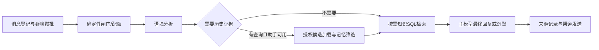

# 助手协作整合：调用链盘点与第二批设计

日期：2026-11-11。代码基准：main，fd9ee8b。第一批为静态调用链审查与契约设计，不是共享编排器已实现的声明。工作区同时存在模型连通性接口和环境示例的其他改动，本批不编辑或覆盖它们。

## 1. 结论与实施范围

下一批先在已有群聊协作入口增加“可信单轮上下文 + 阶段状态 + 有界调用与诊断”，不一次性合并所有聊天入口。群聊、QQ私聊、桌面桥接目前不是同一条助手链路。偏好、语言、愿望已经进入聊天，后续工作是统一读取结果与诊断，不能重复开发接入。

状态系统继续暂缓。社交评估、反思、知识候选处理和周期记忆属于领域任务，不接成每轮必调助手。单轮上下文不是长期记忆、持久任务或统一成长万能表，不持有明文凭据，不赋予跨领域写权限。

## 2. 真实聊天入口

### 群聊：启用语境助手且分析成功



代码入口：[渠道管道](../server/utils/channel-adapter/pipeline.ts)、[群聊协作](../server/utils/group-context-reply.ts:15)。主要行为：

- 语境助手输入本轮、背景和已验证的短期工作上下文；只返回结构化分析与白名单消息引用。
- 有memoryQuery时，角色授权候选再次过滤为character范围，再由记忆助手选择来源；最多一个逻辑检索阶段。
- 有knowledgeQuery时，通过领域查询读取已确认ACTIVE知识；此处没有调用知识处理AI。
- 最终生成关闭memoryAssistantAvailable，防止成功分析路径再次发起历史检索。
- 临时工作摘要和知识候选分别走受限回调；它们不等于批准模型修改长期记忆、正式知识或关系。

### 群聊：语境助手关闭或分析失败

[群聊协作入口](../server/utils/group-context-reply.ts:37)回退到[记忆补查包装器](../server/utils/memory-assistant.ts:678)：

`主模型首轮 → 判断是否需要历史查询 → 可选记忆筛选 → 可选主模型最终轮`

所以“群聊每轮只调用一次主模型”只适用于语境分析成功路径，不能推广到回退路径。回退保留原有来源与群内隐私过滤，不能为了共享上下文删除这条路径。

### QQ私聊

[渠道管道](../server/utils/channel-adapter/pipeline.ts:1665)先对当前私聊原始消息做确定性知识信号预筛。符合条件且语境助手可用时，调用私聊专用知识分析：同一次分析可以返回knowledgeQuery及候选证据ID。知识检索独立于自动收集开关；只有开启自动收集才创建候选，仍不能自动正式入库。

随后调用group-context-reply，但其groupChat=false分支直接进入记忆补查包装器，不运行群聊分析器。私聊分析不读取群聊背景或别人的私人范围。主人跨窗口上下文是独立旁路，不得混为当前窗口历史。

### 桌面桥接 / 直接聊天API

[桌宠桥接](../scripts/pet-bridge/server.mjs:1)只翻译OpenAI兼容协议到[chat.post](../server/api/characters/[id]/chat.post.ts)，复用角色会话，不独立调用模型。它不是第三套记忆引擎，也没有把私聊知识分析自动带进桌面API。

直接chat.post有自己的身份校验、桌面会话边界、请求幂等、本人私人范围和记忆候选加载，然后进入记忆补查包装器。已经读取偏好、语言、愿望；没有发现调用群聊语境分析或私聊知识分析的入口。

## 3. 助手职责、凭据与副作用

| 能力 | 输入与输出 | 凭据来源 | 当前允许的持久化/副作用 |
| --- | --- | --- | --- |
| 主聊天模型 | 已装配上下文→回复/沉默、来源ID及可选查询 | 角色聊天Key，按现有规则可用环境兜底 | 调用方保存消息/白名单引用；渠道负责发送 |
| 群聊语境助手 | 当前轮/背景/工作证据→摘要、参与关系、查询与候选ID | 专用语境Key；地址允许沿聊天地址兜底，Key不兜底 | 工作摘要CAS、可选知识候选；不直接回复或写正式领域结论 |
| 私聊知识分析 | 当前轮私聊原文→查询与候选ID | 同一语境助手配置，使用私聊专用提示词 | 仅开启收集时创建知识候选 |
| 记忆助手 | 已授权候选→sourceKeys | 专用记忆Key；地址可兜底，Key不兜底 | 只读筛选；不改写原文、不写记忆 |
| 知识SQL检索 | 查询→角色ACTIVE正式知识 | 无额外模型Key | 只读，不读取待确认候选 |
| 偏好/语言/愿望检索 | 当前话题/场景→当前角色有效条目 | 无额外模型Key | 只读；使用ID为白名单自报 |
| 知识处理助手 | 单个候选与已有知识摘要→整理建议 | 独立知识模型与Key | 候选处理结果，入库仍人工确认 |
| 社交关系评估 | 已派发经历、关系版本、来源清单→建议 | 独立评估模型、地址和Key | 评估历史/证据；关系变化必须人工采纳 |
| 反思任务 | 有界公开忆泡/正式知识/总结→待审反思 | 当前角色聊天模型与Key、每日额度 | 反思记录/建议；接受不直接改其他领域 |
| 周期记忆/忆泡 | 按范围与周期选择消息/来源→结构化提炼 | 当前Worker使用角色聊天配置/Key解析 | 对应领域事务、来源白名单、版本与审计 |

凭据证据：[语境runtime](../server/utils/context-assistant.ts:93)、[记忆runtime](../server/utils/memory-assistant.ts:224)、[知识runtime](../server/utils/knowledge-ai.ts:21)、[社交runtime](../server/utils/social-relationship-assessment-ai.ts)、[反思调用](../server/utils/reflection-worker.ts:184)、[Worker角色Key](../server/utils/memory-worker.ts:229)。不能把API地址复用描述成Key共享，也不能假定所有领域助手都有独立Key：反思和表单建议实际复用聊天配置。

## 4. 调用次数、超时与预算：当前值

逻辑调用指一次阶段执行，HTTP尝试指请求重试；两者必须分别统计。

| 阶段 | 当前尝试与超时 | 输出预算与失败行为 |
| --- | --- | --- |
| 群聊语境分析 | 最多2次HTTP，共享45秒AbortSignal | 可见配置默认2048；识别为DeepSeek时增加4096思考余量，请求上限16,384；截断才提高预算重试，失败回退旧流程 |
| 私聊知识分析 | 最多1次HTTP，45秒 | 可见预算夹512–1024，识别思考模型时增加余量；失败不阻断私聊回复 |
| 记忆来源筛选 | 最多2次HTTP，每次22秒 | 首次配置预算80%，截断后用满配置，最高8192；DeepSeek筛选关闭思考；无候选不调模型 |
| 一次主聊天生成 | 网络失败最多补2次，JSON/空正文修复最多1次，计数器独立 | 外层最多4次requestReply；每次带thinking被HTTP400拒绝还可内部移除字段再请求一次，理论HTTP上界8次（非正常轮次预期）；每次使用聊天超时，其他HTTP/超时不按网络错误重试 |
| 记忆包装器 | 主聊天生成最多2个逻辑阶段、记忆筛选最多1个逻辑阶段 | 不是全轮固定60秒；候选加载、首轮、筛选、最终轮串行可累计 |
| 知识候选处理 | 当前1次HTTP，45秒 | 输出按独立配置512–8192；失败留下候选处理错误，不写正式知识 |
| 社交评估一次执行 | 截断最多追加1次HTTP，每次60秒；任务队列另有最多3次尝试 | 默认8192，上限32,768；不能把队列重试当HTTP重试；重要变化仍待人工 |
| 反思一次执行 | 1次HTTP，60秒；任务另有最多3次退避 | 输出2048–4096；无新来源不调模型；租约/fencing防旧结果提交 |
| 周期记忆的一次块调用 | 1次HTTP，后台默认180秒 | 固定16,000输出，截断不在块内自动抬预算；任务重试与多块调用另算 |

代码证据：[语境重试](../server/utils/context-assistant.ts:319)、[私聊分析](../server/utils/context-assistant.ts:409)、[记忆筛选](../server/utils/memory-assistant.ts:475)、[聊天重试](../server/utils/chat-reply.ts:1627)、[超时解析](../server/utils/llm-timeout.ts:18)、[社交预算](../server/utils/social-assessment-budget.ts)、[记忆请求](../server/utils/memory-ai.ts:762)。本表不是供应商延迟保证；现有pipeline还含看图、语音等附加路径，本批不把它们算入文本协作次数。

## 5. 证据范围和当前可观测性

- 群聊记忆范围只允许character；私聊/桌面由可信身份解析可读范围，不使用客户端传来的scope列表扩大权限。
- 消息白名单来自调用方提交的本轮与允许背景，助手返回ID再校验。原文是不可信资料，不是指令。
- 工作摘要只用于群会话、24小时TTL、有版本及游标CAS；来源必须从同会话消息重取。见[working context](../server/utils/conversation-working-context.ts:27)。它不能作为跨轮缓存全部助手结果的借口。
- 记忆、快照、忆泡、原文、知识、偏好、语言、愿望各自已经有预算/条数限制，但并不等于共享总上下文预算。偏好600、语言800、愿望1000目前是序列化字符预算，不要误报为精确token。
- 当前turnId把部分usage行关联为一轮；[turn detail](../server/utils/model-turn-detail.ts:3)仅有context/memory/response三类。知识检索、偏好、语言、愿望未在此契约中完整表达阶段结果。
- 私聊知识分析usage有turnId及source=private-knowledge-analysis，但不是群聊context诊断阶段；展示not_applicable不能解释成“这轮完全没调用语境模型”。
- 用量写入失败由[统一记账](../server/utils/model-usage.ts:130)吞错并记录日志。usage表是操作记账，不是逐次供应商请求完整账本；主聊天失败尝试的usage目前没有全部累计，不能由一行usage推算物理请求数或完整费用。

## 6. 已确认差异与未证实风险

| 类型 | 证据 | 下一步处置 |
| --- | --- | --- |
| 已确认：入口编排不同 | group-context-reply成功、回退、私聊分支不同；桌面API独立 | 保留差异，先固定群聊适配器，不提前全入口共用 |
| 已确认：全轮没有共享deadline | 每助手/每HTTP各有timeout，回退可增加主模型阶段 | 第二批新增可选单轮控制对象，先不改变默认超时策略 |
| 已确认：诊断没有完整覆盖领域读取 | turn detail没有knowledge/preferences/language/goals阶段 | 增加版本兼容的只读阶段诊断，区分未启用、不需要、无来源和失败 |
| 已确认：操作用量不等于请求数 | 主聊天有独立网络/解析重试且只返回部分usage | 在请求边界计attempt；真实usage已报告才计，缺失不可当零费用 |
| 已确认：愿望已接聊天 | pipeline和chat.post均有loadGoalsForPrompt | 修正文档旧状态，不再重复接入 |
| 已确认：成功分析与回退的时间线触发不同 | 成功群聊仅用analysis.memoryQuery，wrapper另有确定性人物首/末次查询兜底 | 先补两路径对照用例，再决定统一触发，不能据此直接判定召回质量已退化 |
| 已确认：桥接重试不复用请求键 | pet-bridge为每次传入请求创建新requestKey，404重建还会再创建 | 作为后续桌面接入项；第一批不改，不能宣称客户端重发端到端幂等 |
| 需验证：同轮重复领域读取 | 各入口有独立查询及回退；未证明有相同查询重复执行 | 用测试替身计数，不先凭猜测重写 |
| 需验证：表达质量与延迟改善 | 静态边界与模拟测试无法证明自然交流质量 | 匿名本地样例对比与实际供应商观察后下结论 |

后台额度也有明确差异：反思调用前检查dailyTokenLimit，当前社交评估执行器、知识候选process及记忆Worker未发现同样的每日额度检查。是否应统一属于产品策略待定，不能把它写成所有模型调用已受同一额度控制；第二批先记录，不顺手改变后台调度。知识处理网络/JSON信封失败可发生在记账前，快照失败也不保证取得usage，后续诊断需允许未知。

桥接还有独立运行边界：其上游超时在fetch返回响应头后清除，不能保证覆盖后续正文读取；桥接仅转发最后一条USER文本，模拟SSE在完整回复后才输出；本地开发免登录不等于生产Cookie鉴权已接通。这些列入桌面后续批次，不在群聊第一小步混改。

本批未发现已证实的跨角色泄漏，不代表完整安全审计。也没有因“缺少统一上下文”就推断现有流程每轮都会重复调用。

## 7. 第二批共享单轮上下文契约（设计，尚未实现）

建议新增`server/utils/assistant-turn-context.ts`，先由pipeline在可信角色、渠道和会话范围解析完成后创建，再交给group-context-reply。首批只接QQ群聊；私聊、桌面和后台保持原样。

```ts
type TurnStage = 'context' | 'memory' | 'knowledge' | 'response';
type StageState = 'not_enabled' | 'not_needed' | 'running'
  | 'success' | 'no_sources' | 'failed' | 'budget_exhausted';
interface AssistantTurnContext {
  readonly turnId: string;
  readonly identity: {
    characterId: string;
    channel: 'qq-group';
    conversationKey: string;
    readableScopeIds: readonly string[];
    allowPrivate: false;
  };
  readonly evidenceIds: ReadonlySet<string>;
  readonly startedAt: number;
  readonly policy: {
    contextAnalyses: 1;
    memorySelections: 1;
    knowledgeQueries: 1;
    responseGenerations: 2; // 为旧流程回退保留首轮+最终轮
  };
  // 方法名为拟议接口；不能让模型或浏览器提供这些状态。
  runOnce<T>(stage: TurnStage, key: string, run: () => Promise<T>): Promise<T>;
  recordAttempt(stage: TurnStage, data: {
    attemptId: string; status: string; durationMs: number;
    usageReported: boolean; finishReason?: string;
  }): void;
}
```

约束：

1. 创建上下文的参数来自服务端已授权结果；对象不得序列化Key、提示词、供应商推理文本、真实账号或未过滤私人正文到日志。
2. 缓存只活在本次请求，不持久化，不跨角色/会话。key包含阶段、规范化查询、可读范围及本轮来源版本摘要；不同查询、不同权限不能共用。失败结果和成功空结果必须有明确语义，避免每层各自重试。
3. 同key并发共享Promise；请求失败记录一次阶段失败。HTTP重试留在现有helper，runOnce不能再套一层自动重试。
4. 第一小步只统计现有逻辑/HTTP次数与耗时，不新增自动调用。第二小步再依据基线引入共享deadline；默认值和到期回退必须通过测试/观察确定，不能凭任意秒数让旧回复突然被截断。
5. 成功分析路径仍不允许主模型再次请求记忆；分析失败后只允许已有wrapper回退一次，不能回到context反复循环。responseGenerations允许2是兼容回退上限，不代表每轮必须生成两次。
6. 总输入预算与各领域局部预算是不同维度。第二批不把所有领域预算相加当精确token，不取消局部约束，不放行候选作为正式成长结论。
7. identity冻结只是编程约束，不代替Gateway再次校验来源归属/当前状态；共享上下文不获得跨领域写权限。
8. telemetry采用白名单结构；扩展ModelTurnDetail需兼容version1读取，未知新阶段旧客户端不应崩溃。attemptId不等于审计业务幂等键，不允许用它创建第二条消息。

## 8. 第二批施工顺序与文件

| 小批 | 文件/范围 | 内容 |
| --- | --- | --- |
| 2A | 新assistant-turn-context.ts、新纯测试 | 阶段状态、runOnce请求内去重、逻辑计数、不可变授权上下文；纯函数不接DB |
| 2B | group-context-reply.ts、pipeline.ts | 只在群聊文本协作链创建/传递；默认保留原行为；故障回退仍走旧wrapper |
| 2C | context-assistant.ts、memory-assistant.ts、chat-reply.ts | 可选request-attempt回调/预算检查，只计当前请求，避免helper和caller重复记账 |
| 2D | model-turn-detail.ts、usage/turn读取契约和展示 | 兼容阶段状态、HTTP尝试/耗时与缺用量标识，禁止返回凭据/推理全文 |
| 后续批 | 偏好/语言/愿望/知识读取器、私聊、chat.post | 只有群聊通过基线后逐个适配；不在2A顺手迁移 |

若仅内部可选对象且HTTP响应不变，2A/2B不需要数据库迁移或改OpenAPI。2D改变公开诊断响应时再同步OpenAPI/前端类型/测试。不提前建通用Task表，不用setInterval保证任何正式任务。

## 9. 验收清单

- 普通闲聊不额外调用记忆/知识；历史问题最多一个逻辑记忆筛选阶段；语境助手截断重试只增加HTTP attempt、不变成第二次逻辑分析。
- 同轮同key并发只加载/执行一次；不同query、角色、范围、来源版本不复用。新一轮创建全新上下文。
- 群聊loadCandidates即使返回private来源也再次拒绝；未知消息ID、角色错配和来源失效不能进入最终提示词。
- 语境未启用/失败/超时分别记录；已有fallback最多执行一次；记忆无候选、HTTP失败、无来源与成功不可混成一种成功状态。
- 主模型网络重试、JSON修复、wrapper两轮各自可识别；用量缺失不当免费；记账失败和诊断回调异常不阻断已成功回复。
- no_sources缓存不引发无限查询；共享deadline后不新增调用，未完成阶段降级可解释；已经有效的首轮事实答复不得被错误兜底覆盖。
- 保持直接@、沉默、表情、梗、引用与点名、主人/群友隐私规则；不把语境分析变成渠道副作用命令。
- 快速切角色、同群不同绑定、私聊与群聊交错时，不复用其他轮数据。数据库写仍走原消息事务/请求幂等。
- 同一组匿名样例记录输入范围、阶段次数、实际HTTP次数、耗时、token报告完整性、来源引用和最终回复。不得只记录“模型觉得更像人”。

现有回归入口：`test:context-assistant`（含群聊协作/工作摘要/历史覆盖/私聊知识）、`test:memory-assistant`、`test:model-turn-detail`、`test:chat-reply`、`test:chat-private-memory`、`test:chat-speaker-context`。涉及接口/DB时再跑对应隔离套件，不把名称含unit的脚本默认视为不连业务库。

## 10. 2A实施记录（2026-11-11）

已新增[assistant-turn-context.ts](../server/utils/assistant-turn-context.ts)和[纯逻辑测试](../scripts/test-assistant-turn-context.ts)，通过`test:assistant-turn-context`执行，并接入既有`test:context-assistant`命令。没有接入pipeline或group-context-reply，所以下文拟议接口与实际模块应区分。

实际API采用`createAssistantTurnContext`、`runOnce(stage, {query, sourceVersion}, run)`、`skip`、`hasEvidence`与`snapshot`。操作返回`{value,state:success|no_sources}`；每阶段逻辑上限为context1、memory1、knowledge1、response2。相同key共享同一Promise，成功空结果与失败都会缓存；不同key超过阶段额度明确拒绝，没有重新调用或自动回退。预算拒绝单列计数，不会覆盖已完成操作状态。

授权身份/范围数组被复制并冻结；证据Set隐藏在闭包内，不把可变Set暴露给调用方。key散列包含turn、角色、绑定、会话、范围、阶段、首尾trim后的query和sourceVersion；不额外合并大小写或内部空白。query规范化和来源版本摘要由后续可信适配器负责。每次创建使用独立缓存，不存在跨请求全局缓存。

缓存仅接受有限深度、无环、纯JSON兼容数据，防御性复制后递归冻结，不支持Date/Map/类实例/undefined。回调生产者和先到的读取者不能改写后续共享证据。相同阶段/key必须始终使用同一结果类型，这是可信调用方的类型契约，泛型本身不能证明key与返回类型匹配。

HTTP尝试记录仅为可选诊断：同attemptId只计首次终态，最多保留16条；坏数据、重复归属、超量或操作结束后的记录不会改变业务成功结果，被拒诊断单列计数。`reportedAttempts=0`只表示未报告，不表示实际没有HTTP调用。第二批2C尚未接入请求边界，也没有执行物理请求预算、token预留或整轮deadline。

snapshot只输出阶段状态、耗时、逻辑次数、预算拒绝和白名单尝试状态，不包含身份、查询、结果正文、错误原文、attemptId、凭据或推理文本。原错误只沿Promise交回可信调用者。诊断快照重新构建，外部修改快照不影响内部状态。

验证覆盖：并发与重复Promise、同步抛错缓存、空来源缓存、不同来源版本预算拒绝、两轮response上限、跨turn隔离、跳过状态冲突、输入/结果/快照不可变、时钟回拨、诊断去重/上限/安全白名单。已执行新专项、已有语境协作套件、完整typecheck及定向lint通过。业务主流程未改、未运行数据库/真实模型/渠道。下一步才是2B群聊接入，不能据此宣称聊天已减少调用或提速。

## 11. 2B群聊接入记录（2026-11-11）

pipeline在角色、绑定、会话、可读范围和背景证据解析完成后，仅为qq-onebot群聊创建上下文。采用真实externalConversationId作为conversationKey，证据白名单涵盖本轮、允许背景、近期消息与重新授权后的working context。私聊和其他入口不创建；上下文作为内部参数传入，不进入chatInput、提示词、消息metadata或公开响应。

新增[assistant-turn-execution.ts](../server/utils/assistant-turn-execution.ts)作为JSON安全的阶段适配器，group-context-reply通过可选turnContext执行context/memory/knowledge/response。完整同轮编排用WeakMap关联上下文和输入指纹，重复调用共享最终Promise，回调和操作记账不重复；同context不同输入拒绝。指纹排除明文Key和可执行回调，不输出查询/身份；结果复制冻结。进入编排前先复制冻结本轮数据，再做白名单校验、指纹和执行，防止调用者在异步执行前修改原始消息，形成“校验旧输入、执行新输入”的窗口。执行所需凭据仅留在内部runtime，不进入诊断。所有缓存只随本轮对象生存，不是跨轮共享资料缓存。

语境成功路径：context1→可选memory1→可选knowledge1→response1；成功后不再开启记忆补查。memory阶段包含候选加载、群内character二次过滤和筛选；knowledge只是领域SQL读取。分析关闭或失败后仍走原memory-assistant包装器，但首轮、筛选和最终轮继续使用同一context，response总上限2，没有重置预算或新增一轮context重试。未传上下文时保持既有调用路径；私聊忽略误传上下文。

新增[test-group-turn-context.ts](../scripts/test-group-turn-context.ts)并接入test:context-assistant，验证并发及顺序重复仅执行一次、候选回调/usage单次、私人候选拒绝、未知消息ID拒绝、变更输入拒绝、失败回退共享预算、no_sources与private旁路、最终结果不可变。现有memory助手和语境套件通过，完整typecheck通过。2C物理HTTP尝试诊断、共享deadline、token预留以及2D公开日志展示均未接入；本批不能宣称真实延迟或费用下降。

最终语境协作套件（含输入即时变更回归）、记忆助手、私人范围、主人身份回归、完整typecheck、全量lint与生产build通过；隐私和差异检查通过。构建仍有既有媒体下载BigInt目标环境警告与Vite耗时提示，不属于本批新增。

没有数据库结构或HTTP响应契约变化，不新增模型调用或长期领域写入；候选/摘要回调仍受原有开关与白名单约束。未操作业务数据库或真实渠道，真实供应商/浏览器行为需后续现场观察。

## 12. 2C请求边界诊断记录（2026-11-11）

新增[assistant-request-diagnostics.ts](../server/utils/assistant-request-diagnostics.ts)，语境群聊分析、记忆筛选和主模型生成在实际HTTP尝试处创建一次性终态记录。包含耗时、success/failed/timeout/http_error/invalid_response/truncated、白名单finishReason与usageReported。thinking参数400降级、网络重试、JSON修复与截断重试各计实际尝试，不新增任何重试。耗时包含响应正文读取和解析；共享deadline尚未引入。

observer通过独立参数传入helper，不进入chatInput、提示词或HTTP业务响应；runAssistantTurnStage把每条记录关联到当前操作，生成内部attemptId。缓存命中不产生新尝试，SQL知识查询保持0模型HTTP尝试。私聊知识分析入口本批不接诊断；未传observer保留既有运行行为。

usageReported表示供应商usage至少含一个有效非负token字段，显式零值与完全缺失区分。它不是完整账单，也不表示所有token分项已齐全；本批不重写model_usages聚合，不自动把之前丢失的尝试费用补记。诊断不复制Key、正文、错误原文、推理、URL或身份；观察者异常被吞掉，不影响业务结果。每HTTP只完成一次，快照仍有16条/逻辑操作的有界诊断上限。

专项新增语境/记忆截断后两次HTTP、主模型JSON修复、thinking400重发、超时、零值/缺失usage、observer异常保护与群聊阶段attempt计数。现有语境、记忆与聊天回归、完整typecheck、全量lint、隐私扫描和生产build已通过，最终正文超时诊断补丁另经专项和定向lint复验。诊断目前只存在本轮上下文，尚未持久化或在UI展示，2D再统一公开契约和日志展示。真实请求延迟、费用与供应商兼容性仍待现场观察。

## 13. 2D保存与模型日志展示（2026-11-11）

群聊pipeline在生成成功和异常两个分支，将collaboration.snapshot写入现有turnDetail字符串，再随chat/channel主模型用量记录保存；不新建表、不改变消息发送授权。读取仍走角色拥有者限定的`usage/logs/:logId/turn`，按同一character和turnId取主记录，重走[诊断白名单](../server/utils/assistant-turn-diagnostics.ts)，不返回原始metadata。

ModelTurnDetail保持version1，新增可选collaboration；旧记录缺失不回填，页面明确“未保存协作诊断”，不当作零请求。仅groupChat=true保留诊断，未知版本/字段和私聊伪造诊断不返回。限制4个唯一阶段、context/memory/knowledge最多1操作、response最多2操作，每操作16条attempt，耗时和计数夹取；reportedAttempts按过滤后实际条数重算，不信任输入自报数字。所有身份、query、attemptId、错误正文、Key和推理字段都被丢弃。

[ModelTurnDetail.vue](../app/components/ModelTurnDetail.vue)增加阶段与请求区，分别显示逻辑次数/上限、HTTP已报告次数、状态、耗时、截断/超时/错误及usage缺失。明确诊断不是供应商完整账单，usageReported只说明至少一个token字段存在，零值不是缺失，部分字段不等于费用齐全。知识SQL无HTTP不被算成模型调用；本批不变更每日额度和实际费用计算。

新增持久化回读/恶意metadata边界测试及UI脚本测试，并接入test:model-turn-detail；已有owner/turn查询限制回归保留。专项、语境协作回归、75个SFC、完整typecheck、全量lint、OpenAPI YAML解析、隐私扫描和生产build已通过。审查后另补严格枚举类型校验，拒绝将数组强转为状态字符串，专项与定向lint再次通过。构建保留既有媒体下载BigInt目标环境警告和Vite耗时提示。没有业务DB写入、真实模型调用或渠道操作；UI脚本测试不代替真实浏览器排版和点击，旧记录实际回读基于纯逻辑替身验证。

## 14. 2A–2D隔离运行验收（2026-11-11）

新增[test-assistant-collaboration-isolated.ts](../scripts/test-assistant-collaboration-isolated.ts)与[真实落库/handler测试](../scripts/test-assistant-collaboration-db.ts)，命令`yarn test:assistant-collaboration-isolated`已接入verify:local与CI。runner强制本机随机测试库，执行全部73个迁移，测试结束删除临时库；业务数据库不写入。

测试实际调用generateGroupContextReply与单轮上下文、拦截全部供应商请求，模拟语境length重试、主模型JSON修复和主模型HTTP失败；用真实recordModelUsage写入数据库，用真实createSession创建Cookie会话，再在随机回环端口的H3测试服务挂载原turn.get handler。不是复制handler查询来假装接口通过，也不是全渠道pipeline端到端：QQ消息登记/真实发送未运行，pipeline将snapshot写入日志的位置仍由代码审查和既有回归覆盖。

结果：单阶段两次HTTP正确保存/读回；助手日志能关联本角色主记录；他人/错误角色404、匿名401；相同turnId不能借读其他角色日志；旧记录不伪造零请求；失败生成保留http_error与缺usage提示；响应不包含Key、供应商错误正文或私人候选。所有断言已实际通过，临时库删除。新增脚本按真实tsconfig.server扩展配置的strict类型检查及定向lint通过；原有模型详情/诊断/UI脚本回归再次通过，CI和package注册校验通过。

已有3000服务的首页、愿望和社交评估页面HTTP200；但独立Chrome即使禁用扩展仍在文档导航报ERR_ABORTED，未完成Vue挂载，因此真实DOM交互与窄屏视觉验收继续未通过。未启新应用服务替代现有页面；H3回环服务仅供隔离handler测试，测试后关闭。未调用付费模型、未发真实QQ消息。

## 15. 提交与只读真实日志观察（2026-11-11）

2A–2D及隔离验收已提交为56c18f7，模型连接测试和环境示例的并行改动未混入。

只读抽样最近24小时的1071条chat/channel/context-assistant/memory-assistant用量行，未达到一万条查询上限：主记录431条（channel428、chat3），其中collaboration诊断0条，不能反推物理HTTP次数或设置新全轮deadline。语境助手404条：成功403、失败1；记忆助手236条：成功221、无来源15；channel生成成功425、失败3，3条没有正token报告。旧生成durationMs样本431条，中位数约15.7秒、95分位约26.6秒；这是已有模型生成阶段耗时，不含完整渠道收发，也不证明新协作链的性能。

现有OneBot进程在本批代码接入前已启动，未主动重启或制造真实消息来获得新样本。后续应在正常重启/发布后观察自然产生的含collaboration记录，再决定共享整轮截止时间，不能用旧日志填补新字段。

浏览器历史ERR_ABORTED原因已定位为验收脚本选中了Chrome扩展background_page而非type=page标签。明确选择page后已有3000应用成功Vue挂载；这不需要修改业务页面或启动替代服务。模型日志详情通过既有3000前端和CDP模拟API进行真实点击验证：新诊断的逻辑次数、HTTP次数、截断与缺用量提示可见，375px下文档宽375px、弹窗宽343px（左右各16px），没有检测到横向溢出；截图保存在被忽略的本地验收目录。此为真实前端+模拟API验收，不能替代真实模型日志联调；图片未通过本会话图像通道目视审查。旧记录真实浏览器重开场景当时未通过：验收脚本关闭/重开嵌套弹窗时误关父弹窗；后续成长读取验收改用详情页“返回调用日志”按钮，旧记录重开已通过，详情见成长读取诊断验收记录。旧记录纯逻辑/UI脚本兼容测试保持通过。截图可能含SSR外壳原角色显示名，仅本地留档，不发布或提交。

## 16. 群聊成长读取诊断

知识、偏好、语言与愿望新增只读读取状态、有限候选/预算/条数计数和提供版本引用；回复后与模型自报使用ID再取白名单交集。仅QQ群聊保存在现有turnDetail可选growthReads中，旧日志和私聊不伪造字段。详见[成长读取与引用诊断](growth-read-diagnostics.md)。未新增助手、额外SQL、模型调用或领域写入；真实日志观察仍需在正常发布后进行。

## 17. 第一批盘点验证记录

实际执行：`yarn test:context-assistant`、`yarn test:memory-assistant`、`yarn test:model-turn-detail`全部通过，均使用离线替身或纯逻辑，不连接业务数据库、不调用真实模型。仅证明已有回归基线，不证明第二批设计已实现。

隐私扫描通过；扫描发现架构旧文案含具体角色称呼，本批将其脱敏为泛称。git diff --check通过。

本批不修改运行代码，未启动/重启Web、Worker或渠道，未调用付费模型，未执行数据库写入。完整typecheck/lint/build不是本次文档变更的必需检查，未重新执行；第二批必须在代码完成后跑适用检查。真实浏览器与供应商语义质量本批未验收。
